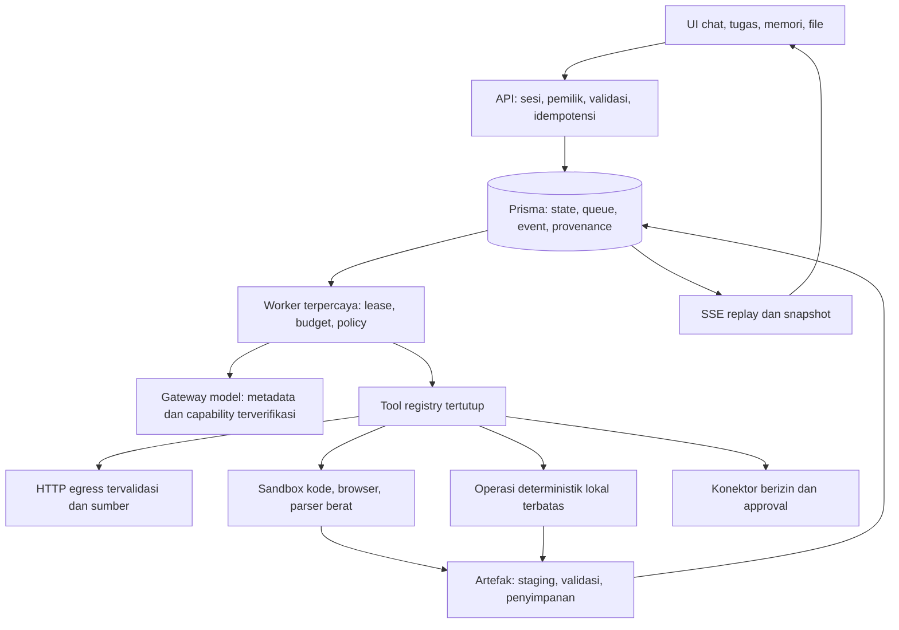

# Desain dan rencana implementasi

Status: seluruh FIX masih `planned`. Dasar bukti: [audit](01-audit.md).
Kriteria lulus: [verifikasi](03-verifikasi.md). Dokumen ini merencanakan seluruh
area A–J; implementasi dilakukan bertahap, bukan memasang semua komponen sekaligus.

## 1. Keputusan arsitektur

Pertahankan Next.js App Router/React, Prisma dua provider, Auth.js, dan worker
antrean DB. Jangan menambah Redis, Kubernetes, vector DB, framework agen besar,
atau backend kedua tanpa hasil pengukuran yang menunjukkan kebutuhan.

Gunakan desain `Task`/`TaskRun`/`TaskStep`/`TaskEvent`/`TaskInteraction`/`Artifact`
pada [SDD data agen](../../tasks/agent-v1/02-data-migrations.md). Jangan membuat
`Approval` atau `File` kedua yang menduplikasi `TaskInteraction` dan `Artifact`.
Pohon Chat tetap untuk percakapan existing; Task untuk pekerjaan panjang. Tool
registry dan policy sama dapat dipakai keduanya, dengan kontrak context yang jelas.



`LOCAL` hanya operasi library tepercaya dengan input terbatas: kalkulator terstruktur,
serialisasi JSON/CSV, dan CRUD service aplikasi. Kode dari model, template aktif,
konversi berisiko, shell, atau parser berat tidak dijalankan di proses web/worker
yang memegang rahasia. Tidak menampilkan chain-of-thought; progres berupa aksi,
status, sumber, hasil, dan alasan kegagalan yang aman.

## 2. Pilihan teknologi dan kapan dipakai

Versi terpasang dibaca dari `package.json`/resolusi modul pada baseline. Paket
transitif harus dijadikan dependency langsung sebelum diimpor kode produksi;
keberadaan di `node_modules` tidak menjamin tersedia pada clean install.
Nama kandidat di bawah adalah keputusan teknis awal, **bukan klaim API vendor
sudah diverifikasi atau persetujuan memasang seluruhnya**. Pin versi kompatibel,
periksa dokumentasi resmi, ukuran, keamanan, dan lisensi saat FIX terkait dimulai.

| Kebutuhan | Pilihan untuk Kawan | Alasan dan batas |
|---|---|---|
| Web/UI/DB/job/auth | Stack existing; `fetch`, Web Streams, AbortController, `node:crypto` | Tidak perlu framework baru; ownership tetap di query/transaksi |
| Schema input tool | Validasi manual untuk beberapa DTO sederhana; Zod bila schema tool mulai berulang | Zod 3.25.76 ter-resolve transitif (MIT), belum dependency langsung; hindari dua validator |
| DNS pin dan socket policy | `undici` dengan dispatcher/lookup yang mengikat IP tervalidasi | 7.30.0 ter-resolve transitif (MIT). Jadikan langsung; pertahankan Host/SNI hostname asli dan validasi seluruh redirect |
| Web search | SearXNG existing | Self-host/endpoint operator; hasil search bukan isi halaman |
| Ekstraksi halaman web | Bounded fetch + `@mozilla/readability` dan DOM yang inert | `jsdom` 30.1.3 sudah devDependency; evaluasi promosi production untuk reader. Tidak menjalankan script/resource loader |
| Bibliografi | Crossref REST untuk DOI, OpenAlex bila perlu pencarian ilmiah | Provider-specific adapter kecil, cache, rate limit, fixture; metadata cocok bukan bukti klaim benar |
| Hitungan desimal | Operasi JSON allowlist memakai `decimal.js` | 10.6.0 MIT transitif; dependency langsung untuk presisi desimal. Bukan `eval` ekspresi |
| Statistik kompleks | Python stdlib/paket terpin dalam sandbox | Catat rumus, sampel, satuan dan pembulatan; paket tambahan hanya kebutuhan nyata |
| PDF teks | `pdf-parse` existing | Pertahankan page locator; batas halaman/waktu/memori dan scan fallback |
| DOCX input | `mammoth` untuk teks, bukan rendering HTML tepercaya | Dependency baru hanya FIX-14; ZIP/XML limits sebelum parsing, jangan fetch external relations |
| XLSX input/output | `exceljs` | Isi/formula dipisahkan, tanpa menjalankan macro/formula/URL; batas sheet/cell/expanded ZIP |
| DOCX output | `docx` | Layout, tabel, Unicode; gunakan saat writer minimal gagal requirement, bukan membangun OOXML lengkap sendiri |
| PPTX output | `pptxgenjs` | Slide dari schema deklaratif; font dan layout diuji, bukan slide berisi dump chat |
| PDF output | `pdfkit` dengan font Unicode berlisensi; alternatif Chromium print untuk HTML kompleks | PDFKit default untuk dokumen terstruktur. Chromium hanya dalam runner terisolasi setelah spike; tidak langsung memakai browser E2E produksi |
| ZIP upload | `yauzl` untuk ekstraksi streaming | Batas expanded bytes/ratio/count, zip-slip/symlink/duplicate entry. Writer STORE existing cukup untuk bundel kecil |
| OCR | Tesseract CLI + bahasa `ind`/`eng` pada runner terisolasi | Untuk scan/handwriting dengan kualitas terukur; jangan menganggap OCR tulisan tangan selalu andal |
| Gambar/EXIF | `sharp` untuk decode/re-encode/resize/format, ExifTool pada runner bila metadata kaya diperlukan | Pixel/decompression limit; strip metadata default saat output publik, pembacaan metadata harus diminta |
| Grafik | SVG deklaratif sederhana + renderer PNG di runner | CSS/SVG cukup untuk bar/line dasar. Tambahkan library chart hanya setelah kebutuhan axes/layout/interaksi melampaui implementasi kecil |
| QR/barcode | `qrcode`, `bwip-js` | Algoritme standar, verifikasi decode dengan reader independen; jangan minta model menggambar pola |
| Media | Route gateway existing bila probe lulus | STT/TTS/imageGen tidak dianggap aktif hanya karena env terisi |
| Video/audio lokal | FFmpeg/ffprobe pada runner terisolasi; Web APIs untuk rekam user | Chunk/transkrip/frame bertimestamp, codec/durasi/ukuran dibatasi; tanpa fetch URL arbitrer oleh FFmpeg |
| Runtime kode/browser | Adapter E2B sesuai SDD; Playwright dalam template browser terisolasi | API key control-plane hanya worker; spike live resource/network/kill wajib sebelum enable |
| Email reset/notifikasi | SMTP operator lewat library sender yang dipin; kandidat Nodemailer | Verifikasi versi/lisensi terhadap kebijakan repo sebelum memilih versi. Jika tidak lolos, gunakan HTTPS transactional API resmi yang disetujui operator |
| Konektor | Adapter REST kecil + OAuth Authorization Code/PKCE | Google Drive/Sheets dahulu; scopes minimum; jangan pasang framework konektor umum sebelum ada dua kebutuhan nyata |
| Jadwal | Tabel schedule + worker/sweeper DB; `cron-parser` hanya recurring cron | Timer tunggal `runAt` tidak perlu library. Zona IANA dan DST wajib untuk recurring |
| Storage | Adapter filesystem existing di luar webroot | Objek acak, quota, lifecycle. S3 hanya saat multi-host/volume/reliability menuntutnya |
| Test/eval | Vitest dan Playwright existing, fixture provider, Python/stdlib reader checks | Tidak perlu framework eval baru. Mulai dataset JSONL dan runner kecil |

Tidak memakai paket GPL/AGPL secara diam-diam. `npm run check:licenses` berlaku
untuk dependency JavaScript; binary/font/model OCR/template sandbox juga perlu
inventaris lisensi dan distribusi. Versi/lisensi kandidat yang belum dipasang
harus dipastikan dari artefak yang benar-benar akan digunakan.

## 3. Kontrak bersama sebelum menambah fitur

### 3.1 Capability dan konteks sesi

Perluas endpoint capabilities existing secara additive. Pertahankan boolean lama
sementara UI dimigrasikan. Detail server-owned per capability:

```json
{
  "schemaVersion": 1,
  "webRead": {
    "state": "available",
    "reasonCode": null,
    "checkedAt": "2026-10-21T00:00:00Z",
    "requiresApproval": false
  },
  "codeExecution": {
    "state": "unconfigured",
    "reasonCode": "SANDBOX_NOT_CONFIGURED",
    "checkedAt": null,
    "requiresApproval": false
  }
}
```

State: `available`, `unconfigured`, `unsupported`, `temporarily_unavailable`,
`permission_required`, `unknown`. `requiresApproval` menyatakan policy aksi,
bukan pengganti state capability. `available` tidak memberi izin mengeksekusi
aksi spesifik. Probe cache terikat connection/model/config revision, TTL, timeout,
dan tidak berulang di setiap token/request. Probe berbayar hanya opt-in operator;
capability iklan gateway dibedakan dari capability yang benar-benar diuji.

Snapshot untuk model memuat waktu UTC server, timezone pilihan pengguna,
model ID, tools yang benar-benar tersedia, batas, serta konteks aplikasi minimum
(chat aktif dan item yang memang dipilih). Jangan mengirim seluruh sidebar,
User-Agent lengkap, IP, lokasi, secret, atau seluruh riwayat secara otomatis.
Cutoff/context window yang tidak diketahui tetap `unknown`, bukan ditebak.

### 3.2 Tool input, hasil dan efek

Gunakan registry pada SDD eksekusi agen; satu nama tool mempunyai schema argumen,
validator, handler, effect classification, timeout, byte cap, dan policy.
Awal: `web.search`, `web.read`, `documents.read`, `math.calculate`,
`artifacts.create`; lalu memory dan aksi aplikasi. Nama tools hanya usulan kontrak,
harus dibekukan bersama schema sebelum implementasi.

Tidak menerima `userId`, path host, secret, arbitrary headers, SQL, atau shell
sebagai otoritas dari model. Pemilik dari sesi/task context; ID diverifikasi ke DB.
Field tambahan ditolak untuk input alat sensitif. Seluruh konten sumber/tool/file
adalah data tidak tepercaya, tidak dapat mengubah policy atau memberi approval.

Hasil minimum: `{schemaVersion, status, data, sources, warnings, truncated}`.
`status` membedakan sukses, tidak ditemukan, tidak dapat diperiksa, dan gagal.
Kesalahan provider tidak dipoles menjadi jawaban sukses. UI merender komponen
allowlist berdasarkan tipe terstruktur, bukan HTML/JS hasil model.

Read-only dalam scope berjalan langsung. Perubahan setting pribadi yang reversible
dapat langsung dengan ringkasan dan undo; delete, share publik, send/publish,
pembelian, perubahan akun eksternal, atau berbagi data ke tujuan baru menggunakan
review spesifik sesuai policy. Diam/idle bukan approval. Hasil ambigu tidak diulang
otomatis. Gateway key tidak pernah masuk sandbox atau tool result.

### 3.3 Data tambahan tanpa menduplikasi SDD

| Entitas/field usulan | Diperlukan pada | Invariant |
|---|---|---|
| Chat.titleSource/titleRevision, state revision | FIX-03/04 | Judul otomatis tidak menimpa rename manual, update memakai CAS |
| Generation connection/model/config snapshot + event cursor/revision | FIX-02/05 | Snapshot immutable, tidak menyimpan plaintext key; nama field diputuskan migration contract |
| ChatDocument atau manifest input yang terikat chat | FIX-06 | Owner chat dan dokumen sama; read hanya ready/nondeleted; run tetap pakai snapshot |
| SourceRecord + referensi claim/source | FIX-10 | URL kanonik, timestamp, content hash, locator, verification state; bukan snapshot internet tak terbatas |
| MemoryItem + MemoryDependency | FIX-13 | Owner, teks ringkas, asal/revisi, status, consent, expiry, scope, category; sumber dapat diinvalidate |
| UserSetting tambahan | FIX-13/18 | Timezone IANA, preferensi gaya terstruktur; locale UI bukan bahasa jawaban wajib |
| ConnectorCredential/Grant | FIX-20 | Token terenkripsi, scopes/provider/user, expiry/revocation; external account tidak disamakan dengan identitas legal |
| Schedule/Occurrence/Notification | FIX-21 | Unik(scheduleId, scheduledFor), UTC fire time + timezone IANA, policy revision dan outbox delivery |
| WorkerHeartbeat | FIX-24 | Process identity, lastSeen/expiresAt, version dan capabilities; bukan heartbeat job historis |
| Deletion marker / cleanup intent | FIX-23 | Metadata minimum tanpa isi terhapus, lifecycle idempotent, semua derivatif terjangkau |

Task dan Artifact sudah dirinci SDD. Field di tabel ini adalah desain target,
bukan schema final. Setiap migrasi harus merinci FK/cascade/index/retention,
backfill, nullability, dan kompatibilitas SQLite/PostgreSQL sebelum ditulis.
Jangan menambah seluruh tabel roadmap dalam satu migrasi bootstrap.

## 4. Urutan kerja dan dependency

| FIX | Tahap | Dependency langsung | Padanan SDD agen |
|---|---|---|---|
| FIX-01 | R0 | — | WO-AG-P0-01 |
| FIX-02 | R0 | FIX-01 | WO-AG-P0-04, WO-AG-P1-03 |
| FIX-03 | R0 | FIX-01,FIX-02 | WO-AG-P0-02 |
| FIX-04 | R1 | FIX-03,FIX-07 | WO-AG-P0-02/03/05 |
| FIX-05 | R1 | FIX-02,FIX-03,FIX-04 | WO-AG-P0-02, WO-AG-P2-01 |
| FIX-06 | R1 | FIX-01,FIX-02,FIX-07 | WO-AG-P2-02/03 |
| FIX-07 | R0 | FIX-01 | WO-AG-P0-04 |
| FIX-08 | R2 | FIX-03,FIX-05,FIX-06,FIX-07 | WO-AG-P1-01..04 |
| FIX-09 | R2 | FIX-08,FIX-04 | WO-AG-P2-01 |
| FIX-10 | R2 | FIX-09,FIX-07 | WO-AG-P2-02 |
| FIX-11 | R2 | FIX-09,FIX-06 | WO-AG-P2-03/04 |
| FIX-12 | R3 | FIX-11,FIX-17 | WO-AG-P2-03; perluasan format |
| FIX-13 | R3 | FIX-05,FIX-06,FIX-08 | Perluasan memori; WO-AG-P4-01 untuk delete |
| FIX-14 | R3 | FIX-06,FIX-11,FIX-17 | WO-AG-P2-03; perluasan input |
| FIX-15 | R2/R3 | FIX-09,FIX-11 | Perluasan tool deterministik |
| FIX-16 | R3 | FIX-04,FIX-11,FIX-17 | Backlog AG-10 |
| FIX-17 | R4, runner dasar lebih awal | FIX-07,FIX-09,FIX-11 | WO-AG-P3-01/03/04/05 |
| FIX-18 | Semua tahap | FIX-04 untuk profil; FIX-10/13/15 untuk eval lanjut | WO-AG-P4-04/05 |
| FIX-19 | R3/R4 | FIX-09,FIX-08; FIX-20 untuk efek sensitif | WO-AG-P0-03, perluasan tools aplikasi |
| FIX-20 | R4 | FIX-07,FIX-08,FIX-09 | WO-AG-P3-02; backlog AG-09 |
| FIX-21 | R4 | FIX-08,FIX-20,FIX-24 | Backlog AG-09 |
| FIX-22 | Setelah single agent terukur | FIX-09,FIX-18,FIX-24 | Backlog AG-11 |
| FIX-23 | Semua tahap, gate tiap storage baru | FIX-01/FIX-02; fitur baru wajib mengintegrasikan cleanup | WO-AG-P4-01/03 |
| FIX-24 | R0 sampai R5 | FIX-01; metrik lanjut mengikuti fitur | WO-AG-P4-02/03/05 |

Urutan praktis: 01 → 02+07 → 03 → 04 → 05+06 → 08 → 09 → 10+11+15 dasar →
runner 17 → 12+14+16 → 13+19 → 20 → 21. FIX-18/23/24 mengikuti setiap irisan;
FIX-22 sesudah bukti kebutuhan. Tanda `+` menunjukkan pekerjaan independen yang
dapat diatur terpisah, bukan instruksi menjalankan agent paralel.

## 5. Rincian work package

### FIX-01 — schema dan migrasi yang dapat direproduksi

**Masalah:** T01/T02; generated client lama menyamarkan schema tidak valid.
**Cara:** hapus deklarasi relasi `connections` yang duplikat tanpa mengubah DDL
relasi sebenarnya. Jalankan validasi schema sumber, generate SQLite, validasi
SQLite, generate kedua client dari checkout sementara. Jangan memodifikasi init
yang sudah pernah diterapkan.

Ubah checker menjadi urutan nama migrasi yang sama per provider, checksum init
tetap, SQL valid per provider, lalu uji hasil fresh dan upgrade populated. Jangan
memaksa setiap migrasi baru identik dengan init; provider-specific SQL boleh hanya
jika hasil perilaku setara dibuktikan. Helper test menerapkan seluruh migrasi
urut, bukan satu hardcoded init. CI fresh menjalankan generate sebelum typecheck.

**Path:** `prisma/schema.prisma`, `scripts/check-migrations.mjs`,
`scripts/make-sqlite-schema.mjs`, `tests/helpers/auth-db.ts`, `.github/workflows/ci.yml`.
**Lulus:** checkout tanpa generated output berhasil validate/generate/typecheck;
dua provider fresh+upgrade mempertahankan data dan indeks yang diperlukan.
**Rollback:** hanya kode/checker jika belum migrate; migrasi berikutnya additive,
backup fixture diuji sebelum data nyata.

### FIX-02 — worker, stream dan penghapusan tanpa stale write

**Masalah:** T03/T13/T17. **Cara:** teruskan claim `{jobId, leaseToken, expiresAt}`
ke handler domain. Tiap transaksi penulisan pesan, part, event, status dan usage
mengunci/memvalidasi job dengan token, state dan expiry yang masih hidup. Heartbeat,
markRunning, complete dan fail juga menolak expiry; heartbeat yang terlambat tidak
menghidupkan lease mati. Tangani rejection heartbeat tanpa unhandled promise.

Terminalisasi menyimpan partial, terminal event, state dan pembukuan job atomik.
Stop sebelum dispatch mencegah request provider baru; stop setelah dispatch menyimpan
partial tanpa mengklaim provider membatalkan biaya. Job non-idempotent ambigu masuk
`indeterminate`, tidak diputar ulang. Tombstone chat/account diperiksa sebelum
dispatch dan setiap write; cleanup tetap boleh menutup pekerjaan setelah tombstone.

Satukan cleanup stream dalam try/finally: idle timer, stop poll, reader, listeners,
response gagal dan backoff. Bedakan explicit 429 yang belum dieksekusi dari 5xx/
disconnect ambigu; jangan menganggap semua retry POST bebas penagihan ganda.

**Path:** `src/lib/jobs/{queue,worker}.ts`, `src/worker.ts`,
`src/lib/chat/{generate,start-generation,recovery,stop}.ts`.
**Lulus:** dua worker, expiry, shutdown, stop saat idle, delete saat stream dan
late delta tidak menghidupkan state/menulis setelah kehilangan hak. Timer bersih.

### FIX-03 — state UI, replay dan idempotensi

**Cara:** set pending synchronously sebelum await pertama; simpan draft sampai
admission sukses. Satu action ID membuat satu Idempotency-Key yang dipakai kembali
pada retry transport. Backend digest meliputi owner namespace, operasi, chatId,
payload ternormalisasi dan versi kontrak. Key lintas chat/operasi harus conflict,
bukan mengembalikan generation milik chat lain.

Pisahkan state aktif berdasarkan chat/generation. Saat Chat baru reset pesan,
leaf, error, editing, citation, draft attachment sesuai UX yang ditetapkan; response
fetch lama tidak boleh mengisi chat baru. Abort stream HTTP ketika navigasi, bukan
cancel job. Snapshot reload memberikan generation aktif, durable text, cursor dan
state konsisten; lanjut dari cursor, dedup seq, backoff terbatas. Jangan menyusun
snapshot lalu cursor dari dua pembacaan yang dapat race. EOF sebelum terminal
terlihat sebagai reconnect/error, bukan sukses diam-diam. Cursor dipruning memakai
snapshot baru sesuai kontrak SDD, tidak menggandakan teks.

Hubungkan continue/system/judul dan model picker existing; repeated continue harus
tetap menunjuk user ancestor yang benar. Branch change dipersistenkan sehingga
reload tidak kembali ke cabang lain. Notifikasi sidebar setelah create/rename/delete
menggunakan invalidasi terarah, bukan polling semua resource.

**Path:** `src/components/chat-view.tsx`, `chat-sidebar.tsx`, `src/app/page.tsx`,
route chat/messages/stream, `src/lib/chat/{messages,sse,continue,tree}.ts`.
**Lulus:** double click satu job; network retry satu job; reload/switch/back tanpa
delta tertukar/hilang/ganda; draft tidak hilang saat admission gagal.

### FIX-04 — capability, model, tanggal dan sidebar yang jujur

**Cara:** kontrak §3.1; UI dan prompt membaca sumber server yang sama. Model picker
mengambil daftar koneksi, mempertahankan model per chat, menghapus hardcoded model
sebagai keputusan tersembunyi. Model tidak tersedia menghasilkan pilihan/fallback
yang jelas; jangan mengganti model berbayar diam-diam. Input tanggal dari clock
server dan timezone tervalidasi; cutoff unknown bila tak punya metadata resmi.

Judul memakai `deriveTitle` existing sekali setelah pesan pertama tersimpan,
dengan titleSource/revision atomik. Judul default memakai state, bukan perbandingan
teks terjemahan. Rename manual selalu menang; judul tidak membutuhkan model kedua.
Preferensi tema lokal dan DB disinkronkan; locale, font dan Enter berlaku konsisten.
Konteks aplikasi ke model hanya item aktif/terpilih; jangan membocorkan sidebar lengkap.

**Path:** `src/lib/providers/gateway.ts`, `src/lib/connections/model-cache.ts`,
capabilities/models routes, `src/lib/chat/title.ts`, komponen chat/settings, i18n.
**Lulus:** gateway tanpa tools tidak menawarkan agen; env media palsu tidak berarti
siap; tanggal lintas zona benar; rename tidak tertimpa judul otomatis.

### FIX-05 — konteks per model dan snapshot koneksi

**Cara:** pin modelId, connectionId dan revisi konfigurasi saat admission. Jika
koneksi diedit/dihapus sebelum dispatch, tolak dengan alasan jelas atau gunakan
versi yang memang dipertahankan; jangan beralih ke koneksi aktif lain. Jangan
menyalin key mentah ke snapshot/event/job. Tentukan lifecycle revocation key.

Budget meliputi system prompt, memory, history, RAG, tool schema/results, gambar,
dan reserve output. Metadata context/output harus punya sumber; bila unknown pakai
ceiling konservatif dan label estimasi. Gunakan tokenizer model-specific bila
tersedia melalui API/library teruji; hitungan karakter hanyalah fallback, bukan
angka token sebenarnya. Input terbaru terlalu besar ditolak/diringkas dengan
persetujuan, bukan memangkas diam-diam. Summary terikat branch, cutoff message,
source revision dan provenance; invalidasi saat edit/delete/forget.

**Path:** `src/lib/chat/{generate,messages,start-generation}.ts`, provider metadata,
schema snapshot dan modul context kecil. **Lulus:** branch tidak tercampur, prompt
tetap masuk, koneksi tidak bergeser, input overlimit terlihat, unknown usage tidak nol.

### FIX-06 — dokumen terpilih, retrieval dan lifecycle aman

**Cara:** kaitkan dokumen pilihan ke chat dan snapshot run. Legacy chat default
tanpa dokumen terpilih; sediakan opt-in pencarian seluruh koleksi bila diinginkan.
Filter owner/status/deletedAt/document IDs di query. Gunakan topik follow-up dari
history terbatas atau query rewrite tercatat, tanpa mengubah maksud pengguna.
Mulai keyword search bounded; minimum relevance dievaluasi pada fixture. Vector
opsional tetap fallback; jangan menambah vector DB sebelum ukuran/eval membutuhkannya.

Upload: staging file → transaksi Document+enqueue → finalize, dengan kompensasi
dan reconciler untuk setiap crash boundary. Delete: tombstone → hentikan job/
akses → cleanup file/chunk/embedding → finalize. Satu kontrak dipakai delete satu
dokumen dan delete akun. File `.tmp` juga punya cleanup TTL; jangan menyapu upload
aktif. Jika truncation terjadi pada ekstraksi, metadata yang disimpan ikut
menyatakan batas/halaman hilang; marker string saja tidak cukup untuk UI.

Sumber jawaban memuat nama, halaman/sheet/cell/chunk dan revisi. Degradasi keyword,
retrieval gagal dan dokumen terhapus terlihat; model tidak mengaku membaca yang
tidak masuk konteks. **Path:** `src/lib/documents/`, composer, chat admission,
schema attachment. **Lulus:** dua dokumen bertopik mirip tidak tercampur; fault
injection storage/DB/enqueue tidak meninggalkan row ready tanpa file.

### FIX-07 — batas jaringan, request, reset dan secret

**Cara:** pin DNS ke IP tervalidasi lewat transport, bukan check-then-fetch ulang.
Tetap verifikasi private/metadata/IPv4-mapped IPv6, semua hasil DNS, origin redirect,
scheme dan port. Cegah credential forwarding lintas origin. Pisahkan allowlist
gateway privat operator dari policy web publik/sandbox; izin gateway internal
tidak membuka `web.read` ke jaringan privat. Proxy lingkungan tidak boleh
membypass policy. Batasi DNS/connect/headers/body/idle/total, compressed dan decoded
bytes, redirect count, response content type; batalkan reader saat limit tercapai.

Ingress upload/JSON dibatasi sebelum buffering, termasuk chunked request. Reverse
proxy body cap menjadi lapis tambahan, bukan satu-satunya guard. Periksa magic
bytes/base64 valid, image pixel cap, MIME konsisten. Samakan Cache-Control private
no-store dan X-Request-Id pada route, termasuk error/SSE/download. Origin/CSRF untuk
mutasi cookie-auth: exact canonical origins, bukan origin dari body; reverse proxy
harus menghapus forwarded header dari klien lalu menulis nilainya sendiri.

Reset memakai canonical app URL tervalidasi. SMTP/API sender nyata, token hanya
hash DB, TTL/one-time claim diperiksa atomik termasuk expiry saat consume. Tanpa
sender gunakan jalur operator terautentikasi sekali pakai; jangan mengandalkan
URL bertoken dalam log umum. Rate limit login/register/reset dan endpoint mahal.
Rotasi encryption memakai keyring current+previous yang benar-benar diimplementasi,
checkpoint re-enkripsi dan verifikasi backup; jangan hanya mengganti env.

**Path:** `src/lib/net/`, `src/lib/api/`, upload/media routes, `src/lib/auth/`,
`src/lib/secrets/`, config dan operator docs. **Lulus:** rebinding sungguhan ditolak,
oversize chunked tidak membengkakkan memori, reset link tidak bocor lewat host/log,
key lama tetap terbaca selama rotasi.

### FIX-08 — task persisten dan hasil interaktif

**Cara:** implementasikan entitas/state/invariant SDD secara additive. Admission
task+run+message+job+queued event+idempotency satu transaksi. Batas satu run aktif
per task/user ditegakkan CAS/lock, bukan count-then-insert. Run meminjam lease Job,
pause/input melepaskannya, resume membuat segment job baru. Follow-up terminal
membuat run baru; close tab tidak cancel. Sediakan daftar/detail/search, durable
partial, snapshot dan SSE yang mengikuti cursor konsisten.

UI mempunyai status queued/running/waiting_input/waiting_approval/completed/failed/
cancelled/indeterminate, progres aksi nyata dan kartu sumber/file/form input.
Persentase progres hanya bila total pekerjaan diketahui. Komponen dibatasi schema,
keyboard/label/focus/live region memadai. **Path baru:** `src/lib/tasks/`,
`src/app/api/kawan/v1/tasks/`, komponen task; ikuti kontrak route SDD dahulu.
**Lulus:** task lanjut setelah tab ditutup, restart tidak menggandakan efek,
cross-user 404 dan interaksi basi ditolak.

### FIX-09 — tool calling dan loop tunggal

**Cara:** perluas adapter gateway/parser untuk fragmented `tool_calls`, Unicode,
call ID/name/arguments, finish_reason tool_calls, beberapa panggilan, JSON rusak
dan EOF tidak lengkap. Ukuran argumen dibatasi saat streaming. Jangan melewati
tool call malformed seperti delta prosa rusak; kegagalan harus eksplisit.

Single orchestrator: reserve step/budget → model → validasi call → policy/approval
→ catat intent → execute → simpan hasil berotorisasi lease → model berikutnya.
Tool unknown/extra field/owner mismatch ditolak. Safe tool result masuk sebagai
data dengan ID call yang cocok. External effect punya invocation state
prepared/dispatched/confirmed/unknown; crash unknown tidak replay. Batasi iterasi,
token, wall-clock, result bytes dan concurrency sesuai SDD. Model tanpa dukungan
tool diberi chat fallback yang jujur, bukan prompt simulasi agen.

**Path:** `src/lib/providers/`, parser chat yang dipakai ulang bila aman,
`src/lib/tasks/`, registry tool kecil. **Lulus:** beberapa langkah nyata menghasilkan
hasil, malicious arguments ditolak, loop berhenti tepat saat budget/stop.

### FIX-10 — web reader dan sitasi yang dapat diperiksa

**Cara:** sambungkan SearXNG ke `web.search`; `web.read` mengambil HTML/PDF yang
diizinkan, melalui FIX-07, tanpa script/cookie/resource otomatis. Extract judul,
teks, URL final, fetchedAt, publishedAt bila tersedia, hash dan locator. Ekstraksi
gagal/login/paywall berarti unsupported/permission required, bukan halaman kosong
yang dianggap telah dibaca. robots/terms dan akses resmi diperhatikan; tidak
merencanakan bypass paywall/bot-blocker.

Bibliografi: DOI canonical → resolve metadata Crossref → cocokkan judul/author/
tahun → status verified/mismatch/unreachable/unknown. OpenAlex opsional bila DOI
tidak ada. Tautkan claim ke kutipan halaman/paragraf/chunk nyata. Bedakan (1) URL
merespons, (2) metadata benar, (3) kutipan ada, (4) klaim didukung; tidak menyatukan
semuanya sebagai badge "benar". Model verifier dapat membantu tetapi bukan bukti
independen tunggal. Simpan sumber yang dipakai saja, bukan seluruh halaman tanpa
retention; retry GET terbatas, cache terikat waktu dan scope pemilik bila privat.

**Path:** `src/lib/search/`, `src/lib/sources/` baru bila dibutuhkan, source UI,
tool registry. **Lulus:** DOI fiktif/mismatch ditandai, link mati tidak diaku hidup,
sumber bertentangan terlihat, berita/harga menyebut waktu pengambilan dan mata uang.

### FIX-11 — artefak buatan asisten dan unduhan

**Cara:** reuse Artifact SDD dengan storage adapter existing. Tool membuat konten
bertipe → staging → validasi MIME/ukuran/hash → ready → kartu file. Format awal
TXT/MD/JSON/CSV dan ZIP kecil yang memang diminta; PDF/Office melalui FIX-12.
Gunakan schema `{format, displayName, content|rows|document}`; jangan menerima
path arbitrer. JSON harus parseable, CSV menangani quote/newline dan formula
injection, nama file dibersihkan dan Content-Disposition aman.

Download melalui owner-checked endpoint tanpa token publik permanen. Preview
text/image aman; HTML/SVG aktif tidak diinject ke origin aplikasi. Bila preview
HTML diperlukan gunakan origin terpisah/cookie-free, CSP ketat dan iframe sandbox.
Output maksimum 25 MiB/file, 10 output/run, quota user dan retention operasional
ditetapkan di server. Link kartu mengacu ID, bukan path atau secret URL sandbox.
Siapkan cleanup saat create gagal, delete/expiry, serta export akun sejak awal.

**Path:** schema Artifact SDD, `src/lib/artifacts/`, API artifacts dan komponen kartu.
**Lulus:** prompt membuat file nyata, parser independen membukanya, user lain 404,
expired/deleted tidak dapat diunduh, gagal tulis tidak menghasilkan kartu sukses.

### FIX-12 — dokumen berformat, versi dan konversi

**Cara:** jangan memperpanjang writer PDF/OOXML minimal menjadi framework baru.
Pakailah schema dokumen `{title, blocks}` dengan heading/paragraph/list/table/code/
image yang tervalidasi. Renderer PDFKit/docx/exceljs/pptxgenjs sesuai §2 menerima
schema yang sama sejauh formatnya mendukung; bukan parsing bebas semua Markdown
ke semua format. PDF paginate, wrap, font Unicode berlisensi dan page numbers;
DOCX heading/table/list; XLSX sheet/cell types; PPTX slide dengan overflow policy.

Konversi sederhana JPG→PNG melalui sharp; Office/PDF kompleks melalui LibreOffice
headless di runner terisolasi hanya bila spike fidelity/lisensi lolos. PDF→DOCX
ditawarkan sebagai rekonstruksi best-effort dengan preview, tidak menjanjikan layout
identik. Template memakai slot data tervalidasi; tidak mengeksekusi expression dari
user. Edit file membuat versi baru yang menyimpan parentArtifactId/provenance,
preview/diff relevan dan tidak menimpa sumber. Ganti format dari konten kanonik
yang sama tidak perlu model ulang; upload mentah belum tentu punya representasi itu.

ZIP: stream extraction, path traversal/absolute/duplicate/symlink ditolak, batas
entry/ratio/expanded bytes/depth; archive bersarang tidak diekstrak otomatis.
**Path:** `src/lib/chat/document-export.ts`, renderer artifact dan runner converters.
**Lulus:** dokumen panjang/Unicode/tabel dibuka reader independen, tidak terpotong
diam-diam; fixture ZIP bomb diblokir; versi lama tetap dapat diperiksa.

### FIX-13 — memori opt-in, koreksi dan lupa selektif

**Cara:** pisahkan history, personal preferences, factual memory, summary dan model
weights. Tidak ada klaim retraining. MemoryItem berisi owner, scope global/chat,
category, teks pendek, provenance source IDs/revision, createdAt/updatedAt,
consent/status/expiry. Default tidak menyimpan otomatis data sensitif. Permintaan
"ingat ini" menyimpan item eksplisit; inferensi preferensi menjadi usulan yang
dapat ditinjau, bukan diam-diam dianggap fakta.

UI memory list/search/edit/delete/disable, mode sementara yang tidak membaca/
menulis memori, dan panel "ingatan yang dipakai". Mode sementara harus punya
kontrak storage: default tanpa history permanen, TTL transport/job pendek, tak
muncul di share/export biasa; provider masih menerima input saat inferensi.
History search lintas chat hanya setelah pilihan pengguna; query selalu owner.
Mulai keyword metadata search, vector hanya bila eval recall membutuhkannya.

"Lupakan X" menampilkan target yang jelas bila ambigu; setelah konfirmasi yang
memang diperlukan untuk delete, tandai revoked, invalidasi summary/cache/vector/
source-dependent memory, hentikan run yang sudah memakai snapshot terhapus atau
mulai run baru tanpa snapshot itu. Tidak menjanjikan menarik kembali request yang
sudah sampai provider. Koreksi mengubah versi memory dan mempertahankan provenance
minimum; konflik dicatat, jangan menimpa fakta berbeda tanpa konteks waktu.

**Path:** `src/lib/memory/`, settings, context builder, schema MemoryItem/Dependency,
memory API/UI, delete service. **Lulus:** preferensi bertahan lintas sesi, user lain
tidak terbaca, revoke tidak muncul pada run berikutnya, summary turunan ikut gugur.

### FIX-14 — Office, OCR, vision dan metadata

**Cara:** extend ingest berdasarkan magic bytes dan allowlist format; jalankan
parser berat di runner yang tidak mempunyai secrets/mount host. DOCX lewat mammoth,
XLSX lewat exceljs, PPTX text extraction memakai parser OOXML yang teruji setelah
ZIP validation; bila parser belum dipilih tandai format unconfigured, bukan parse
XML dengan regex. Macro/encrypted/format lama `.doc/.xls/.ppt` punya penolakan atau
converter sandbox eksplisit. Formula dibaca sebagai formula/cached result dengan
label, tidak dieksekusi. External relations tidak di-fetch.

PDF scan: render halaman bounded di runner → OCR Tesseract ind/eng → simpan page,
bbox bila tersedia, confidence OCR dan status scan; confidence OCR bukan probabilitas
jawaban benar. Handwriting hasil best-effort, tampilkan bagian meragukan untuk
koreksi. Vision probe model, resizing/pixel cap dan consent pengiriman gambar;
tabel/grafik hasil ekstraksi mempunyai cell/value/locator yang bisa dikoreksi.

Metadata: bedakan client filename, server upload time, embedded creation date,
author, EXIF dan metadata yang hilang. EXIF/GPS tidak dipercaya sebagai bukti
lokasi/identitas; strip pada output publik kecuali diminta dipertahankan.
Wajah boleh dideskripsikan/dideteksi untuk kebutuhan gambar; identitas orang tidak
ditebak dari wajah. Verifikasi identitas legal melalui provider resmi di FIX-20.

**Lulus:** PDF scan diberi OCR atau alasan jelas, tabel Excel tetap punya sheet/cell,
Office malicious tidak keluar jaringan, OCR lemah tidak disajikan pasti benar.

### FIX-15 — kalkulator, statistik, chart, QR dan barcode

**Cara:** tool hitungan menerima operasi/operand string desimal, satuan, precision
dan rounding mode; decimal.js untuk aritmetika presisi. Batas digit/exponent/jumlah
operasi, division-by-zero dan nonfinite ditolak. Jangan `eval`, `Function`, shell
atau SQL bebas. JSONL fixture menyimpan input, rumus, output expected. Statistik
melaporkan definisi sampel, missing data, n, unit dan metode. Analisis kompleks
beralih ke code sandbox FIX-17, bukan improvisasi angka oleh model.

Jumlah kata memakai definisi yang ditampilkan, misalnya `Intl.Segmenter` dengan
locale dan word-like segments; karakter membedakan byte/code point/grapheme.
Grafik SVG deklaratif dari data tervalidasi, label/axes/unit/legend, tabel alternatif
aksesibel; render PNG/PDF melalui runner. Mermaid strict existing dipertahankan,
export SVG disanitasi/re-render ke raster sesuai kebutuhan. QR/barcode dibuat
library standar dengan payload preview, lalu decode ulang untuk verifikasi.
Tanda tangan digital bukan gambar QR/tulisan tangan; masuk FIX-20.

**Lulus:** 0.1+0.2 tepat secara desimal, pembulatan konsisten, chart sesuai data,
QR decode cocok, SVG tidak menjalankan script dan pembaca layar mendapat tabel.

### FIX-16 — audio, video dan perangkat input

**Cara:** perbaiki capability gating media existing; probe format/size/error gateway.
STT memberi transkrip dan timestamp bila didukung, dapat diedit sebelum dikirim;
TTS playback punya cancel/revoke URL. Image generation memberi Artifact, bukan
menyisipkan output besar sebagai base64 permanen dalam history. Rekam mikrofon
memakai MediaRecorder/getUserMedia setelah tindakan dan izin pengguna; fallback
upload saat API/codec tidak tersedia.

Video: ffprobe metadata → FFmpeg frame sampling dan audio extract di runner → STT
→ rangkuman dengan timestamp/frame provenance. Batasi durasi, FPS sample, pixel,
jumlah frame dan output; jangan mengklaim sudah menonton setiap frame. Generasi
video hanya adapter provider yang benar-benar mendukung, dengan polling job,
timeout, quota dan cancellation/ambiguity. Diarization berarti speaker A/B, bukan
menebak identitas suara. Tidak membangun voiceprint identity default.

**Path:** media modules/routes, Artifact, runner dan komponen record/playback.
**Lulus:** permission denied/codec unsupported/provider down punya fallback, video
panjang dibatasi, sumber timestamp dapat dibuka, output tersimpan sesuai retention.

### FIX-17 — sandbox, browser, screen sharing dan akses perangkat

**Cara:** adapter E2B mengikuti SDD-AG-5. Satu runtime per run, user nonprivileged,
filesystem sementara, CPU/RAM/wall caps, network default deny, tanpa DB/key/socket
Docker/host mount. Kode model hanya di guest. Input dari manifest artefak,
output diverifikasi server setelah keluar runner. Mount read-only/input subset,
quota dan kill seluruh proses; status kill yang belum pasti menjadi indeterminate.

Playwright browser di runtime terpisah per run, egress proxy tervalidasi, screenshot/
DOM/action progress nyata. Handover login milik pengguna tanpa menyalin cookie/
password ke log/model; viewer token singkat dan owner-checked. Klasifikasikan aksi
baca vs write dan ajukan approval digest sebelum submit/send/purchase. CAPTCHA/
login/paywall berhenti untuk input pengguna, tidak pura-pura berhasil.

Layar lokal: `getDisplayMedia` hanya melalui klik pengguna, preview/crop/redaksi,
indikator sharing, stop tracks saat selesai. Tidak mengintip layar otomatis.
Kamera/getUserMedia, geolocation, clipboard, file picker dan `window.print()`
mengikuti izin/gesture browser; fallback manual saat tidak didukung. User-Agent
dan geolokasi bersifat minimum, opt-in, tidak dikirim model tanpa kegunaan.
Kontrol OS penuh butuh aplikasi native/permission model tersendiri; web tidak
boleh mengklaim sudah mengontrol printer atau filesystem arbitrary.

**Lulus:** semua live isolation gates SDD lulus; jika tidak ada runtime/key,
capability unconfigured dan hasil `blocked_external`, bukan pass mock.

### FIX-18 — kualitas jawaban, sumber dan batas pengetahuan

**Cara:** system prompt server memberi fakta kemampuan/tanggal, instruksi singkat
sesuai preferensi, pemisahan fakta/inferensi, dan larangan mengarang sumber/aksi.
Urutan otoritas prompt dibekukan; dokumen/web/memory bukan otoritas policy. Jangan
membuat prompt panjang berisi daftar semua larangan yang menghabiskan konteks.

Eval dataset Indonesia berisi percakapan singkat/panjang, koreksi, tekanan agar
setuju, permintaan sumber fiktif, pertanyaan unanswerable, berita, niche/lokal,
bahasa daerah, penolakan berlebih dan format. Gunakan tool/oracle deterministik
untuk angka dan sumber. Model judge hanya tambahan, uji beberapa seed/run dan
catat model/config/date. Bandingkan model pada gateway sama sebelum menyalahkan
UI atau menjanjikan kualitas ChatGPT. Unknown tidak berarti tidak ada; tampilkan
search scope dan alasan tidak cukup bukti.

JSON terstruktur divalidasi; repair terbatas satu percobaan bila aman, lalu gagal
jelas. Jangan menampilkan "90% yakin" tanpa eval kalibrasi pada domain itu; lebih
baik status bukti terverifikasi/parsial/belum diperiksa. Seed/temperature adalah
parameter opsional provider, bukan jaminan determinisme. Kasus medis/hukum/finansial
memberi sumber dan batas relevan, tanpa disclaimer panjang untuk semua percakapan.

**Path:** prompt builder, profile settings, `tests/evals/` JSONL dan runner kecil.
**Lulus:** metrik/threshold [verifikasi](03-verifikasi.md), regresi format dan
sycophancy terukur; batas model dilaporkan sebagai risiko tersisa.

### FIX-19 — tools aplikasi dan UI interaktif

**Cara:** tool wrappers memanggil service existing, bukan request HTTP localhost
yang membawa cookie: chat rename/pin/archive/folder/search, share/export, settings,
prompt template, memory dan artifact cards. UserId/chat aktif diambil server;
model hanya mendapat ID publik yang diizinkan. Read-only list dibatasi jumlah dan
field. Setting change/rename dapat undo; destructive delete/share publik memakai
review target yang spesifik. Sidebar/event invalidation mengikuti hasil service,
tidak menampilkan sukses sebelum commit.

Kartu form memakai field allowlist, validasi server, revision dan one-time submit.
Tidak ada arbitrary JSX/HTML/event handler dari model. Input yang kadaluarsa
tidak menulis state terbaru. Template variabel wajib diisi, preview hasil sebelum
publish. **Lulus:** "ubah judul chat ini" mengubah objek yang tepat; folder/share/
settings dari percakapan mempunyai efek nyata, undo/approval sesuai policy, input
injection tidak dapat mengubah chat orang lain.

### FIX-20 — approval, konektor dan identitas/tanda tangan

**Cara:** bangun TaskInteraction approval SDD lebih dahulu: action/target/payload
preview, argsDigest/policyRevision/runId/stepId/expiry/revision, consume atomik sekali.
Perubahan argumen membatalkan approval. Gateway/tool output tidak dapat menyetujui.

Konektor pertama Google Drive/Sheets read-only melalui OAuth Authorization Code+
PKCE/state, redirect URI exact, scopes minimum, token AES-GCM keyring, revoke dan
refresh race-safe. Kemudian write Sheets, email, Notion; WhatsApp/SMS hanya API
resmi provider dengan akun/nomor/template/biaya yang dikonfigurasi. Token tidak
masuk model/sandbox. Per-host API client kecil dengan endpoint allowlist, pagination,
rate limit dan audit redacted. Link external tidak mewarisi otoritas konektor.
Booking/pembelian/pembayaran: preview penerima/nominal/mata uang/item, approval,
provider idempotency bila tersedia, status unknown saat timeout. Jangan menyimpan
data kartu mentah; hosted checkout resmi. Tidak menambahkan billing Kawan.

Email verification hanya bukti kontrol inbox; login hanya kontrol akun. Identitas
legal atau tanda tangan digital tersertifikasi memakai penyedia tepercaya dengan
consent, certificate verification, timestamp/revocation checks dan batas hukum
yang benar. Core Kawan hanya integrasi, tidak menerbitkan klaim legal sendiri.
Gambar tanda tangan boleh dibuat dari input pengguna sebagai gambar berlabel,
bukan diklaim tanda tangan kriptografis. **Lulus:** revoke menghentikan akses,
approval stale/berbeda digest ditolak, tidak ada send/pay ganda pada crash test.

### FIX-21 — jadwal, proaktif dan notifikasi

**Cara:** persist Schedule dengan owner, timezone IANA, runAt/recurrence,
nextRunAt, prompt/input manifest, enabled, policy revision dan batas. Sweeper
berlease membuat Occurrence unik(scheduleId, scheduledFor) dan job atomik;
dua scheduler tidak menghasilkan run ganda. Recurrence menghitung timezone/DST,
misfire policy (`skip` default untuk aksi berbiaya/eksternal), edit/cancel revision,
serta expiry. Jangan memakai `setInterval` browser sebagai jadwal permanen.

Notifikasi awal inbox/badge persisten, lalu Web Notifications setelah izin dan
email sender FIX-07; Web Push/service worker hanya saat kebutuhan tab tertutup
terbukti. Notification delivery memakai outbox, dedup dan retry; teks sensitif
tidak otomatis tampil di lockscreen. Idle detection hanya aturan opt-in dan
tidak mengeksekusi aksi eksternal tanpa otoritas yang masih sah. Scheduled
read-only dapat berjalan sesuai consent awal; aksi send/write perlu approval
per occurrence atau grant terbatas eksplisit target/scope/limit/masa berlaku.

**Lulus:** restart/DST/offline/dua worker tidak menggandakan occurrence; cancel
menghentikan dispatch; permission denied tetap ada inbox; jadwal terlihat dapat
diedit/dihapus dan tidak menjanjikan alarm tepat detik ketika perangkat mati.

### FIX-22 — bantuan model lain setelah kebutuhan terukur

**Cara:** selesaikan single orchestrator terlebih dahulu. Tahap pertama cukup
review/fallback model yang dipilih pengguna, bukan swarm. Jika eval menunjukkan
manfaat, buat child run dengan parent ID, task scope, input minimum, budget
diturunkan dari parent dan tanpa capability lebih luas. Cancellation/deadline/
approval berlaku seluruh child. Batasi kedalaman/jumlah/concurrency; agregasi
menyebut sumber dan perbedaan pendapat. Model lain tidak otomatis memverifikasi
kebenaran, dan fallback model tidak boleh mengganti provider biaya/privasi diam-diam.

**Path:** task orchestration, provider adapter, usage accounting, eval.
**Lulus:** peningkatan kualitas/latensi/biaya terukur pada dataset sama; child tidak
membaca file chat lain, tidak melewati quota dan tidak mengirim efek ganda.
Tanpa manfaat terukur, requirement bantuan AI dipenuhi mode review terbatas;
arsitektur multi-agent besar tidak dibangun.

### FIX-23 — kontrol data, forget, ekspor dan retensi

**Cara:** satu dependency map menjangkau User→Chat/Task→Run→Message/Step/Event→
Source/Memory/Summary/Artifact/Connector/Job/Notification. Delete memakai tombstone,
fencing, cleanup intent dan retry idempotent; endpoint private langsung 404 setelah
tombstone. Pangkas event/idempotency/cache/temp sesuai TTL, jangan merusak replay
snapshot. Metadata penghapusan hanya ID opaque/waktu/status minimum dengan TTL;
tidak merekam kembali isi terhapus untuk menjawab "apa yang kuhapus?".

Export versioned archive berisi manifest, semua chat/cabang, file input/output,
memori/preferensi/sources yang memang milik user; kredensial, session/token,
internal path tidak ikut. Import dispatch berdasarkan format archive vs single
chat, validasi graph/references, mapping ID baru, quota dan transaction boundaries.
Revoke share terkait; ekspor teks lama diberi keterangan kehilangan attachment.

Kebijakan menjelaskan chat/berkas tersimpan, siapa operator, field yang dikirim
gateway/search/sandbox/OCR/konektor, retention dan pihak ketiga. Tidak menjanjikan
end-to-end encryption ketika server mendekripsi untuk model. Disk/backup encryption
operator, TLS, least privilege dan keyring adalah lapisan berbeda. Preview/redaksi
data sensitif sebelum kirim bila diminta; detector tidak diklaim menangkap semua PII.
Backup immutable tidak dapat dihapus per baris secara ajaib: retention terukur,
akses terbatas, deletion ledger minimum yang diterapkan kembali saat restore
sebelum server membuka akses; jelaskan jendela residu backup/provider.

**Lulus:** delete saat run aktif tidak menyisakan akses/hasil baru, export/import
round-trip valid, restore tidak menghidupkan data yang seharusnya sudah dihapus,
aturan privasi cocok dengan alur data aktual setiap capability.

### FIX-24 — operasi, dokumentasi dan gate rilis

**Cara:** heartbeat proses worker idle terpisah dari job, readiness memeriksa DB,
schema, worker freshness dan runner capability tanpa membocorkan informasi publik.
Admin status tetap auth-checked; buat liveness/readiness terpisah minimal bila
dibutuhkan supervisor. Registry enqueue menolak kind tanpa handler aktif; placeholder
email/embed tidak dianggap implementasi. Scheduler cleanup punya CLI nyata dan
petunjuk cron/supervisor, bukan perintah yang belum ada.

Metrik minimum: queued age, run duration, state/error counts, lost lease, ambiguous
effects, cancellation latency, bytes storage, cleanup lag, sumber gagal, token
reported/estimated terpisah. Jangan log prompt/file/token. Rate/step/token/byte/time
cap bukan billing. Build/generate/test di checkout terisolasi, tidak menimpa `.next`
server aktif. Backup/restore diuji pada salinan SQLite dan PostgreSQL populated,
font/binary/template pin dan update policy dicatat. README/changelog/status docs
berdasarkan acceptance, bukan jumlah dokumen/tes. Feature flags default off sampai
gate terkait lulus, rollout terbatas dan rollback diuji.

**Lulus:** worker mati terlihat walau tidak ada job, unknown kind ditolak, cleanup
terjadwal nyata, operator bisa restore, smoke provider dipisah fixture dan release
notes menyebut limit yang masih berlaku.

## 6. Batas server dan konfigurasi

Pertahankan baseline SDD untuk agent run: 15 menit wall-clock, 40 langkah,
50.000 token terlapor/run, output model 4.096 token/request, 1 run aktif/user dan
4 global, tool result 20.000 karakter, 25 MiB/output file dan 100 MiB input/run,
10 output/run. Ini **nilai desain**, belum benchmark produksi. Unknown usage
menggunakan reserve estimasi terpisah, tidak mengisi usage nyata dengan angka palsu.

Chat existing memakai idle 90 detik; SDD agent memakai idle 30 detik dan total
120 detik/model call. Jangan mengganti timeout seluruh mode secara diam-diam:
profil chat dan task berbeda, uji model reasoning/live sebelum menaikkan/mengurangi.
Upload dokumen existing 10 MiB tidak otomatis menjadi 25 MiB hanya karena output
artifact berlimit 25 MiB. Batas image existing 4 gambar × 4 MiB tetap sampai profil
baru diuji; total body/pixel limit tetap harus diterapkan.

Konfigurasi baru ditambahkan saat konsumennya ada: canonical app URL, trusted
proxy/origin, keyring, retention/quota, sandbox provider/template, OCR languages,
SMTP/API sender, OAuth client, schedule limits. Tidak ada `NEXT_PUBLIC_*` untuk
secret. Feature status membedakan belum dikonfigurasi dari konfigurasi invalid;
secret wajib yang invalid gagal startup, fitur opsional yang belum dipasang off.

## 7. Strategi migrasi, rollout dan rollback

1. Ambil backup terverifikasi pada salinan; catat SHA kode, checksum init, versi
   schema/client dan inventaris file. Jangan menghapus `dev.db` untuk membuat tes hijau.
2. Jalankan FIX-01. Tambah migrasi kecil per irisan dengan kolom nullable/tabel
   terpisah, backfill idempotent/checkpoint, verifikasi jumlah/hashes dan ownership.
3. Deploy pembaca format lama+baru lebih dahulu. Aktifkan penulis baru setelah
   semua proses web/worker kompatibel; draining generasi lama mengikuti policy
   snapshot, jangan membuat job berbayar baru untuk replay.
4. Flag capability off sampai fixture/security/UI gates lulus. Live gates yang
   membutuhkan key/akun/runtime ditulis `blocked_external` sampai benar-benar diuji.
5. Rollout pengguna uji terbatas, pantau error/biaya/queue/cleanup. Matikan capability
   baru jika regresi; stop run terkait dan cleanup runtime, jangan replay efek unknown.
6. Rollback kode hanya ke versi schema-compatible. Restore DB/file bersama key yang
   benar, replay deletion ledger sebelum akses dibuka, reconcile run restore sebagai
   indeterminate bila efek eksternal tidak dapat dipastikan.

## 8. Hasil yang tidak boleh dijanjikan

Tidak ada janji ingatan tanpa batas, lupa yang mengubah bobot model/provider,
halusinasi nol di dunia nyata, netralitas/gaya 100%, determinisme lintas provider,
sitasi benar hanya karena URL hidup, akses paywall tanpa izin, identitas dari
wajah/suara, atau hasil yang otomatis sah sebagai nasihat profesional/tanda tangan
legal. Semua butir ini tetap tertangani: batas capability, alur izin, verifikasi,
kontrol data, eval, dan penjelasan risiko yang relevan. Bukan dihapus dari scope,
bukan dicentang selesai hanya dengan menambahkan disclaimer.
