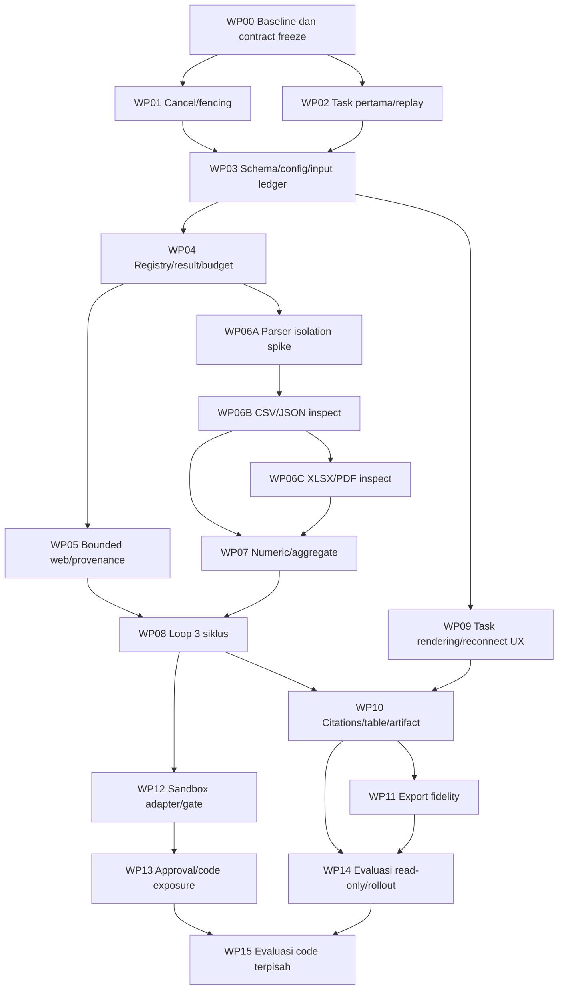

# Rencana implementasi — satu WP per sesi

**Belum diotorisasi.** Tidak menjalankan coding/migrasi/push/deploy dari rencana ini. Mulai hanya setelah keputusan pemilik di [DECISIONS](<DECISIONS.md>); target [PRD](<PRD.md>), kontrak [SDD](<SDD.md>), gate [ACCEPTANCE](<ACCEPTANCE.md>).

## Aturan eksekusi kelak

Satu workstream utama; satu pemilik shared schema/DTO, satu WP per sesi. Periksa Git/HEAD/diff sebelum tiap WP; pertahankan perubahan manusia dan existing fitur/guard. Jangan reset/clean/stash otomatis, edit init migrasi, menyentuh secret/host atau restart layanan lain. Tidak membuat abstraksi satu implementasi, framework baru atau dependency untuk sesuatu yang sudah tersedia.

Setiap WP menghasilkan diff kecil, regression nyata yang gagal sebelum perbaikan, bukti command+exit+jumlah tes+SHA+environment, review manusia/independen untuk state/security. Fixture existing bukan bukti target. Jika perubahan melebihi scope, pecah WP berikutnya, bukan meluas diam-diam. Tidak commit/push kecuali izin eksplisit.

## Dependency DAG



Tidak perlu menjalankan semua cabang sekaligus. Recommended release read-only berhenti WP14; WP12/13/15 bukan blocker read-only jika code benar-benar off. Klarifikasi read-only terminal partial dengan follow-up existing; consent egress WP05 tidak bergantung WP13. Format yang belum lolos WP11 tetap diberi batas/tidak dipromosikan, bukan menahan MD/CSV/JSON/XLSX aman.

## Work packages dan scope file aktual

Path di bawah existing, kecuali bertanda **baru** dalam kode. Test baru ditambah hanya saat WP terkait. Perintah V0/V1 dst dijabarkan di bawah; bukan perintah deploy.

| WP / owner-role | Dependensi | Scope minimum | Acceptance / verifikasi |
|---|---|---|---|
| WP00 — Product + QA | Izin coding terpisah | Baca [scope](<../../../tasks/ACTIVE-SCOPE.md>), [schema](<../../../prisma/schema.prisma>), [manifest](<../../../package.json>), seluruh paket ini; tulis fixture manifest **baru** `tests/fixtures/research/manifest.json` saat disetujui | Bekukan R01–R11, model/provider capability dan batas; split60 total (40 development+20 held-out stratified), bekukan jumlah per keluarga di manifest; baseline per command, bukan angka lama. V0, V1 |
| WP01 — Backend lifecycle | WP00 | [run](<../../../src/lib/tasks/run.ts>), [tasks](<../../../src/lib/tasks/tasks.ts>), [run tests](<../../../src/lib/tasks/run.test.ts>), [worker lifecycle test](<../../../tests/worker-lifecycle.test.ts>) | T01: hung stream cancel/deadline/shutdown abort; stale lease antara check/write ditolak atomik; terminal sekali. V2 + V1 |
| WP02 — Frontend task | WP00 | [task-view](<../../../src/components/task-view.tsx>), [task-view tests](<../../../src/components/task-view.test.tsx>), [events](<../../../src/lib/tasks/events.ts>), [tasks](<../../../src/lib/tasks/tasks.ts>); **baru** `e2e/research.spec.ts` | T02: pengguna kosong bisa create, double-submit idempotent; snapshotSeq/dedup tanpa concat replay. V3 + V1; browser gate |
| WP03 — Data contract owner | WP01,WP02 | [schema](<../../../prisma/schema.prisma>), [tasks](<../../../src/lib/tasks/tasks.ts>), [agent registry](<../../../src/lib/agents/registry.ts>), [artifact create](<../../../src/lib/artifacts/create.ts>); **baru** pasangan `prisma/migrations/{sqlite,postgresql}/<timestamp>_research_contract/migration.sql` | T03: additive TaskStep/TaskSource/TaskAttachment + nullable config/parts/lineage; snapshot agent benar; legacy tetap baca; attachment survive retry; tambah metadata upload/egressJson nullable dan sticky privateContextSeen. V4 + V2 + V1 |
| WP04 — Tools/backend | WP03 | [registry](<../../../src/lib/tools/registry.ts>), [registry tests](<../../../src/lib/tools/registry.test.ts>), [run](<../../../src/lib/tasks/run.ts>); **baru** `src/lib/tasks/research-budget.ts` dan test berpasangan | T04: output/error schema konsisten, unknown tool denied, reserve CAS, cap survive restart; final input4.000/output1.000 reserve serta terminal template tanpa model saat tidak cukup. V5 + test baru + V1 |
| WP05 — Web/data | WP04 | [web search](<../../../src/lib/search/web.ts>), [source read](<../../../src/lib/sources/read.ts>), [source record](<../../../src/lib/sources/record.ts>), [search prompt](<../../../src/lib/search/prompt.ts>), [search tests](<../../../src/lib/search/web.test.ts>), [source tests](<../../../src/lib/sources/sources.test.ts>), [tasks](<../../../src/lib/tasks/tasks.ts>), [task-view](<../../../src/components/task-view.tsx>); **baru** egress-grants route/DELETE sesuai D04 + tests | T09-egress: private taint, exact single-use consent UI/server, revoke/expiry/canary sebelum outbound; T05: streaming/decompressed cap sebelum allocation, batch partial, abort, snapshot/hash/coverage/locator; SSRF reuse. V6 + V1 |
| WP06A — Parser/security spike | WP04 | [document extract](<../../../src/lib/documents/extract.ts>), [office](<../../../src/lib/documents/office.ts>), [run extract](<../../../src/lib/documents/run-extract.ts>); **baru** `src/lib/documents/inspect.ts` + test saat pilihan isolation ditetapkan | T06a: buktikan parser process tanpa secret/network dan hard memory/time/decompression cap; putuskan duplicate-key JSON bounded. Jika tidak bisa, format off/blocked_external; jangan parser host tanpa batas. V7 + adversarial fixtures + V1 |
| WP06B — Data parser + upload | WP06A | [artifact create](<../../../src/lib/artifacts/create.ts>), [artifact format](<../../../src/lib/artifacts/format.ts>), [task-view](<../../../src/components/task-view.tsx>), [tasks](<../../../src/lib/tasks/tasks.ts>); **baru** `src/app/api/kawan/v1/artifacts/uploads/route.ts` dan test streaming upload,  `src/lib/documents/inspect.ts`, `src/lib/documents/inspect.test.ts`; [registry](<../../../src/lib/tools/registry.ts>) | T03-upload: picker raw byte upload→artifactId→TaskAttachment→inspect/aggregate hash original, oversize stream abort, owner/expiry; T06b: CSV quoted newline/leading zero/locale, JSON duplicate/unsafe/nested; source locator/cursor signed/coverage, owner/expiry. V7 + test baru + V1 |
| WP06C — Data parser | WP06A,WP06B | [extract](<../../../src/lib/documents/extract.ts>), [office](<../../../src/lib/documents/office.ts>), [run extract](<../../../src/lib/documents/run-extract.ts>); extend inspect/test WP06B berurutan, bukan penulis paralel file sama | T06c: XLSX formula/cache/date/hidden; PDF page/scan; cap before full allocation; tidak klaim tabel PDF akurat otomatis. V7 + test baru + V1 |
| WP07 — Numerik | WP06B,WP06C | [compute](<../../../src/lib/tools/compute.ts>), [compute tests](<../../../src/lib/tools/compute.test.ts>), [registry](<../../../src/lib/tools/registry.ts>); **baru** `src/lib/documents/aggregate.ts` + test | T07: precision/exactness benar; aggregate complete source range, n/missing/unit; no sample totals. V5 + test baru + V1 |
| WP08 — Orchestrator | WP05,WP07 | [run](<../../../src/lib/tasks/run.ts>), [prompt builder](<../../../src/lib/chat/prompt-builder.ts>), [registry](<../../../src/lib/tools/registry.ts>), [run tests](<../../../src/lib/tasks/run.test.ts>); helper **baru** `src/lib/tasks/research.ts` hanya jika memisahkan logika bounded membantu tes | T08: tool result kembali model, 1/2/3 cycle stop dan keempat denied, gap/conflict/abstain, no reset; T08-clarify: terminal partial+pertanyaan, follow-up replyToRunId/revision valid/stale/foreign/expired; T04-final: deterministic fallback; T09 injection. V2,V5,V6 + V1 |
| WP09 — Frontend rendering | WP03 | [task-view](<../../../src/components/task-view.tsx>), [Markdown](<../../../src/components/markdown.tsx>), [Markdown tests](<../../../src/components/markdown.test.tsx>), [task tests](<../../../src/components/task-view.test.tsx>) | T10: reuse renderer, safe HTML/links, unlabeled fence, Mermaid invalid→valid/theme/source reset, raw copy; truthful progress. V3 + V8 + V1 |
| WP10 — Output/provenance | WP08,WP09 | [task-view](<../../../src/components/task-view.tsx>), [chat-view](<../../../src/components/chat-view.tsx>), [source-list](<../../../src/components/source-list.tsx>), [artifact create](<../../../src/lib/artifacts/create.ts>), [artifact route](<../../../src/app/api/kawan/v1/artifacts/[artifactId]/route.ts>); **baru** source resolver route sesuai SDD D04 | T11: claim refs checked; 10k dataset preview bounded/full download; cross-owner denied; expiry/hash; keyboard/mobile. V8,V9 + V1 |
| WP11 — Export, satu format per sesi | WP10 | [transfer](<../../../src/lib/chat/transfer.ts>), [document export](<../../../src/lib/chat/document-export.ts>), [convert](<../../../src/lib/artifacts/convert.ts>), [render](<../../../src/lib/artifacts/render.ts>), [render-binary](<../../../src/lib/artifacts/render-binary.ts>), [format](<../../../src/lib/artifacts/format.ts>) | T12: scope export eksplisit, CSV→GFM jujur, CSV injection, PDF 5 halaman/Unicode/table consumer test; PPTX off sampai registry/tool/HTTP lengkap. Pecah per format; jangan ubah semua sekaligus. V9 + V1 |
| WP12 — Sandbox/security | WP08; izin provider/live | [sandbox contract](<../../../src/lib/sandbox/contract.ts>), [E2B adapter](<../../../src/lib/sandbox/e2b.ts>), [sandbox tests](<../../../src/lib/sandbox/sandbox.test.ts>) | T13: corrected Python/Node invocation, caps/network none/kill descendants/owner isolation live. Capability off jika ada gate gagal. V10 + live canary, bukan host code |
| WP13 — Approval + code exposure | WP12 seluruh gate pass | [tasks](<../../../src/lib/tasks/tasks.ts>), [registry](<../../../src/lib/tools/registry.ts>), [run](<../../../src/lib/tasks/run.ts>); **baru** interaction route D04 dan tests | T14: approval digest/version/expiry/CAS fail-closed; code unavailable without gate; no duplicate effects/ambiguous retry. V2,V5,V10 + V1 |
| WP14 — QA + operator read-only | WP10,WP11 format terpilih | [E2E docs](<../../../e2e/documents.spec.ts>), [E2E render](<../../../e2e/render.spec.ts>), [responsive](<../../../e2e/responsive.spec.ts>), research E2E/manifest baru; laporan **baru** `docs/research-planning/kawan-next/reports/read-only-gate.md` | T15: dataset60/model3 repeats/live10 official tasks, migration upgrade+backup restore, rollout/rollback drill. V0–V9 sesuai perubahan; deployment tetap otorisasi lain |
| WP15 — QA + operator code | WP13,WP14 | Sandbox live fixture/report terpisah **baru**, tidak secret/trace privat | T16: Python+JS actual sandbox execution, seluruh isolation gate setelah template/provider change; report blocked_external bila belum ada akses. V10 + live; bukan menyatakan selesai dari mock |

## Perintah verifikasi yang tersedia di repo

Jalankan dari root repo dalam DB/environment test terisolasi. Tidak membaca/menyalin secret ke laporan. Perintah berikut rencana, **belum dijalankan oleh WP implementasi ini**.

```bash
# V0: baseline / dokumen (checker lama tidak mencakup paket baru otomatis)
git status --short
git rev-parse HEAD
git diff --check
python3 tasks/agent-v1/check_docs.py
python3 tasks/nontechnical-v1/tools/check_docs.py

# V1: gate umum setelah source berubah; generate dua klien pada checkout baru
npm run db:generate
npx tsc --noEmit -p tsconfig.json
# lint path eksplisit yang benar-benar berubah; contoh WP01:
npx eslint src/lib/tasks/run.ts src/lib/tasks/tasks.ts src/lib/tasks/run.test.ts tests/worker-lifecycle.test.ts
npm test
npm run build

# V2: lifecycle
npx vitest run src/lib/tasks/run.test.ts tests/worker-lifecycle.test.ts
# V3: task/renderer fixture
npx vitest run src/components/task-view.test.tsx src/components/markdown.test.tsx
# V4: migration lint + existing checker tests
node scripts/check-migrations.mjs
npx vitest run tests/check-migrations.test.ts
# V5: tools/numerik
npx vitest run src/lib/tools/registry.test.ts src/lib/tools/compute.test.ts
# V6: network/source
npx vitest run src/lib/search/web.test.ts src/lib/sources/sources.test.ts src/lib/net/policy.test.ts
# V7: extraction existing; tambahkan inspect/aggregate test setelah berkas dibuat
npx vitest run src/lib/documents/run-extract.test.ts
# V8: browser existing, server test terisolasi sesuai Playwright config
npm run test:e2e -- e2e/render.spec.ts e2e/responsive.spec.ts
# V9: artifact/document
npx vitest run src/lib/artifacts/artifacts.test.ts
npm run test:e2e -- e2e/documents.spec.ts
# V10: sandbox fixture, BUKAN live isolation
npx vitest run src/lib/sandbox/sandbox.test.ts
```

New test commands hanya setelah file ada: `npx vitest run src/lib/documents/inspect.test.ts`, `npx vitest run src/lib/documents/aggregate.test.ts`, `npx vitest run src/lib/tasks/research-budget.test.ts`; `npm run test:e2e -- e2e/research.spec.ts`. Pastikan tes count >0: konfigurasi existing dapat pass with no tests.

Tidak mengarang command migration live/eval yang belum ada. WP03/14 wajib membangun harness isolated fresh+populated untuk SQLite/PostgreSQL berdasarkan konfigurasi repo aktual, mencatat command persis dan hasilnya. Tidak menjalankan migrasi production dari shell contoh. Live suite memerlukan provider/model config, consent biaya, test account dan laporan sanitized; ketidaktersediaan berarti blocked_external.

## Rollout setelah persetujuan terpisah

1. QA baseline/diff, backup/restore salinan, schema additive dua provider; old reader/new nullable fields diuji.
2. Deploy compatibility reader dengan flags off hanya lewat otorisasi deploy. Admission baru off sampai gate; tidak restart host lain.
3. Jalankan fixture+canary internal read-only; owner test account, limit awal ketat; observasi biaya/latency/partial/cancel.
4. Opt-in kecil; rollback switch off jika leakage/cap bypass/stale write/citation corruption. Tahan sandbox/format belum lulus secara independen.
5. Perluas hanya setelah acceptance, review, laporan SHA/commands/live status; tidak otomatis dari goal/task completed.

Rollback: hentikan admission baru, cancel/drain run dengan acknowledgement, simpan partial/evidence, pertahankan unduh authorized. Rollback binary compatible, bukan drop kolom/tabel/DB; run format baru dibaca compatibility path atau forward fix. Hasil provider ambigu tetap indeterminate. Pantau recovery/lease dan capacity tertahan. Restore backup hanya runbook operator yang disetujui, diuji di salinan; tidak menimpa data pengguna demi tes.
