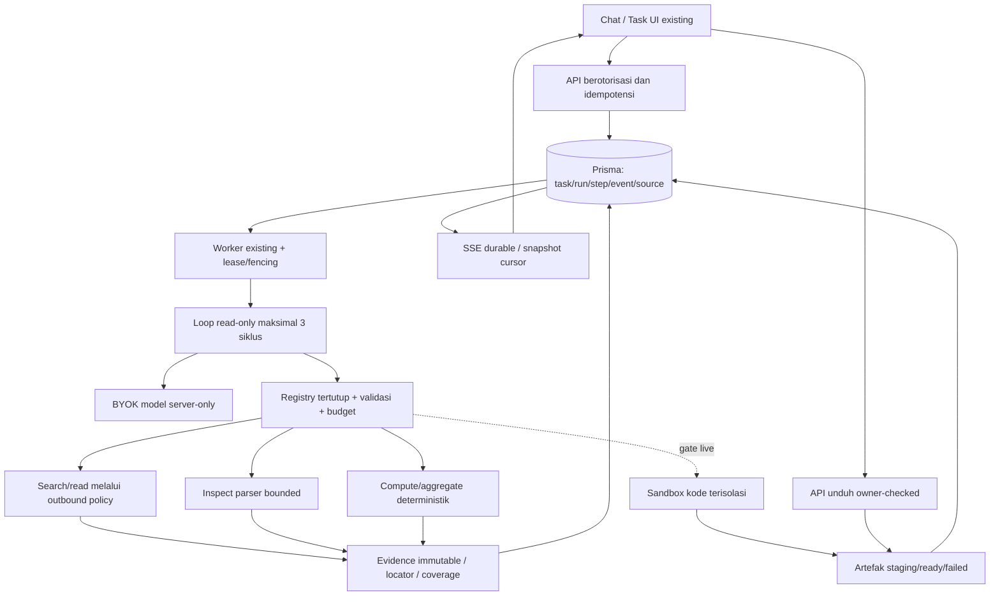
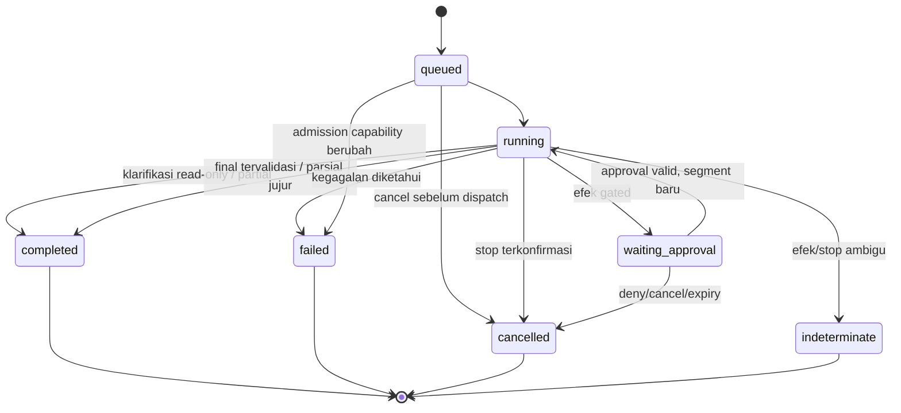

# SDD — integrasi minimum riset Kawan

**Target desain, bukan implementasi.** Requirement [PRD](<PRD.md>); keputusan konflik [DECISIONS](<DECISIONS.md>); gate [ACCEPTANCE](<ACCEPTANCE.md>). Angka default adalah usulan awal, bukan benchmark/vendor guarantee.

## D01 — Arsitektur dan batas modul



Satu orchestrator pada [task runner](<../../../src/lib/tasks/run.ts>), worker [existing](<../../../src/worker.ts>). Registry [existing](<../../../src/lib/tools/registry.ts>) tetap pusat capability; helper search/read/compute/artifact tidak diduplikasi. Jangan mengeksekusi model dalam request handler. Chat biasa tetap jalur existing; aksi riset task memakai durable service. Integrasi chat cukup entry point task/result, bukan loop kedua. Parent/depth reviewer dan plugin existing tidak dihapus; tidak diekspansi.

Boundary: browser hanya request DTO; DB/worker satu-satunya otoritas owner, policy, model, budget, state. Web/file/model/tool output adalah data tidak tepercaya. Parser kompleks resource-limited terpisah dari proses pemegang secret; arbitrary code hanya sandbox provider. Tidak ada framework engine baru.

## D02 — Schema additive, dual-provider

Dasar: [schema Task/TaskRun/TaskMessage](<../../../prisma/schema.prisma#L600-L685>), [TaskEvent/TaskInteraction](<../../../prisma/schema.prisma#L813-L849>), [Artifact](<../../../prisma/schema.prisma#L249-L282>). Gunakan String JSON tervalidasi seperti pola existing, bukan JSONB/enum provider-specific. Semua ID dibuat server; timestamps UTC. DTO JSON memakai `schemaVersion:1`; unknown field ditolak pada input, field output additive dapat diabaikan klien lama.

| Delta minimum | Kontrak target |
|---|---|
| TaskRun tambahan nullable | `configJson`, `budgetJson`, `egressJson`, `stopReason`; konfigurasi beku: policyRevision, agent id/version/system prompt hash+snapshot, tool schema versions, model/connection reference, limits, tokenizer/estimate version. Tidak menyimpan key |
| TaskRun counters | `researchCycle Int default 0`; pemakaian/reservasi token/query/read/tool/bytes persisten di budgetJson, CAS run revision pada transaksi. `segment/currentJobId/revision` existing tetap authority; bukan attempt counter pengganti |
| TaskMessage tambahan nullable | `partsJson` versi 1; `text` tetap fallback canonical jawaban. Parts whitelist: markdown, sourceRefs, tablePreview, artifactRefs; bukan HTML bebas |
| TaskAttachment baru | `id,taskId,messageId,artifactId,contentHash,createdAt`; unique(messageId,artifactId), index(taskId). Referensi file input dipersist saat admission transaksi; ownership/ready/expiry dicek ulang saat penggunaan |
| TaskStep baru | `id,runId,ordinal,segment,kind,callId?,toolName?,toolVersion?,inputHash?,status,inputJson?,outputJson?,sourceRefsJson?,startedAt?,finishedAt?,errorCode?`; unique(runId,ordinal), unique(runId,callId). Status reserved/running/succeeded/failed/indeterminate; JSON hanya bounded metadata/preview, bukan raw file/secret |
| TaskSource baru | `id,runId,stepId?,kind,artifactId?,snapshotKey?,metadataJson,createdAt`; metadata berisi requested/final URL, accessedAt, MIME, raw/extract hashes, extractionVersion, coverage, locator, trust, retention. Index(runId); source ID immutable, bukan nomor tampilan |
| Artifact tambahan nullable | `taskId,runId,stepId` + index run; owner existing tetap authority. Lineage/sourceRefs di metadata terstruktur existing bila kompatibel; jangan buat storage kedua |
| TaskInteraction reuse | `promptJson` approval berisi schemaVersion, action/target, canonical args digest, tool/version, run revision/segment, policyRevision, expiry; tidak membuat tabel Approval paralel |

FK cascade untuk child murni task (step/source/attachment); artifact bytes tidak cascade tanpa service cleanup. Artifact run link nullable/SetNull mempertahankan artefak existing; akses tetap owner dan retention. Menghapus task menonaktifkan akses evidence privat, menjadwalkan cleanup storage, membatalkan run/interaction; jangan menghapus shared chat artefact lewat link attachment. Pin metadata bukan menjamin file tersedia selamanya: expired/deleted → unavailable, bukan fallback ke file lain.

Migrasi: ubah schema canonical, migrasi baru bernama sama pada kedua provider; init/checksum lama tidak diubah. Nullable/default menjaga row lama. Row lama tanpa config/parts dibaca sebagai legacy single-pass; jangan diam-diam mengulangnya dengan tools. Run baru saja memakai capability baru. Generator SQLite dan kedua klien memakai `npm run db:generate`. Checker parity hanya lint migrasi; fresh+populated SQLite/PostgreSQL tetap gate nyata.

Transaksi admission: owner/quota/concurrency + idempotency receipt + task/run + attachment/message + job + event atomic. Key sama/payload sama mengembalikan resource sama; key sama/payload beda 409. Pin config sebelum antre. Lease/job/segment CAS harus berada di transaksi yang sama dengan step/result/message/event/budget mutation. `held()` di luar transaksi tidak cukup. Budget reserve di bawah CAS lalu dispatch; crash setelah reserve tidak mengembalikan jatah secara optimistis.

## D03 — State machine, lifecycle dan recovery



Pertahankan enum existing; **tidak menambah** `interrupted` atau `cancel_requested` status. `cancelRequestedAt` existing merupakan intent nonterminal; UI “Menghentikan” sampai acknowledgement. Stop/deadline/idle/shutdown/lease loss digabung sebagai abort signal ke model fetch, read loop, search, parser dan sandbox; seluruh child resource milik run dibersihkan. Browser disconnect hanya melepas stream, bukan cancel job. Race completed versus cancel diselesaikan satu transaksi terminal CAS; satu terminal event, tidak ada dispatch/delta setelah terminal.

Terminal immutable. Follow-up eksplisit membuat run baru. `stopReason`: sufficient_evidence, no_new_evidence, cycle_limit, budget_limit, unsupported_capability, user_cancel, deadline, provider_error, conflicting_evidence, clarification_required; status dan reason terpisah. `completed` dapat berisi `answerStatus:partial|abstained` bila sintesis final valid; tidak berarti semua klaim terbukti.

Restart: worker baru mengambil lease setelah expiry; stale worker tidak dapat menulis. Committed step read-only direuse berdasarkan input hash; reserved/running call tanpa receipt direkonsiliasi. Read-only boleh retry bounded, tetap menghitung budget dan provider charge unknown. External action/code ambigu menjadi indeterminate; tidak retry otomatis. Tidak mengklaim exactly-once provider. Snapshot agent gagal diverifikasi → failed, bukan resolve latest diam-diam. Interactions pending dipulihkan/expired, tidak auto-approve.

**Klarifikasi read-only:** tidak pernah memasuki `waiting_input` atau `waiting_approval`. Ambiguitas periode/unit/CSV mengakhiri run `completed`, `answerStatus:partial`, `stopReason:clarification_required`, pertanyaan terstruktur dan hasil parsial durable. Jawaban pengguna lewat POST task/messages existing membuat run baru dengan budget/config snapshot baru; lampiran dipilih ulang eksplisit dan owner/hash/expiry diperiksa kembali. Tidak auto-follow-up atau reset siklus tersembunyi. Enum waiting_input tetap dipertahankan untuk kompatibilitas existing tetapi tidak dipakai rilis ini; endpoint input pause/resume ditunda. UI menampilkan “Perlu klarifikasi”, bukan “Riset tuntas”; restart/reconnect hanya membaca hasil terminal. Follow-up mengirim `replyToRunId` dan `expectedTaskRevision`; stale reply 409, foreign 404, lampiran expired ditolak. Tidak ada timer interaction karena tidak ada run menunggu.

## D04 — API dan SSE kompatibel

Reuse routes [tasks](<../../../src/app/api/kawan/v1/tasks/route.ts>), [follow-up](<../../../src/app/api/kawan/v1/tasks/[taskId]/messages/route.ts>), [snapshot](<../../../src/app/api/kawan/v1/tasks/[taskId]/route.ts>), [cancel](<../../../src/app/api/kawan/v1/tasks/[taskId]/runs/[runId]/cancel/route.ts>), [events](<../../../src/app/api/kawan/v1/tasks/[taskId]/runs/[runId]/events/route.ts>). Auth context existing; owner tidak boleh dari body. API response wrapper/error/requestId existing dipertahankan.

| Operasi | Request / response target |
|---|---|
| POST tasks | Existing title,input,connectionId,modelId,artifactIds,agentId; tambah optional mode=`research` (allowlist server); Idempotency-Key wajib untuk aksi UI baru. 202 `{task,run}` setelah commit |
| POST task/messages | Existing input/artifactIds/model/connection/agent; tambahan replyToRunId/expectedTaskRevision untuk jawaban klarifikasi; terminal run saja, 409 RUN_ACTIVE jika aktif; follow-up run baru. Tidak menyisip ke proses aktif |
| GET task | Existing task/run/messages + additive `snapshotSeq`, safe parts/source summaries/budget consumed/stopReason. Snapshot text dan cursor berasal consistent transaction |
| GET run/events | `afterSeq` integer nonnegative; Last-Event-ID fallback; query jika keduanya ada harus konsisten atau 400. Owner check sebelum headers dan berkala |
| POST run/cancel | Idempotent intent; queued dapat langsung cancelled, running intent dahulu. Response bukan klaim provider sudah berhenti |
| GET source target | Route baru di bawah task/run/sources/[sourceId], owner-check, bounded excerpt/locator; snapshot bytes tidak publik. 404 untuk unknown/foreign, 410 hanya setelah owner diketahui dan expired |
| POST interaction target, WP13 (bukan klarifikasi read-only) | Route baru di bawah task/run/interactions/[interactionId]; revision, decision/input, Idempotency-Key; CAS pending+expiry+run binding; 409 stale, deny tetap deny |

### Upload input original — kontrak yang dipilih

Jalur baru `POST /api/kawan/v1/artifacts/uploads` menerima **raw request body** satu CSV/JSON/XLSX/PDF, bukan multipart dan bukan renderer generated artifact. Header Content-Type, nama tampilan tervalidasi (maks120 karakter), Idempotency-Key; identitas dari session. UI picker mengirim File sebagai body streaming, memperlihatkan uploading/ready/failed; hanya ready masuk `artifactIds` pada POST tasks/messages. Document upload existing tetap untuk chat lama, tidak dianggap menghasilkan artifactId dan tidak dikonversi ulang untuk analisis.

Auth/quota sebelum membaca body; Content-Length di atas10MiB ditolak dini tetapi bukan satu-satunya guard. Baca `request.body` dengan counter hingga10MiB, backpressure ke staging storage existing, SHA-256 incremental; stop/cancel pada chunk yang melampaui cap, tanpa `formData()`/`arrayBuffer()` seluruh input. Tolak Content-Encoding selain identity. Sniff header bounded untuk magic/MIME/ekstensi; CSV/JSON text tervalidasi pada parser bounded berikutnya, bukan percaya Content-Type. File XLSX/PDF tidak di-re-render; hash original dan bytes tetap sama. Tidak ada tabel/storage kedua; reuse Artifact/storage staging/ready/failed dengan metadata origin=upload, extractionStatus=not_started, contentHash, byteSize, MIME, expiresAt. `ready` berarti byte durable dan admission valid, bukan extraction sukses. Failed/aborted upload membersihkan staging; dangling staging direkonsiliasi cleanup existing. Idempotency owner+key+payload hash, same payload reuse ID, mismatch409; cap tetap ditegakkan pada retry.

Response201 `{artifact:{id,status:"ready",origin:"upload",contentHash,byteSize,mime,expiresAt,extractionStatus:"not_started"}}`; error413 UPLOAD_TOO_LARGE,415 MIME_MISMATCH/UNSUPPORTED_MEDIA,400 INVALID_UPLOAD,429 quota. `file.inspect` memicu bounded extraction saat perlu; status extraction running/ready/failed dicatat pada step + metadata, tersedia pada snapshot task tanpa membuka byte ke model. PARSE_LIMIT/OCR_UNAVAILABLE tidak mengubah original. Retensi7 hari, orphan upload belum terikat dibersihkan setelah24 jam; admission memeriksa owner/ready/hash/expiry, total5 file/25MiB, lalu TaskAttachment mengikat artifact ke task/message atomik. Cleanup tidak menghapus bytes yang masih punya binding valid sebelum expiry; expired tetap tidak diperpanjang diam-diam. Unduh original lewat route owner-checked existing. T03-upload menguji browser picker sampai inspect/aggregate atas hash original, bukan hanya fungsi parser.

### Consent outbound privat — endpoint read-only WP05

`POST /api/kawan/v1/tasks/[taskId]/runs/[runId]/egress-grants` menerima keputusan user terhadap proposal server: proposalId, payloadDigest, expectedRevision, expiresAt≤deadlineAt; session/CSRF check existing, bukan tool model. Proposal berisi tool/version, penerima exact origin+path (search termasuk operator search), method, query/body/URL **lengkap**, tujuan, input hashes; UI menampilkan data yang akan dikirim. Server menyimpan grant bounded di TaskRun `egressJson` additive nullable dengan owner/run/segment/policyRevision, digest, expiry, single-use status. DELETE resource grant mencabut pending; tidak dapat menarik kembali bytes yang telah terkirim. Grant boleh dibuat/dicabut hanya user; model hanya menghasilkan proposal tanpa dispatch. Run tetap running sambil UI menampilkan proposal hingga deadline; tidak memakai waiting_input/interaction WP13, tidak memperpanjang deadline. Tanpa keputusan, tool denied dan final partial; grant sesudah terminal/stale409, foreign404. Retry outbound butuh grant baru. Grant dan permit dispatch dikonsumsi atomik sebelum network; revoke sebelum CAS menang menolak dispatch, revoke sesudah CAS hanya abort best-effort. Semua ini wajib tersedia di cabang read-only, bukan menunggu sandbox.

Error stabil: INVALID_REQUEST 400; UNAUTHENTICATED 401; RESOURCE_NOT_FOUND 404; REVISION_CONFLICT/RUN_ACTIVE 409; CAPABILITY_UNAVAILABLE 422; quota 429 + Retry-After; upstream error disanitasi. Provider/key/internal URL tidak dikirim ke klien.

Event existing `TaskEvent` durable dipertahankan. SSE `id: seq`, `event: kind`, `data: payload`; meta memuat schemaVersion/runId/afterSeq. Additive kinds `step.started`, `step.completed`, `source.added`, `budget.updated`, `artifact.ready`, `interaction.required`; existing run/message events tetap valid. Payload memiliki schemaVersion, correlation IDs, safe label/count, bukan raw args/CoT/secrets. Unknown kind diabaikan klien, seq tetap maju.

**Tidak mengadopsi provisional delta sebagai downgrade.** Saat ini delta disimpan; target mengikat append delta + message projection + cursor secara atomik. SnapshotSeq menyatakan semua delta ≤ cursor sudah tercakup; klien hanya append seq lebih besar, dedup runId+seq, satu text buffer per message. Out-of-order/gap → reload snapshot; jangan concat snapshot dengan replay nol. SSE batch 200 existing; buffer byte/time bounded, slow consumer ditutup dengan kemampuan reconnect. Setelah terminal dan lastEventSeq terkirim, stream tutup. Event replay tidak menjalankan tool.

## D05 — Loop, lima lapisan dan budget

Metode [PRD](<PRD.md>) berjalan di bawah prompt hierarchy policy/capability/preference/context/untrusted [existing](<../../../src/lib/chat/prompt-builder.ts>). Tool result tidak dijadikan instruksi system tepercaya. Model mengeluarkan rencana ringkas/gap summary terstruktur, bukan chain-of-thought.

Admission → framing → cycle 1 discovery/extraction → validation → (gap nyata, budget cukup, cycle<3: ulang discovery terarah) → synthesis. Satu siklus = satu batch pengumpulan bukti plus pemeriksaan gap; bukan model turn, tool call, retry atau HTTP request. Counter increment atomik **sebelum** dispatch batch; resume tidak reset. Maksimal 3 termasuk awal. File/URL langsung tidak dipaksa search; kasus cukup bukti berhenti dini. Tidak ada evidence baru setelah satu siklus tambahan → final parsial. Final invalid citation/unsupported claim dikeluarkan atau dilabeli, bukan memulai siklus keempat.

| Resource | Cap awal server |
|---|---|
| Siklus/query | 3; awal 2–4 bila multi-aspek, tambahan ≤2/siklus, total query ≤8 |
| Search/read | ≤5 hasil/query, ≤40 hasil; ≤8 sumber unik; parallel fetch ≤2 |
| Tool/retry | ≤24 invocations termasuk retry, ≤1 retry transient per logical call; invalid/denied tidak retry |
| Waktu | 120 detik read-only absolute; search 8 detik, read 10 detik; sandbox run ≤15 menit terpisah |
| Model | input kumulatif ≤24.000 token, output ≤6.000; reserve final input 4.000 + output 1.000 dari jatah masing-masing, bukan tambahan |
| Body/context | search ≤512 KiB; read ≤2 MiB decompressed raw; extract ≤200.000 karakter; prompt excerpt ≤6.000/sumber |
| Konkurensi | ≤2 run aktif/owner; 1 sandbox/run; atomic admission |

Cap lebih rendah dari deployment/model selalu menang. Sebelum model/tool dispatch reserve worst allowed output/resource; sesudah return settle actual, jangan pernah mengizinkan saldo negatif. Missing usage memakai estimator konservatif berlabel; hard enforcement menghentikan streaming saat cap lokal, biaya provider mungkin tetap tercatat setelah abort. Retry memakai remaining deadline dan menambah tool/query usage; tidak gratis. `budgetJson` mencatat max/reserved/consumed/estimated, versi estimator dan reason. Tidak membangun billing/pricing baru; cost ditampilkan hanya jika tarif tepercaya tersedia.

Final call hanya memakai paket≤4.000 input token (policy+tujuan+evidence ringkas+schema minimal, tanpa history penuh) dan output≤1.000. Nonfinal tidak boleh memakai reserve ini; ukur dengan estimator konservatif yang sama sebelum dispatch. Jika paket tidak muat, cap model lebih rendah, input habis, deadline tiba saat gap review, atau provider gagal setelah tool: **terminal tanpa model**. Worker menyusun template deterministik dari step durable: hasil tool/sumber yang tersedia, status coverage, daftar gap/error, pertanyaan bila ada; `answerStatus:partial|abstained`, `synthesisStatus:not_generated`, stopReason budget_limit/deadline/provider_error. Tidak membuat klaim/entailment baru atau memulai siklus keempat; links/artifacts parsial tetap owner-accessible. Status failed untuk provider/deadline fatal, completed partial untuk budget/clarification yang ditangani; cancelled tetap cancelled. Commit terminal+pesan+event atomik, nol token tambahan.

## D06 — Tools dan context

Schema input/output tertutup dan terversi, `additionalProperties:false`, batas string/array/numeric; server memilih tool sesuai capability dan tool-call compatibility provider. Unknown name/version/schema output ditolak. Jangan mengklaim tool dipanggil bila provider tidak mendukung tool calls; tawarkan chat/model lain.

Context server: `{userId,taskId,runId,stepId,segment,signal,deadlineAt,policyRevision,privateContextSeen,egressGrantId?}`. Model tidak boleh menetapkan owner, storage path, key, limit maksimum atau policy. Envelope final:

```ts
type ToolResult = {
  schemaVersion: 1;
  status: "ok" | "invalid" | "denied" | "failed";
  text: string; // ringkas, termasuk hasil/error yang aman
  data?: unknown; // divalidasi schema tool
  sourceRefs: string[];
  artifactIds: string[];
  truncated: boolean;
  errorCode?: string;
  message?: string;
};
```

| Tool target | Input inti | Output / kontrol |
|---|---|---|
| web.search | queries[1..4], limit1..5 | results + queryOutcomes; batch partial eksplisit; snippet discovery saja |
| web.read | url, maxChars1000..6000, cursor? | sourceId/hash/finalUrl/excerpt/locator/coverage; cursor snapshot yang sama |
| file.inspect | artifactId, view summary/rows/text, sheet/range/pages/jsonPointer, cursor?, maxRows1..100/maxChars≤8000 | typed schema/sample/rows/text, fileHash, warnings/coverage; format-specific fields mutually exclusive |
| compute.calculate | enum op, operand string, precision/rounding sesuai schema existing | value/rule/rounded + exactness/significant precision metadata; bukan eval |
| compute.stats | bounded values, sample/population, unit | n/missing/statistics; provenance step; bukan uang/big integer Number |
| data.aggregate | artifactId/sheet/columns, count/sum/mean/min/max, groupBy≤2, missing exclude/error | complete sourceRange/count/missing/unit/precision; tanpa SQL/expression umum |
| generate_file / generate_document | schema existing | artifact ID ready setelah validation/storage; error bukan kartu sukses |
| code.execute, gated | python/javascript, code≤64KiB, input IDs≤5, timeout≤60s | executionId, code/input/template hash, output IDs, usage/status; tidak menerima env/install/network |

Detail argumen/error/coverage berlaku seperti [riset data §5](<riset-data-evaluasi.md#L74-L100>), kecuali nama/envelope di atas menjadi kontrak integrasi. Existing `compute.*` dipertahankan, bukan alias ganda. Hasil tool kembali ke model dalam turn berikutnya, bukan hanya efek setelah final. Tool invocation journal mencatat callId/inputHash/status/usage; stdout raw tidak menjadi aktivitas UI.

Konteks: simpan evidence lengkap yang diizinkan di storage privat, prompt berisi excerpt bounded dengan source ID/hash/range/truncated. Pin tujuan, batas, schema tool, sumber yang dirujuk, summary hasil; pruner tidak menghapus original. Summary memuat source refs dan coverage, bukan klaim sudah membaca bagian yang dibuang. Budget prompt seluruh history+tool+schema, bukan excerpt saja. Tidak membawa seluruh dataset ke model untuk dihitung.

## D07 — Inspeksi file dan numerik

Input ≤10 MiB/file, ≤5 file, ≤25 MiB/run; magic/MIME/ekstensi tervalidasi, UTF-8 awal. Preview tool default 20 baris×20 kolom, cell≤500 karakter, total≤8.000 karakter. Parser: 10 detik, 256 MiB, expanded ZIP≤50 MiB/1.000 entries/100:1, JSON depth≤50/nodes≤100.000, XLSX≤50 sheets/20.000 cells, CSV≤100 columns/20.000 cells, PDF≤200 pages. Enforcement selama stream/decompress/parse; cek setelah full allocation tidak lulus. Jika parser terpasang tidak dapat membatasi dengan benar, capability format tersebut off atau input ditolak; bukan menjanjikan gate semu.

CSV: reuse parser ExcelJS, mapping string identitas; quote/newline/leading zero tetap. Delimiter/decimal locale ambigu → klarifikasi; kosong tidak otomatis nol/null. JSON: bounded parsing, array records/JSON Pointer; unsafe integer dan duplicate keys tidak diam-diam hilang. Stdlib JSON.parse saja tidak dapat mendeteksi duplicate key; WP spike wajib memilih scanner bounded kecil yang teruji atau dependency minimal dengan persetujuan; sampai itu input ambigu ditolak/tidak diaktifkan. Tidak merge keys ke config. XLSX: formula text dan cachedValue terpisah, cache tidak dihitung ulang; external link/macro tidak dieksekusi; hidden sheet/date system eksplisit; encrypted/.xls unsupported. PDF: page locator, bukan asumsi extracted text adalah tabel akurat; scan → OCR_UNAVAILABLE.

Aggregate hanya pada range lengkap di bawah cap; coverage incomplete → INCOMPLETE_INPUT, bukan total sampel. Decimal clone dengan precision/mode pin untuk uang/operand string; `1/3` aproksimasi, no blanket exact. Statistik Number mempunyai toleransi absolute+relative per fixture. Rekam operation, unit, n/missing, range/hash, rounding, library version; persentase basis nol undefined/error. Preview metadata tidak disamakan analisis seluruh file.

## D08 — Provenance dan sitasi

SourceRecord immutable milik run: ID, requested/final URL, accessedAt, tanggal terbit jika diketahui, raw hash, extract hash/version, MIME, trust, coverage, snapshotKey dan retention. File memakai artifactId/fileHash/sheet-cell range/PDF page/JSON Pointer. Dedup canonical URL+hash tidak mengubah URL request semantik. Snapshot privat tidak dibagi lintas owner; default retensi mengikuti artefak 7 hari sampai keputusan pemilik.

Claim: `{claimId,statement,sourceRefs,evidenceStatus:supported|conflicting|insufficient|unverified}`. Server memeriksa source ada/owner cocok/excerpt pernah dibaca/quote ditemukan/locator valid. Pemeriksaan ini bukan entailment semantik; penilai manusia/golden mengecek dukungan klaim, tanggal/definisi/unit. Marker sitasi fiktif menggagalkan validasi final; tidak diam-diam dihapus sehingga jawaban tampak terverifikasi.

Konflik tampil A/B berikut tanggal/populasi/definisi; pilih sumber primer relevan, bukan voting atau sekadar paling baru. Snippet, link hidup, DOI cocok bukan bukti klaim. Final menampilkan hasil terdukung, gap, status partial/abstained, waktu akses dan source resolver. Tidak menebak isi paywall/scan/failed extract. Angka/table output merujuk tool step dan input hash, bukan hanya URL.

## D09 — Keamanan, approval dan sandbox

Reuse [outbound policy](<../../../src/lib/net/policy.ts>): HTTPS/allowed port, IP A/AAAA tervalidasi dan dipin, no credentials embedded, private/loopback/link-local/metadata diblok, redirect lintas-host tetap ditolak. Byte cap decompressed selama stream; tidak meneruskan auth header search ke target. Tidak ada cookies/script/subresource fetch. Query tidak mengandung file privat/PII tanpa consent. **Enforcement server:** `privateContextSeen` sticky durable sebelum private file/excerpt/derived result dimasukkan konteks; follow-up dengan history privat mewarisi true. Secara konservatif task dengan lampiran privat ditandai sejak admission. Setelah true, seluruh outbound model-authored web.search/web.read (termasuk callback URL dari dokumen, path/query/body/header dan redirect) ditolak `EGRESS_CONSENT_REQUIRED` kecuali exact grant D04 sah. Tidak mengandalkan classifier PII, prompt atau allowlist host publik. Permit diperiksa dispatcher sebelum setiap network request; hash mencakup payload encoded final, recipient/method/tool/input hashes. Parameter/recipient berubah, grant expired/revoked/consumed, run berbeda → denied. Model BYOK yang dipin merupakan kanal pemrosesan utama yang pengguna pilih saat submit, ditampilkan pada picker; tidak boleh diganti ke provider lain diam-diam. Sandbox jaringan tetap none. Log hanya IDs/digest/deny code, bukan query/body privat. Egress proposal disimpan owner-scoped tanpa raw payload dalam audit log umum. Web phase tanpa konteks privat boleh dilakukan lebih dahulu, tetapi tidak menghapus taint setelah file dibaca. Canary token unik wajib nol pada outbound/log sebelum grant; grant exact mengizinkan hanya payload yang ditinjau.

External content tidak dapat mengubah policy, memasang tools, menaikkan budget, memberi approval atau mengakses secrets. HTML model tidak dirender; URL protocol allowlist; Markdown remote image default tidak dimuat untuk hasil riset privat (tampilkan link/placeholder sampai consent), jangan membangun proxy fetch bebas. Mermaid strict + config terkunci, no click callback/arbitrary themeCSS, bounded text/edges. CSV output mode spreadsheet menetralkan formula, JSON canonical tersedia untuk mesin; raw input tidak diubah. Download existing attachment/no-store/nosniff/CSP sandbox tetap.

Approval efek eksternal hanya kirim/publish/beli/hapus/ubah akun; consent egress privat D04 adalah guard read-only terpisah, bukan bypass approval. Binding actor+run+segment+revision+tool/version+canonical args hash+target+policyRevision+expiry, sekali pakai CAS. Preview error/expired/parameter berubah → deny/re-ask. Persetujuan tidak menembus policy deny atau mengganti sandbox. P0 read-only tidak membuka tool efek eksternal.

Code capability tersedia hanya `configured AND policy permits AND runtime compatible AND isolation attested AND recent health probe`. Status unavailable/degraded beserta reason/version/checkedAt. Reuse [kontrak sandbox](<../../../src/lib/sandbox/contract.ts>): 1 CPU, 1.024 MiB RAM, disk256 MiB, command60s/run15min, stdout/stderr256KiB masing-masing, ≤10 output/25MiB. Runtime per run/non-root/input read-only/output khusus; tidak ada host mount/socket/DB/BYOK/env secrets. Network none termasuk DNS/IPv6/metadata/proxy; stdlib/prebaked packages saja. Node invocation harus execute, bukan `-c` syntax check.

Output resolved berada root output, regular file, bukan symlink/hardlink/device/FIFO/traversal; MIME/size/hash diverifikasi sebelum publish. Kill seluruh descendants; stop tidak terkonfirmasi → indeterminate, capacity tetap reserved sampai reconciliation. Tidak ada fallback host atau retry program ambigu. Live gate vendor/application-level wajib sebelum exposure; mock/key/template tidak cukup. Browser automation tetap di luar irisan.

## D10 — UX tabel, diagram, Markdown dan download

Reuse [Markdown](<../../../src/components/markdown.tsx>) pada [task view](<../../../src/components/task-view.tsx>), bukan renderer kedua. Existing chat tetap. Canonical text raw untuk copy/export, bukan DOM innerText. Fence tanpa bahasa tetap blok; Mermaid hanya render fence lengkap/settled atau debounce terukur, reset SVG/error saat source berubah. Fallback kode, loading/error berbeda, copy source dan `.mmd` download; SVG/PNG defer.

TablePreview: `{schemaVersion,artifactId,title,columns:[key,label,type],previewRows,rowCount,previewRowCount,truncated,warnings,sourceRefs}`. Native table maksimal 50 baris×12 kolom DOM; ini cap UI berbeda dari inspect20×20. Dataset penuh terpisah DocSchema, tidak melewati limit tabel presentasi 2.000 baris dan diam-diam terpotong. Kolom/baris lain via bounded pagination/download; null/empty/leading zero/decimal tetap. CSV/JSON/XLSX canonical pipeline; file penuh atau label partial eksplisit.

Artifact refs berisi ID/version/hash/name/MIME/size/expiry/status; tombol hanya ready, authorize kembali saat klik. Copy jawaban raw; export jawaban tunggal atau active branch/all history eksplisit, membawa sumber dan artefact metadata tanpa token download. PDF Unicode/pagination/table fidelity dan PPTX end-to-end belum lulus; jangan label supported penuh sampai consumer gate. CSV→MD harus GFM benar atau ubah label, bukan CSV mentah bernama Markdown.

Aktivitas berasal event committed: fase/latest + details, cycle n/3, counts dan stop reason; tidak menampilkan % palsu, CoT atau secret args. Reconnect badge; cancelled bukan completed. Native table caption/th/scope, scroll lokal berlabel, diagram ringkasan tekstual/accTitle/accDescr. Keyboard/focus visible/44px target/aria-live polite terbatas, tidak autoscroll paksa. Uji 320/375px, zoom200%, light/dark/reduced motion. Tidak membuat asset atau identitas visual baru; Delivery Gate antislop/browser tetap pending.

## D11 — Observability, rollout dan rollback

Log aman: request/run/step/call IDs, state/stopReason, latency, bytes/tokens estimated vs reported, attempts, budget remaining, policy/config hash. Tidak log prompt/file/key mentah. UI/export audit evidence mengikuti owner+retention. Metrik: completion/partial/abstain, source support, numeric accuracy, cap rejection, stale writes, cancel latency, reconnect duplication, parse failures; alert keamanan tidak diisi isi file privat.

Feature gate default off; gunakan config/capability existing, tidak menambah sistem flags baru. Internal fixture → operator canary read-only → opt-in terbatas → perluasan setelah evaluasi. Sandbox/format fidelity masing-masing gate terpisah. Schema additive dahulu, reader compatible dahulu, writer baru sesudah gate. Tidak menjalankan deploy pada tugas planning.

Rollback aplikasi: matikan admission kemampuan baru, drain/cancel run dengan alasan jelas, pertahankan read/download run existing, rollback binary hanya ke versi yang bisa membaca nullable fields; jangan down-migrate/drop data. Backup/restore diuji pada salinan sebelum rollout. Jika state/format baru tidak dapat dibaca binary lama, gunakan forward fix atau compatibility release, bukan memaksa rollback. Detail urutan dan owner: [IMPLEMENTATION-PLAN](<IMPLEMENTATION-PLAN.md>).
