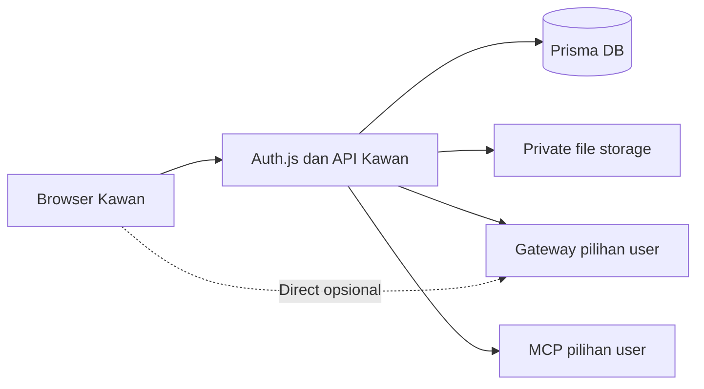

# Rencana pembangunan Kawan

Status: rencana untuk pelaksana; aplikasi belum diimplementasikan.
Tanggal: 12 Oktober 2026.
Pemilik produk: tokengateway.ai.id. Domain target: kawan.ai.id.
Daftar pekerjaan dan bukti penyelesaian: [todo.md](todo.md).
Instruksi siap diberikan kepada pelaksana: [execution-prompt.md](execution-prompt.md).
Audit kesetaraan Open WebUI dan gap schema/fitur: [parity-audit.md](parity-audit.md).

## 1. Tujuan dan batas pekerjaan

Bangun antarmuka chat AI BYOK untuk pemakaian pribadi, multi-user, dapat di-self-host. User membawa endpoint OpenAI-compatible dan key gateway miliknya; Kawan tidak menyediakan saldo, menjual token, memilih provider secara tersembunyi, atau mengambil key dari akun tokengateway. Kawan dan gateway merupakan layanan terpisah.

Pengalaman penggunaan mengambil referensi penuh dari fitur personal Open WebUI: auth → connection → model → percakapan → riwayat → pengaturan. Rasa UI mengikuti chat web ChatGPT/Claude. “Hampir 100%” berarti kesetaraan alur fitur yang tercantum dalam brief, bukan seluruh produk Open WebUI.

Audit lanjutan mengonfirmasi bahwa rencana ini **bukan schema identik dan belum mencakup seluruh fitur personal Open WebUI**. Archive, folder bertingkat, tags, temporary chat, JSON import/export, advanced parameters dan beberapa pengaturan personal belum masuk backlog utama. Lihat audit untuk mapping dan kandidat perluasan; jangan mengklaim persentase parity tanpa matriks/test.

Instruksi terakhir user: hanya membuat planning sebagai mandor. Semua implementasi, instalasi dependency, deployment, dan perubahan layanan dilakukan pelaksana lain. Dokumen ini bukan bukti bahwa fitur sudah berjalan.

### Keputusan dasar yang harus diikuti

| Area | Keputusan |
|---|---|
| Stack | Next.js 15 App Router, TypeScript strict, Tailwind CSS 4, komponen shadcn/ui, Vercel AI SDK v5, Prisma, Auth.js Credentials |
| Database | SQLite untuk development; PostgreSQL untuk production; migrasi keduanya harus diuji |
| Default BYOK | Server Kawan menyimpan key gateway terenkripsi dan meneruskan request ke connection user |
| Direct opsional | Browser menyimpan key di localStorage dan memanggil gateway langsung; key tidak dikirim ke server Kawan |
| Riwayat | Pohon pesan; satu cabang aktif; DB menjadi sumber kebenaran untuk percakapan |
| Streaming | SSE melalui POST dan fetch streaming; server memakai AI SDK v5 |
| File | Gambar dikirim sebagai input multimodal; PDF/teks menjadi konteks lampiran, tanpa RAG |
| Share | Snapshot cabang aktif, read-only, tidak otomatis berubah mengikuti chat asli |
| Usage | Monitoring token berdasarkan usage gateway, tanpa harga atau billing |
| MCP | Remote HTTP/SSE, auth milik user, tool execution server-side; fitur terakhir |
| Referensi | Pelajari perilaku dan struktur; tulis ulang kode/aset; jangan menyalin repo Open WebUI |
| Bahasa | Bahasa Indonesia sebagai default; English sebagai pilihan yang benar-benar menerjemahkan UI |

Brief awal menyebut “murni klien” sekaligus meminta server route dan key terenkripsi. Acuan implementasi adalah spesifikasi teknis yang lebih rinci: **mode default memang melewatkan request LLM di server Kawan**. Mode Direct menyediakan jalur tanpa server Kawan untuk request LLM. Copy produk harus menjelaskan dua mode ini dengan jujur.

“Browser tidak pernah pegang key mentah” di mode default berarti key tidak pernah dikembalikan dari server atau disimpan di browser setelah submit. Saat user mengetik key, browser tentu menampungnya sementara dalam form. Jangan membuat klaim absolut yang keliru.

### Fitur wajib

- Register, login, logout, isolasi data per user.
- Onboarding gateway; test endpoint; CRUD beberapa connection; pilih connection aktif.
- Streaming, stop, regenerate, model per chat, system prompt per chat.
- Sidebar riwayat, pencarian judul dan isi pesan, rename, pin, hapus, folder, kelompok tanggal.
- Edit pesan user dengan cabang baru; berpindah antar-cabang tanpa menghapus versi lama.
- Markdown, syntax highlighting, copy jawaban dan code block.
- Lampiran gambar, PDF berisi teks, file teks.
- Tema light/dark/system, responsive, Settings General/Connections/About.
- Export Markdown, share link publik read-only, cabut link.
- Usage per user dan connection, grafik harian, total per model.
- MCP server URL + auth, discovery tools, pemilihan tools di composer, eksekusi model tool-calling.
- Seluruh branding yang disebut user, dokumentasi self-host, lisensi kode Kawan sendiri.

### Tidak termasuk

RAG, knowledge base, embeddings/vector DB, Ollama native API, marketplace, RBAC/team, admin kompleks, calendars, notes, voice, image generation, pembayaran, sinkronisasi akun gateway, multi-model paralel, autonomous agents, OCR PDF scan, OAuth MCP, MCP stdio/shell, import seluruh format Open WebUI.

Direct bersifat opsional. Rencananya tersedia sebagai fase terpisah; bila disepakati ditunda, jangan tampilkan toggle palsu. Semua fitur wajib lainnya tetap diselesaikan.

## 2. Temuan referensi dan cara memakainya

Repo lokal yang ditelaah: `/Users/mekari/tokengateway/open-webui`, commit lokal `f8ae8a6`. Repo upstream: [open-webui/open-webui](https://github.com/open-webui/open-webui).

| Area | File referensi lokal | Perilaku yang dipelajari | Adaptasi Kawan |
|---|---|---|---|
| Layout | `src/routes/+layout.svelte`, `src/routes/(app)/+layout.svelte` | Bootstrap session/settings, layout app | Server layout untuk auth; client shell untuk interaksi |
| Sidebar | `src/lib/components/layout/Sidebar.svelte`, `Sidebar/ChatMenu.svelte`, `Sidebar/Folders.svelte` | Navigasi, menu chat, folder | Sidebar sederhana dengan aksi yang sama dalam scope |
| Search | `layout/SearchModal.svelte`, `Sidebar/SearchInput.svelte`, backend `models/chats.py` | Pencarian riwayat dan filter | Cari judul/isi; filter folder/pin; bukan seluruh filter enterprise |
| Connections user | `chat/Settings/Connections.svelte`, `Connections/Connection.svelte` | Daftar koneksi Direct, normalisasi URL, edit/hapus | Connection milik user; secret default tersimpan encrypted |
| Connections admin | `admin/Settings/Connections.svelte`, `Connections/OpenAIConnection.svelte`, `AddConnectionModal.svelte` | Endpoint/key, konfigurasi, test | Ambil alur form/test tanpa admin global |
| Streaming | `chat/Chat.svelte`, `src/lib/apis/streaming/index.ts` | Delta SSE, abort, usage, lifecycle response | SDK server, protokol SSE Kawan yang terdefinisi |
| Branching | `chat/Messages.svelte` | Parent/children, cabang aktif, sibling navigation | Message adjacency list; children dihitung dari parent |
| Pesan/code | `chat/Messages/Markdown.svelte`, `Messages/CodeBlock.svelte` | Rendering streaming, code actions | React Markdown dengan sanitasi dan highlighter |
| Attach | `chat/MessageInput.svelte`, `FileNav.svelte`, backend `models/files.py` | Upload, preview, lampiran pesan | Input multimodal/teks, tanpa retrieval pipeline |
| Settings | `chat/SettingsModal.svelte`, `Settings/General.svelte`, `Settings/About.svelte` | Tab settings, tema/bahasa, versi | Settings yang fokus pada fitur Kawan |
| Share | `chat/ShareChatModal.svelte`, `src/routes/s/[id]/+page.svelte`, backend `models/shared_chats.py` | Snapshot dan halaman publik | Snapshot cabang aktif, minim metadata, revoke |
| Usage | `chat/Settings/Usage.svelte` | Statistik pemakaian personal | Grafik harian + tabel model dan connection |
| Tools | `chat/ToolServersModal.svelte`, `Settings/Integrations.svelte` | Discovery, auth status, pemilihan server/tools | MCP remote per user; tools terpilih saja |
| DB chat | backend `models/chats.py`, `models/chat_messages.py`, `models/folders.py` | Owner, parent, current message, pin/folder | Model relasional Prisma yang lebih kecil |
| DB auth/user | backend `models/auths.py`, `models/users.py` | User dan autentikasi | Auth.js Credentials + User milik aplikasi |

Pelaksana wajib membaca area referensi lagi sebelum mengerjakan fiturnya, lalu mencatat perilaku penting dan perubahan scope. Jangan menyalin markup, CSS, ikon, aset, fungsi, atau migrasi dari repo tersebut. Jangan memindahkan nama/branding Open WebUI ke UI Kawan. Referensi tidak menjamin kompatibilitas API Open WebUI.

Dokumentasi teknis utama:

- Auth.js Credentials memberikan alur authorize; aplikasi tetap perlu mengelola registrasi/password sendiri. [Auth.js Credentials](https://authjs.dev/getting-started/authentication/credentials).
- Model gateway memakai provider OpenAI-compatible, bukan gateway default Vercel. [AI SDK v5 provider](https://ai-sdk.dev/v5/providers/openai-compatible-providers).
- Tool loop menggunakan API v5 dan batas langkah yang eksplisit. [AI SDK v5 tool calling](https://ai-sdk.dev/v5/docs/ai-sdk-core/tools-and-tool-calling).
- Transport MCP dan lifecycle client mengikuti versi paket yang dipasang; API experimental perlu dipin. [AI SDK v5 MCP](https://ai-sdk.dev/v5/docs/ai-sdk-core/mcp-tools).
- Migrasi SQL bergantung pada provider; mengganti `DATABASE_URL` saja bukan migrasi SQLite → Postgres. [Prisma migration limitations](https://www.prisma.io/docs/orm/v6/prisma-migrate/understanding-prisma-migrate/limitations-and-known-issues).

Jangan menyalin contoh dokumentasi terbaru bila contoh itu telah bergeser ke SDK 6/Prisma 7. Verifikasi export/types pada paket versi yang dikunci saat eksekusi.

## 3. Arsitektur aplikasi



### Batas tanggung jawab

- Browser: interaksi, form, draft, branch navigation, render SSE, theme/locale, clipboard. Secret default hanya berada di form sampai submit, lalu dikosongkan.
- Server: session/ownership, enkripsi, request gateway default, validasi URL, persistence, usage, upload default, share snapshot, MCP execution.
- Gateway: daftar model, inferensi, usage, error/rate limit. Kawan tidak mengasumsikan semua model punya vision/tools.
- DB: user, connections, chats, messages, folders, attachment metadata, generation status, usage, settings, shares, MCP metadata/auth encrypted.
- Storage: bytes lampiran privat. Folder lokal persisten untuk self-host; object storage privat untuk deployment tanpa disk persisten.

### Struktur file yang dituju

```text
src/
  app/
    (auth)/login/page.tsx
    (auth)/register/page.tsx
    (workspace)/layout.tsx
    (workspace)/page.tsx
    (workspace)/onboarding/page.tsx
    (workspace)/c/[chatId]/page.tsx
    (workspace)/settings/[section]/page.tsx
    (workspace)/usage/page.tsx
    s/[token]/page.tsx
    api/auth/[...nextauth]/route.ts
    api/register/route.ts
    api/connections/.../route.ts
    api/chats/.../route.ts
    api/generations/.../route.ts
    api/folders/.../route.ts
    api/attachments/.../route.ts
    api/settings/route.ts
    api/usage/route.ts
    api/mcp/servers/.../route.ts
    layout.tsx
    globals.css
  components/
    ui/                 # komponen shadcn yang benar-benar dipakai
    brand/
    auth/
    connections/
    chat/
    sidebar/
    settings/
    usage/
    mcp/
  lib/
    auth.ts
    db.ts
    crypto.ts
    validation.ts
    outbound.ts         # request gateway/MCP dengan proteksi jaringan
    connections.ts
    message-tree.ts
    generation.ts
    stream-protocol.ts
    attachments.ts
    storage.ts
    usage.ts
    i18n/
prisma/
  sqlite/schema.prisma
  sqlite/migrations/
  postgres/schema.prisma
  postgres/migrations/
tests/
  unit/
  integration/
  e2e/
  fixtures/             # gateway SSE dan MCP palsu khusus test
tasks/
docs/
```

Struktur di atas adalah batas domain, bukan kewajiban membuat seluruh file sejak awal. Jangan membuat service/repository/adapter generik untuk setiap tabel. Server Component membaca service server secara langsung; jangan self-fetch API melalui HTTP bila tidak diperlukan. Route Handler dan UI berbagi schema validasi/DTO kecil, bukan ORM record mentah.

### Dependency dan versi

Kunci patch terbaru yang kompatibel dalam major yang diminta saat implementasi: Next 15, Tailwind 4, AI SDK 5. Gunakan versi Prisma yang mendukung fitur schema terpilih dan Auth.js Credentials yang diuji. Catat versi persis di lockfile dan README. Gunakan runtime Node yang memenuhi seluruh paket.

Dependency yang wajar: paket stack, provider AI compatible, Zod, komponen Radix yang dipakai shadcn, ikon, React Markdown + GFM, satu highlighter, PDF parser, serta tooling test. `@ai-sdk/mcp` atau MCP SDK hanya ditambahkan bila versi v5 terpilih membutuhkannya. Transport HTTP yang mendukung DNS pinning boleh dipakai untuk proteksi SSRF; jelaskan kegunaannya.

Password dapat memakai `node:crypto` scrypt asynchronous dengan parameter dan salt yang benar, sehingga tidak wajib menambah dependency password. Jangan memakai SHA biasa sebagai password hash. Jangan menambah Redis, vector DB, workflow engine, agent framework, billing SDK, atau state library global sebelum ada kebutuhan nyata.

## 4. Model data dan invariants

Nama/type di bawah adalah kontrak desain, bukan schema Prisma siap dijalankan. Semua timestamp tersimpan UTC. UUID/cuid untuk ID privat; token share dihasilkan dengan cryptographic random.

| Model | Field inti | Constraint/perilaku |
|---|---|---|
| User | id, emailNormalized, name, passwordHash, sessionVersion, createdAt | Email normalized unik; password hash tidak ada di DTO |
| UserSettings | userId, theme, language, timezone, updatedAt | Satu record/user; theme light/dark/system; locale id/en |
| Connection | id, userId, name, baseUrl, apiKeyEncrypted?, apiKeyMask?, isDirect, isActive, createdAt, updatedAt | Direct tidak punya encrypted key; maksimal satu aktif/user |
| Folder | id, userId, name, createdAt, updatedAt | Satu tingkat cukup; nama dibatasi; hapus folder memindahkan chat ke tanpa folder |
| Chat | id, userId, title, selectedModel?, connectionId?, systemPrompt, currentMessageId?, revision, folderId?, pinned, activeGenerationId?, createdAt, updatedAt | Current message/connection/folder harus milik user dan chat yang sesuai |
| Message | id, chatId, parentId?, role, content, model?, connectionId?, status, errorCode?, createdAt, updatedAt | Parent dari chat sama; tidak ada cycle; role user/assistant untuk node UI |
| Generation | id, userId, chatId, assistantMessageId, connectionId?, connectionNameSnapshot, requestedModel, returnedModel?, idempotencyKey, mode, status, leaseExpiresAt, startedAt, finishedAt? | Satu run per assistant node; key unik per user; lease/concurrency ditangani DB |
| Attachment | id, userId, filename, mimeType, byteSize, storageKey?, extractedText?, source, status, createdAt | Bytes privat; status ready/parsing/failed; source server/browser |
| MessageAttachment | messageId, attachmentId | Join unik; reusable ketika edit branch; ownership dicek |
| UsageRecord | id, generationId, userId, connectionId?, connectionNameSnapshot, model, promptTokens?, completionTokens?, totalTokens?, source, recordedAt | Satu summary/run; null berarti tidak dilaporkan; source gateway/browser |
| Share | id/token, userId, chatId, title, messagesSnapshot, schemaVersion, createdAt, revokedAt? | Snapshot allowlist, tanpa connection/key/system prompt; public lookup tidak expose owner |
| McpServer | id, userId, name, url, transport, authType, authEncrypted?, authMask?, enabled, createdAt, updatedAt | Remote HTTP/SSE saja; secret encrypted; tidak ada command/stdio |
| RateLimitBucket | keyHash, windowStart, count, expiresAt | Counter durable untuk auth/test/discovery; bukan billing limit |

`Message.content` menyimpan parts yang tervalidasi: text dan rangkaian assistant/tool response yang diperlukan untuk replay. Node assistant dapat mengandung beberapa langkah model/tool dalam satu turn. Jangan menghilangkan tool-call/result ketika menyimpan history karena follow-up membutuhkan pasangan tool yang valid. Pada fase sebelum MCP, content hanya berisi text dan referensi input lampiran.

`childrenIds` tidak wajib disimpan di DB: diturunkan dari `parentId`, diurutkan `createdAt` lalu ID. DTO history dapat menyediakan `messagesById`, `childrenByParent`, `currentMessageId`. Menghindari dua sumber kebenaran untuk edge pohon.

### Constraint yang tidak boleh hanya bergantung UI

1. Semua akses resource privat memfilter owner dari session server, bukan `userId` request.
2. Satu connection aktif/user: transaksi dengan serialisasi/lock pada user serta constraint sesuai DB. Aktivasi dua tab tidak menghasilkan dua connection aktif.
3. Mengganti connection/model hanya memengaruhi generation berikutnya. Run menyimpan snapshot connection/model ketika mulai.
4. Parent, folder, attachment, model connection, dan current leaf harus konsisten. ID asing ditolak 404/403 tanpa bocor informasi.
5. `revision` digunakan untuk update cabang/chat dan concurrency. Request stale mendapat 409, tidak menghapus node yang baru dibuat tab lain.
6. Delete connection tidak menghapus chat/usage. FK historis dapat `SetNull`; nama connection snapshot tetap ada. Chat perlu memilih connection baru sebelum inferensi berikutnya.
7. Delete chat mencabut share serta melepas lampiran yang tidak lagi direferensikan. Usage tetap tersimpan sebagai histori monitoring dengan FK historis yang sesuai.
8. Nilai tokens harus integer non-negatif; nullable; jangan mengarang zero bila usage tidak tersedia.
9. Hanya satu generation berjalan/chat. Kendali menggunakan DB lease/claim atomik, bukan Map global atau flag React.

### SQLite dan Postgres

Gunakan dua schema/migration directory dengan model domain yang identik; tipe/provider dan SQL provider-specific boleh berbeda. Tambahkan pemeriksaan kesamaan model agar tidak drift. Generate Prisma Client untuk target yang benar sebelum build; jangan membuat dua client runtime jika hanya satu DB yang aktif.

Commit migration SQL masing-masing provider. Development memakai migration SQLite; CI/release memakai migration Postgres pada DB sementara. `prisma db push` bukan mekanisme release production. `DATABASE_URL=postgres...` tidak mengubah provider otomatis.

Data SQLite development tidak wajib otomatis dipindah ke production. Bila user sudah memakai instalasi SQLite dan ingin migrasi data, buat prosedur export/import tervalidasi di pekerjaan terpisah; jangan mengklaim cukup copy file.

## 5. Kontrak API

Semua route privat wajib session server, validasi body/query, owner check, respons aman, dan `Cache-Control: no-store` untuk data user/secret. Error JSON terstruktur: `{ error: { code, message, field? }, requestId }`. Jangan mengembalikan stack trace, Authorization, API key, atau error body gateway mentah.

Mutasi same-origin memverifikasi Origin/CSRF sesuai auth dan route. GET tidak menjalankan mutasi. Gunakan status 400 validasi, 401 session, 404 resource privat tidak ditemukan, 409 konflik, 413 payload, 429 pembatasan, dan 502/504 upstream. Jangan mencampur error auth Kawan dengan 401 gateway.

| Route | Fungsi dan kontrak |
|---|---|
| `POST /api/register` | name/email/password; create user setelah normalisasi, hash, validasi; tidak menerima role/admin |
| `/api/auth/[...nextauth]` | Auth.js handlers untuk Credentials session/logout |
| `GET /api/connections` | Daftar DTO: id/name/baseUrl/isDirect/isActive/keyMask/createdAt; tanpa ciphertext |
| `POST /api/connections/test` | Test form baru default: name opsional/baseUrl/apiKey transient; tidak menyimpan; return models/count |
| `POST /api/connections` | Simpan connection default encrypted; Direct hanya metadata tanpa key; first connection diaktifkan |
| `PATCH /api/connections/:id` | Rename/url/replace key/mode; blank key berarti keep hanya jika URL/mode tidak berubah |
| `DELETE /api/connections/:id` | Hapus connection; aktif pengganti dipilih secara deterministik atau onboarding jika kosong |
| `POST /api/connections/:id/activate` | Atomik pilih aktif; return daftar/active DTO |
| `POST /api/connections/:id/test` | Test connection tersimpan dengan secret server; dilarang untuk Direct |
| `GET /api/connections/:id/models` | Models dari connection tersimpan default, owner-scoped; Direct dimuat browser |
| `GET /api/chats?q=&folderId=&cursor=` | Metadata paginated, pin/date ordering, query judul dan isi pesan |
| `POST /api/chats` | Buat chat dengan connection/model valid; belum ada request LLM |
| `GET /api/chats/:id` | Chat + tree + attachment metadata; tidak ada secret |
| `PATCH /api/chats/:id` | Title/pin/folder/systemPrompt/model/currentMessageId + expectedRevision |
| `DELETE /api/chats/:id` | Delete owned chat, revoke shares, cleanup referensi |
| `POST /api/chats/:id/generate` | SSE: action send/edit/regenerate, parent/source ID, text, attachmentIds, selected tools, expectedRevision, idempotencyKey |
| `POST /api/generations/:id/stop` | Set cancel requested durable; stream handler mengamati dan meng-abort upstream; idempotent |
| `GET /api/generations/:id` | Status terminal/active untuk reload/poll pemulihan; tidak menjanjikan SSE resume |
| `GET/POST /api/folders` | List/create owned folders |
| `PATCH/DELETE /api/folders/:id` | Rename/delete folder; chat tidak ikut dihapus |
| `POST /api/attachments` | Multipart, limit, MIME, parse dan private storage; tidak menerima remote URL bebas |
| `GET /api/attachments/:id` | Private bytes milik user; nosniff; disposition aman |
| `DELETE /api/attachments/:id` | Hapus lampiran belum terikat; shared reference tidak dirusak |
| `GET/PATCH /api/settings` | Theme/language/timezone saja; bukan arbitrary JSON/secret |
| `GET /api/chats/:id/export` | Markdown cabang aktif; filename aman; bukan seluruh tree |
| `POST /api/chats/:id/share` | Create snapshot cabang aktif; response URL/token milik user |
| `GET /api/chats/:id/shares` | Daftar share milik owner untuk manage/revoke |
| `DELETE /api/chats/:id/shares/:shareId` | Revoke link owner |
| `GET /s/:token` | Public page snapshot; 404 jika revoke; noindex/no-store/referrer-policy aman |
| `GET /api/usage?from=&to=&connectionId=&timezone=` | Totals, daily buckets, model totals, missing-usage count; owner-scoped |
| `GET/POST /api/mcp/servers` | List metadata/masked auth; create remote server |
| `PATCH/DELETE /api/mcp/servers/:id` | CRUD auth/server owned user |
| `POST /api/mcp/servers/:id/test` | Handshake + tools discovery, bukan panggilan tool |
| `GET /api/mcp/servers/:id/tools` | Discovery metadata yang aman; tools belum dieksekusi |

Direct opsional menambahkan `POST /api/chats/:id/direct-runs` untuk claim/create nodes sebelum browser inferensi, dan `PATCH /api/generations/:id/direct-result` untuk simpan output/status/usage. `POST /api/attachments/direct-metadata` menyimpan nama/MIME/size/teks hasil ekstraksi yang tervalidasi dengan source browser dan mengembalikan ID lampiran; tidak menerima key atau bytes file. Server menolak endpoint result ini untuk run default. Jangan mengirim key lewat payload, telemetry, atau error. Direct tidak memanggil route generate default diam-diam.

### Test connection

Normalisasi trailing slash. Input Base URL adalah prefix API persis, misalnya `https://api.tokengateway.ai.id/v1`; request menjadi `${baseUrl}/models`, bukan menambah `/v1` dua kali. Jangan strip path gateway custom. Tolak query, fragment, embedded credentials, protocol tidak didukung.

Respons valid: JSON object dengan `data` array dan setiap model memiliki `id` string non-kosong; deduplicate ID. Empty array berarti endpoint valid tetapi belum ada model, bukan siap chat. Return jumlah, daftar ID, dan pesan yang bisa ditindaklanjuti. Form berubah setelah sukses test → hasil test dibatalkan; jangan menyimpan seolah sudah tervalidasi.

Test form default mengirim key transient ke server melalui TLS, melakukan satu GET, tanpa menyimpan/menampilkan ulang. Save tetap melakukan validasi server atas konfigurasi akhir, tidak memercayai boolean `tested` dari browser. Test tidak memanggil chat completion dan tidak memakai token inferensi.

## 6. Lifecycle streaming dan branching

### SSE Kawan v1

Gunakan framing SSE valid, diparse incremental via fetch; bukan `EventSource` GET. Protokol sendiri dapat memetakan `streamText().fullStream`; jangan mencampur raw OpenAI SSE dengan AI SDK UI stream.

| Event | Payload utama | Kapan |
|---|---|---|
| `start` | protocolVersion, generationId, chatId, userMessageId?, assistantMessageId, revision | Setelah node/run tersimpan |
| `text-delta` | assistantMessageId, delta | Teks bertambah |
| `tool-start` | toolCallId, toolName, serverName, sanitized input | Fase MCP; input tidak berisi auth |
| `tool-result` | toolCallId, status, bounded sanitized output | Tool selesai/gagal |
| `usage` | model, promptTokens?, completionTokens?, totalTokens?, source | Jika gateway melaporkan |
| `finish` | status completed/stopped/failed, revision | Setelah final state tersimpan |
| `error` | code, safe message, retryable | Error setelah stream dimulai |

Sebelum stream dimulai, gunakan error JSON/status biasa. Setelah SSE dimulai, error dikirim sebagai event aman dan state run ditutup. Parser harus menangani chunk terpotong, multiline `data`, UTF-8, CRLF, komentar/heartbeat, flush akhir, dan disconnect. Jangan menganggap satu network chunk sama dengan satu event.

### Alur send default

1. Auth → validasi owner/body/limits → resolve connection/model.
2. Claim satu generation/chat dengan revision/idempotency; duplicate request tidak membuat dua node atau inferensi kedua.
3. Simpan user node dan assistant placeholder dalam transaksi. Update current leaf.
4. Bangun konteks dari root sampai user node pada cabang aktif; masukkan system prompt dan lampiran yang sesuai.
5. Dekripsi secret server sesaat; panggil gateway connection user melalui provider compatible dan outbound transport aman. Jangan memakai provider/gateway bawaan SDK.
6. Stream delta dan checkpoint content berkala, misalnya maksimal sekali per detik atau saat buffer cukup; jangan menulis tiap token.
7. Persist final content/status dan usage yang tersedia; emit finish; cleanup dan release lease.

Jika prompt melewati limit aplikasi/model, beri pesan jelas. Jangan diam-diam memotong pesan/cabang atau mengarang context window dari nama model. Capability vision/tools tidak dapat dipastikan hanya dari model ID; pakai informasi gateway jika tersedia, pilihan capability user jika perlu, dan error provider yang aman.

### Stop, error, reload, concurrency

- Tombol Stop mengirim cancel durable dan membatalkan stream browser. Handler upstream memakai AbortSignal serta mengecek cancel/lease antar-checkpoint; tidak bergantung process-local Map lintas instance.
- Jawaban parsial dipertahankan dan status `stopped`; usage yang tidak sempat diterima tetap null.
- Abort sebelum start, disconnect, upstream timeout, process crash, dan max duration harus berakhir failed/stopped/interrupted sesuai bukti; jangan menandai completed hanya karena reader EOF.
- Lease aktif diperbarui berkala. Lease expired menjadi interrupted ketika rekonsiliasi/read atau cleanup job berjalan; chat tidak terkunci selamanya.
- Reload menampilkan checkpoint DB terakhir dan status; jika masih berjalan, polling bounded boleh dilakukan. Stream resume/background generation bukan janji v1.
- Satu user boleh menjalankan chat lain, dengan limit concurrency user yang jelas. Dua tab chat yang sama mendapat 409 untuk run kedua.
- Jangan retry otomatis POST inferensi/tool yang mungkin sudah berjalan. Retry user membuat run yang eksplisit; retry jaringan tidak boleh menggandakan billing gateway.

### Semantik branching

| Aksi | Perubahan tree |
|---|---|
| Send | User baru child dari current assistant; assistant baru child dari user baru |
| Edit pesan user | User baru sibling dari user lama dengan parent yang sama; assistant baru child dari user baru |
| Regenerate | Assistant baru sibling dari assistant yang dipilih, parent tetap user yang sama |
| Pilih sibling | Current leaf berpindah ke descendant terpilih/terakhir pada sibling tersebut; tidak memindahkan edge |
| Ganti model | Next generation memakai model baru; node historis mempertahankan model asal |
| Ganti system prompt | Berlaku untuk generation berikutnya; hasil lama tidak dihitung ulang |

Contoh wajib test: `U1 → A1 → U2 → A2`; edit `U1` menghasilkan `U1b → A1b`. Cabang `U1/A1/U2/A2` tetap lengkap dan bisa dibuka lagi. Regenerate `A1` menghasilkan `A1c`, bukan menimpa `A1`. Model menerima hanya ancestry node target, bukan seluruh sibling.

## 7. UX dan branding

### Shell chat

Desktop: sidebar sekitar 260 px, dapat collapse; new chat/search di atas, folder/pinned/date groups di tengah, user/settings/branding di bawah. Area pesan memiliki lebar baca sekitar 760–820 px, header model/connection, composer sticky di bawah. Warna netral dengan satu aksen yang konsisten; hindari dashboard kartu dan hero marketing di ruang chat.

Mobile: sidebar drawer yang menutup setelah navigasi; composer mengikuti keyboard dan safe area; menu/tap target minimal sekitar 44 px; halaman tidak horizontal-scroll. Code/table boleh scroll di dalam bloknya. Settings berupa halaman dengan tab navigasi yang dapat dipakai pada layar sempit. Shortcut desktop tidak menggantikan tombol mobile.

Empty chat: sapaan singkat, model/connection yang nyata, composer, beberapa starter prompt yang memasukkan draft. Jangan menampilkan model/riwayat contoh seolah milik user. Tanpa connection, chat diarahkan onboarding dan tidak ada send yang berpura-pura berfungsi.

State yang wajib ada: loading, empty, validation error, connection gagal, model kosong, key invalid, rate limit gateway, attachment parsing, streaming, stop, retry, stale revision, share revoked, MCP auth/discovery gagal.

Markdown: GFM/tabel/list/code, bahasa highlight, copy code, copy jawaban, link eksternal aman. Tidak menjalankan HTML mentah, JavaScript, iframe, atau gambar remote yang otomatis membocorkan request ke pihak ketiga. Lampiran gambar internal boleh ditampilkan melalui route yang aman.

### Branding checklist

| Lokasi | Isi wajib |
|---|---|
| Logo | Teks “Kawan” dan ikon sederhana buatan sendiri |
| Sidebar footer | `by tokengateway.ai.id`, link `https://tokengateway.ai.id` |
| Login/register | Branding produk serta `by tokengateway.ai.id` |
| Onboarding | Heading “Hubungkan Gateway”, footer attribution |
| Bawah Base URL | “Pakai gateway tokengateway.ai.id? Daftar di sini”, link eksternal |
| Connections kosong/test gagal | “Belum punya API key? Dapatkan di tokengateway.ai.id” + tombol membuka tab baru |
| About | Versi app, link repo nyata, `by tokengateway.ai.id`, informasi self-host |
| Metadata layout | Title “Kawan — Chat AI by tokengateway.ai.id”; description memuat identitas yang sama dan BYOK |

Repo Kawan belum diberikan. Gunakan konfigurasi `NEXT_PUBLIC_REPOSITORY_URL` dengan URL yang benar saat release; jangan membuat link repo palsu atau memakai repo Open WebUI sebagai repo Kawan. Versi dibaca dari versi build/package, bukan placeholder permanen.

### Settings dan preferences

- General: theme light/dark/system; bahasa id/en; timezone IANA untuk usage/group tanggal.
- Connections: daftar, nama/URL/key mask/mode/status aktif, tambah/edit/test/activate/delete, CTA.
- About: versi/repo/attribution; ringkasan mode data dan self-host.
- MCP: tab Integrations/Tools ditambahkan pada fase akhir; tidak menyalin panel admin.
- Usage: halaman sendiri dengan akses dari sidebar/settings, filter periode/connection, grafik daily dan tabel model.

Preferences tersimpan per user di DB. Cache local theme untuk mencegah flash diperbolehkan dan dipisahkan dari secret. Locale benar-benar mengubah label/error/actions, bukan sekadar nilai select. Pergantian language tidak mengubah isi chat user.

## 8. Lampiran, share, metering, Direct, MCP

### Lampiran

Default batas awal yang dapat dikonfigurasi: 5 lampiran/turn, gambar 5 MiB/file, PDF/teks 10 MiB/file, batas request dan total user quota disesuaikan deployment. Verifikasi platform upload limit sebelum release; bila lebih kecil, turunkan UI limit atau gunakan signed upload storage. Jangan menjanjikan ukuran yang tidak diterima hosting.

Allowlist JPEG/PNG/WebP, PDF, UTF-8 text/Markdown/CSV/JSON dan source text terbatas. Tolak SVG/HTML executable, ZIP, biner, remote URL fetch, serta MIME spoof. Jangan mempercayai extension/MIME browser saja; validasi header/file content dan ukuran stream.

Gambar: simpan privat; server mengambil bytes sendiri dan mengirim ke model sebagai image input, bukan public URL yang membutuhkan session browser. Model text-only menghasilkan error yang jelas; jangan menebak bahwa vision pasti didukung.

PDF: ekstrak teks tanpa vector database; batasi pages/time/characters, jelaskan jika truncation diperlukan dan minta persetujuan user untuk teks yang dipotong. PDF scan/encrypted/malformed memberi error yang dapat dipahami; OCR tidak termasuk. Teks lampiran diperlakukan sebagai data user, tidak menaikkan instruksi dokumen menjadi system prompt.

Draft lampiran belum terikat dihapus lewat cleanup TTL. Branch edit dapat memakai referensi file yang sama tanpa menggandakan bytes. Hapus satu branch/chat tidak merusak file yang masih direferensikan. Bytes tidak disimpan dalam kolom history JSON besar.

Storage local harus di luar `public/` dengan persistent volume. Serverless production memakai object storage privat S3-compatible atau storage deployment yang setara; keputusan driver ditetapkan pada fase fondasi, diaktifkan pada fase upload. Implementasikan hanya driver deployment yang dipakai plus local self-host, bukan framework storage umum.

### Export dan share

Export Markdown memuat title, urutan user/assistant pada cabang aktif, teks/code yang utuh, nama lampiran dan model bila berguna. Tidak memuat key, base URL privat, system prompt, email, atau semua cabang tersembunyi.

Share preview harus menunjukkan apa yang menjadi publik. Default membagikan teks cabang aktif; tidak membagikan bytes lampiran, extracted text tersembunyi, raw tool output, auth, system prompt, atau identitas owner. Jika jawaban mengutip dokumen sensitif, itu tetap bagian teks publik yang perlu terlihat pada preview. Fitur berbagi lampiran publik tidak termasuk v1.

Token opaque berentropi tinggi. Public page noindex, no-store, no-referrer; tidak ada composer atau endpoint mutasi publik. Create share baru membuat snapshot baru; perubahan original tidak mengubah snapshot. Revoke dan delete original membuat link tidak dapat dibuka. Jangan mem-cache halaman revoked di CDN.

### Usage

Catat actual model bila gateway mengirimkannya; requested model sebagai fallback yang ditandai. Jumlah prompt/completion/total dari response gateway; untuk MCP, agregasi semua langkah dalam satu run, termasuk langkah sebelum abort bila tersedia. Jangan menghitung totalUsage dan per-step usage sekaligus.

Satu run satu UsageRecord final/upsert idempotent; duplicate finish/retry UI tidak menggandakan summary. Request gagal sebelum inferensi tidak dianggap token zero yang pasti; “usage tidak dilaporkan” dihitung terpisah. Jika gateway tidak menyediakan usage, UI menampilkan tidak tersedia, bukan estimasi sebagai data aktual.

Daily buckets mengikuti timezone IANA user; simpan timestamp UTC, pilih periode `[from, to)` konsisten. Filter connection/model owner-scoped; record connection yang sudah dihapus tetap terbaca sebagai histori. UI tidak memakai istilah invoice, kredit, biaya, atau tagihan.

Direct usage dikirim browser dan berlabel browser-reported; tidak dapat dipercaya sebagai bukti billing. Count/size validation dan run ownership tetap diwajibkan.

### Direct opsional

Toggle bernama “Gunakan langsung dari browser”. Jelaskan key tersimpan pada perangkat/browser ini; CORS gateway harus mengizinkan origin Kawan. Default tetap server.

Store key localStorage namespace userId + connectionId, tidak dalam settings yang disinkronkan ke DB. Server hanya mendapat metadata connection; `apiKeyEncrypted=null`. Browser models/test/chat memanggil endpoint connection langsung. Jika CORS gagal, tampilkan bantuan; **jangan fallback server memakai key Direct**.

Setelah logout, hapus secret Direct dari browser; login ulang meminta key lagi. Connection metadata dapat tetap ada dengan status “Masukkan key di perangkat ini”. Perpindahan browser/perangkat tidak memulihkan key. Tombol hapus connection menghapus local key juga. Jangan mengklaim localStorage encrypted dengan secret yang dikirim browser memberikan perlindungan terhadap XSS.

Perubahan server → Direct menghapus encrypted secret server setelah konfigurasi Direct dikonfirmasi; browser meminta key baru karena server tidak boleh mengembalikan secret lama. Direct → server juga meminta key baru dan test default. URL berubah selalu meminta key baru; jangan mencoba secret lama pada host baru.

Key Direct tidak pernah dikirim ke Kawan, tetapi history dan usage tetap disimpan server sesuai fungsi akun. “Direct” bukan aplikasi sepenuhnya offline/tanpa backend. Jelaskan bahwa konten percakapan tetap persisten di Kawan.

Direct file text/PDF diparse di browser; image input berasal dari File/Blob browser. Simpan metadata dan teks ekstraksi yang dibatasi melalui endpoint Direct untuk history, sedangkan bytes file disimpan dalam IndexedDB lokal memakai Attachment.id sebagai key dan namespace user. Tidak perlu dependency database browser khusus. Follow-up pada perangkat yang sama mengambil image bytes dari IndexedDB; metadata bukan pengganti image input.

Logout/delete membersihkan local key dan local file bytes. Pada browser/perangkat lain atau setelah local storage dibersihkan, history teks tetap tersedia tetapi lampiran gambar/raw file perlu dilampirkan ulang sebelum inferensi yang membutuhkan file tersebut. Tampilkan state ini secara eksplisit, jangan diam-diam menghilangkan input. Mengalihkan chat ke mode server meminta upload file ke penyimpanan privat server secara eksplisit. Jangan menyebut file privat dari server jika bytes hanya ada di browser, dan jangan memproxy panggilan gateway Direct.

MCP server-side tidak tersedia dalam Direct v1. Composer menjelaskan alasan dan menyediakan cara memilih connection default; tidak ada perpindahan otomatis yang mengirim key Direct ke server.

### MCP fase terakhir

McpServer per user: nama, URL, transport HTTP/SSE, auth none atau Bearer token. Custom header terbatas dapat ditambahkan hanya bila dibutuhkan gateway target; bukan arbitrary cookie forwarding. Auth encrypted memakai mekanisme secret yang sama, dengan scope/AAD berbeda dari gateway.

Test melakukan initialize/discovery saja. Composer menampilkan server dan daftar tools dengan description, checkbox allowlist tools per turn, serta status connection. Model hanya melihat tool yang dipilih; UI tools tanpa discovery/execution nyata tidak memenuhi fitur.

Tool names dinormalisasi dan diberi namespace server untuk mencegah collision; map kembali ke nama asli saat execute. Validasi schema arguments; batasi jumlah tool, schema bytes, output, deadline, dan total langkah. Default maksimum 5 langkah model/run; timeout discovery sekitar 10 detik dan tool sekitar 30 detik, dapat disesuaikan hosting.

Panggilan MCP dilakukan server atas auth user tersebut. Hasil diberikan kembali ke model agar model bisa menjawab. Simpan tool-call/result dalam parts history; render status/progress/error yang aman. Tool output diperlakukan sebagai data yang tidak dipercaya.

Untuk tool side-effect, pilihan eksplisit tool oleh user memberi otorisasi pemakaian dalam turn tersebut; sediakan peringatan konteks bahwa server dapat melakukan aksi. Jangan mengiklankan safety otomatis hanya karena server mengirim annotation readOnly. Jangan mengulang tool mutasi otomatis setelah timeout; hasil mungkin sudah terjadi.

Tutup MCP client pada complete/error/abort dan kegagalan discovery. Client tidak disimpan global lintas user. Stop meng-abort permintaan yang masih aktif sejauh transport mendukung; tidak menjanjikan membatalkan side-effect yang sudah dilakukan server eksternal.

Auth OAuth, stdio/process spawning, remote arbitrary code, MCP resources/prompts, marketplace, dan approval workflow panjang bukan scope v1.

## 9. Keamanan dan operasi minimum

### Secret

`ENCRYPTION_SECRET` adalah base64 dari 32 byte random dan berbeda dari `AUTH_SECRET`. Validasi saat runtime startup; production gagal bila absent/malformed. AES-256-GCM dengan IV random 12 byte per encryption, auth tag, format envelope version/key ID. AAD mengikat jenis secret + userId + connection/serverId sehingga ciphertext tidak dapat dipindah record.

Mask `sk-...abc1` disimpan saat create/replace; jangan mendekripsi semua key hanya untuk list. Response DTO allowlist tidak memuat encrypted value sekalipun encrypted. Redact form payload, log, traces, error upstream, request headers. Jangan menyimpan key pada URL, analytics, share, export, browser default storage, atau bundle.

Backup DB saja tidak memulihkan key tanpa encryption secret. Dokumentasikan backup secret terpisah dan rotasi key berversi; jangan mengubah env secret pada DB berisi data tanpa re-encryption plan. Password memakai async hash memory-hard, salt unik, constant-time verification; hash tidak pernah kembali ke browser.

### Endpoint user dan SSRF

Mode default/MCP memungkinkan user menentukan URL; ini membutuhkan validasi jaringan sebelum credential dikirim. Deployment publik hanya mengizinkan HTTPS endpoint publik secara default. Tolak loopback/private/link-local/metadata IP, IPv4-mapped IPv6, hostname credentials, dan protocol lain. Batasi response size dan timeout; jangan mengikuti redirect yang membawa Authorization.

Validasi DNS harus terhubung dengan alamat yang benar-benar dipakai transport; pemeriksaan DNS sekali lalu fetch biasa tidak cukup terhadap DNS rebinding. Gunakan pinned/validated lookup di transport atau egress policy yang ekuivalen. Terapkan untuk gateway models/chat dan MCP handshake/discovery/execute, termasuk URL transport tambahan.

Self-host dapat mengizinkan endpoint private tertentu melalui allowlist konfigurasi operator yang presisi. Jangan sediakan toggle bypass SSRF kepada user akun biasa atau bypass global default. HTTP localhost untuk test fixture/dev diizinkan hanya lewat konfigurasi test/dev yang eksplisit.

### Auth dan batas sumber daya

Session cookie HttpOnly/Secure/SameSite sesuai deployment. Server memverifikasi session/version sebelum resource privat. Login error tidak membocorkan email terdaftar; rate limiting register/login dan endpoint outbound memakai penyimpanan durable atau mekanisme deployment yang diuji, bukan memory limiter sebagai klaim multi-instance.

Batasi panjang input, ukuran body/file, jumlah connection/tools, concurrency, durasi inferensi, total lampiran/user. Tidak perlu membuat paket enterprise untuk quota. Nilai limit harus tertulis di config/docs; UI mengikuti limit backend.

Password reset/email verification tidak diminta dalam v1. Jangan membuat tombol yang tidak bekerja. Sebelum layanan publik dibuka untuk banyak user, pemilik perlu memilih mekanisme pemulihan akun; ini keputusan release terpisah, bukan alasan menunda fitur inti.

### Observability dan deployment

Log requestId, resource ID internal, durasi, status, errorCode dan upstream host bila aman. Tidak log prompt/completion/file text/key secara default. Tidak ada analytics pihak ketiga di ruang chat tanpa keputusan produk.

Sediakan healthcheck tanpa secret; error tracking optional. Proxy harus mengizinkan SSE tanpa buffering dengan timeout yang memadai. Deploy server Node container + Postgres + persistent private storage sebagai baseline self-host; Vercel boleh dipakai setelah maxDuration/upload/storage diverifikasi.

CI: install lockfile, typecheck/lint, focused unit/integration, build, E2E smoke, Postgres migration + parity checks. Tidak memakai real provider key di test biasa; fixture gateway/MCP lokal. Real gateway smoke dilakukan terakhir dengan key test operator dan batas penggunaan yang disetujui.

## 10. Fase pelaksanaan dan gate

Urutan wajib: `F0 → F1 → F2 → F3 → F4 → F5 → F6 → F7 opsional → F8 → F9`.
MCP adalah fitur terakhir; F9 hanya integrasi, self-host, dan release review.
Rincian task, dependencies, file, acceptance, verifikasi ada di [todo.md](todo.md).

| Fase | Hasil yang bisa dipakai | Gate sebelum lanjut |
|---|---|---|
| F0 — Referensi & fondasi | Pemetaan parity, stack/versi, shell, kontrak awal, DB strategy | Build minimal sukses; reference notes dan config decisions tersedia |
| F1 — Auth | Register/login/logout dan workspace privat | Dua user tidak saling membaca data; auth E2E + build sukses |
| F2 — BYOK onboarding | Test/simpan gateway, CRUD connections, model list | Happy/failure test nyata via fixture; encrypted/masked key; build sukses |
| F3 — Chat streaming | Kirim, SSE, stop, partial persist, model/prompt | Stream/abort/reload/concurrency diuji; build sukses |
| F4 — Riwayat & branching | Sidebar/search/folder/pin, edit dan sibling navigation | Tree tidak hilang/cycle; owner checks; build sukses |
| F5 — Attach & settings | Gambar/PDF/teks, Markdown/code, tema/bahasa/About | Upload privasi, XSS, responsive dan settings persist; build sukses |
| F6 — Share/export/usage | Snapshot publik, revoke, export, monitoring | Tidak bocor metadata/secret; usage idempotent; build sukses |
| F7 — Direct opsional | Models/test/stream browser dengan local key | Network tidak pernah mengirim key ke Kawan; CORS/error/lifecycle; build sukses |
| F8 — MCP | Remote server, discovery, selected tools, multi-step execute | Fixture tool dipanggil dan hasil dipakai model; abort/cleanup/auth isolation; build sukses |
| F9 — Integrasi & self-host | Production Postgres, Docker/docs/CI, hasil review | Seluruh checklist parity/branding/security/E2E lolos, clean install berhasil |

### Definition of Done setiap task

Task memiliki satu hasil yang terverifikasi dan scope kecil. Route/component yang dibuat langsung terhubung ke alur nyata. Tidak ada mock permanen, tombol kosong, TODO pengganti fitur, secret contoh asli, atau disabled action yang diklaim selesai.

Sesudah 2–3 task, jalankan checkpoint terfokus. Akhir setiap fase wajib `npm run build` sukses; sediakan `npm run typecheck`, `npm run lint`, `npm test`, `npm run test:e2e` sejak fondasi. Test dipilih berdasarkan risiko dan perubahan, bukan sekadar jumlah test. Build sukses tidak menggantikan functional/security tests.

Pelaksana mencatat task selesai, file berubah, command + hasil, flow yang diuji, keterbatasan, commit ID bila repo sudah ada. Jangan menandai task selesai jika hanya UI yang tampil. Jangan maju ke fase berikutnya saat gate fase aktif gagal.

### Pengawasan mandor

1. Pelaksana menerima satu fase atau task yang jelas, bukan seluruh backlog sekaligus.
2. Mandor memeriksa contract/schema changes sebelum integrasi; API/DB bersama tidak diubah sepihak.
3. Laporan fase menyertakan bukti build dan E2E sesuai gate, screenshot desktop/mobile, serta status acceptance.
4. Mandor menguji skenario negatif penting; kalau gagal, task kembali open dengan failure konkret.
5. Scope tambahan dimasukkan backlog terpisah; tidak menggantikan fitur wajib yang belum selesai.
6. Approval deployment/publish menjadi langkah terpisah setelah artefak dan hasil review konkret tersedia. Planning ini tidak memerintahkan deploy atau publikasi sekarang.

### Jika pelaksana dikerjakan paralel

Rencana ini tidak menjalankan sub-agent. Jika pemilik memakai beberapa pelaksana nanti, satu integrator memegang schema, migrations, auth, generation dan contracts. UI shell/i18n, test fixtures, docs dapat berjalan paralel setelah kontrak disepakati. Gateway/streaming → branching → metering/MCP merupakan rantai dependensi yang perlu integrasi berurutan.

Jangan dua pelaksana mengedit migration/shared type/generation lifecycle sekaligus. Gunakan branch/worktree per task, commit kecil, dan integrasi melalui gate. Pelaksana tidak boleh menghapus worktree/commit orang lain.

### Estimasi dan titik ketidakpastian

Estimasi awal untuk satu senior engineer dengan bantuan agent: sekitar 5–8 minggu kerja fokus termasuk integrasi, pengujian, dan self-host. Ini budget perencanaan, bukan janji kecepatan agent. F0–F2 sekitar 5–8 hari, F3–F4 5–8 hari, F5–F6 5–8 hari, Direct 2–4 hari, MCP 3–5 hari, F9 3–5 hari; sebagian pekerjaan dapat overlap. Hitung ulang setelah F2 saat kompatibilitas gateway dan fondasi sudah terbukti.

Risiko utama: kompatibilitas streaming/tool/usage gateway yang berbeda, transport SSRF, limits hosting, PDF parsing, concurrency dua DB, dan integrasi Direct. Pangkas extras seperti drag-and-drop folder atau settings animasi sebelum mengorbankan persistence/security.

## 11. Matriks penerimaan akhir

| ID | Skenario | Bukti yang harus tersedia |
|---|---|---|
| A01 | Register → login → onboarding → logout → login ulang | E2E auth; session redirect benar |
| A02 | User A mencoba IDs chat/connection/file/share manage milik B | Ditolak; test negatif semua resource |
| C01 | Gateway valid, 401, timeout, model kosong, invalid JSON | Pesan tepat dan CTA saat gagal; tidak ada leak |
| C02 | Dua connection, active switch, delete aktif, ganti URL | Model list sesuai; secret tidak dipakai pada host baru |
| C03 | DB dump/DTO/default browser storage | Ciphertext DB; mask DTO; tidak ada raw key default |
| G01 | SSE dipecah byte/chunk, Unicode, upstream error | Parser/render benar; state terminal benar |
| G02 | Stop/reload/disconnect/max duration | Partial tersimpan; lease pulih; tidak completed palsu |
| G03 | Dua tab send sama, request retry | Satu inferensi/run; 409/idempotency tidak duplikasi |
| H01 | Edit pesan pertama + regenerate + pindah sibling | Semua cabang utuh; prompt hanya ancestry target |
| H02 | Search isi pesan, rename/pin/folder/delete | Persist reload; grouping timezone benar |
| F01 | PNG, PDF text, UTF-8; MIME spoof; file terlalu besar | Context/model input benar; invalid ditolak |
| F02 | File user lain, cleanup orphan, shared references | Private bytes terlindungi; cleanup tidak merusak |
| U01 | Tema/bahasa/settings berubah lalu reload | Persist benar; label id/en nyata; keyboard accessible |
| U02 | Layout 320/768/1024/1440, keyboard mobile | Tidak overflow; composer dan menu dapat dipakai |
| S01 | Share → edit original → public view → revoke | Snapshot tetap; revoked 404; tanpa secret/owner metadata |
| S02 | Export code/Markdown/branch | Cabang aktif utuh; tanpa private configuration |
| M01 | Gateway usage, absent usage, abort, duplicate finalization | Sum benar, unknown jelas, tidak double-count |
| M02 | Connection/timezone filter; deleted connection | Owner isolation, bucket konsisten, history tetap ada |
| D01 | Direct models/test/chat pada gateway CORS | Key hanya ke gateway; tidak masuk request Kawan |
| D02 | Direct logout/delete/second device/mode change/CORS gagal | Secret cleanup; key re-entry; tanpa server fallback |
| T01 | MCP tools/list + call + model follow-up | Tool result dipakai; history replay valid |
| T02 | MCP wrong auth, tool timeout, collision, abort | Error aman; cleanup; isolation; batas langkah |
| N01 | URL private/metadata/redirect/rebinding | Outbound guard menolak; tidak mengirim secret |
| P01 | Clean SQLite setup dan clean Postgres production | Migrasi/build/smoke kedua provider |
| B01 | Semua titik branding wajib | Screenshot/DOM assertions, URL repo nyata |

Direct D01–D02 boleh N/A hanya jika pemilik secara eksplisit memilih menunda fase opsional, dan toggle tidak ditampilkan.

## 12. Keputusan yang masih perlu data pemilik sebelum release

Tidak menghalangi fondasi dan fitur inti:

- URL repo Kawan final dan pilihan lisensi kode Kawan (usulan MIT untuk kode baru; review pemilik sebelum publish).
- Deployment publik: Node container atau Vercel; detail Postgres dan storage privat.
- Gateway/model test nyata untuk smoke akhir, termasuk model vision/tool-calling.
- Kebijakan recovery akun untuk layanan publik dan retensi history/lampiran.
- Apakah Direct opsional masuk release pertama atau ditunda.

Pelaksana tidak boleh mengarang repo, credential, endpoint capability, atau keputusan deployment. Gunakan defaults arsitektur dokumen ini untuk progres lokal, lalu tandai kebutuhan konfigurasi release secara spesifik.
