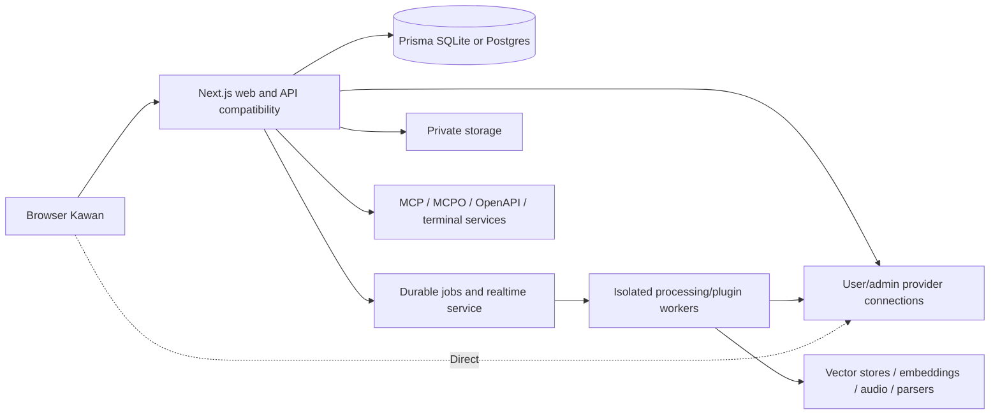

# Kawan — rencana full-feature parity Open WebUI

Status: planning v2; implementasi belum dimulai. Instruksi user terbaru menggantikan pembatasan fitur pada brief awal.

## Dokumen aktif

- [PRD lengkap](prd.md): requirement produk semua domain referensi.
- [SDD lengkap](sdd/README.md): architecture/data/API/state/security/UX/domain/workers/ops/ADRs/work orders dan formal contract schemas.
- [Backlog](todo.md): task/dependencies/acceptance/verification/gates.
- [Acceptance scenarios](acceptance-scenarios.md): 76 minimum cases konkret untuk mandor.
- [Planning verification](planning-verification.md): hasil pemeriksaan konsistensi dokumen; bukan bukti runtime.
- [Schema contract](schema-contract.md): physical schema dan extension Kawan.
- [Inventory baseline](reference/README.md): seluruh source metadata yang dipetakan.
- [Coverage matrix](coverage.md), [machine-readable coverage](coverage.json): kewajiban setiap reference ID.
- [Audit target parity](parity-audit.md): status/exception/aturan klaim 100%.
- [Prompt pelaksana](execution-prompt.md): instruksi operasional untuk developer lain.
- Rencana BYOK v1 disimpan di `archive/byok-v1/`; bukan scope aktif.

## 1. Target dan baseline

Target aktif adalah **seluruh fitur produk Open WebUI pada commit baseline**, termasuk semua fitur personal, workspace, admin, integrasi, collaboration, scheduler dan self-host yang tersedia melalui konfigurasi/version tersebut. Tidak ada fitur yang dipangkas sebagai “enterprise” atau “optional Direct”. Feature yang default disabled tetap wajib punya jalur aktif yang benar bila di-enable.

Baseline lokal bersih: `f8ae8a6c328946dc62cd0712961a0632574581bf`, repo [Open WebUI](https://github.com/open-webui/open-webui/tree/f8ae8a6c328946dc62cd0712961a0632574581bf). Target tidak mengikuti perubahan `main` secara diam-diam. Perubahan upstream setelah baseline memerlukan inventory diff dan revisi backlog.

Latest user instruction mengaktifkan kembali RAG, Ollama, marketplace/plugins, RBAC/groups/admin, calendars, notes, voice, images, multi-model, OAuth/MFA/SCIM, memory, channels, automations, code execution, terminal dan seluruh gap audit lama. Semua domain ini mandatory, walaupun dependency/provider-nya butuh konfigurasi operator.

Kawan tetap bernama Kawan, domain target kawan.ai.id, by tokengateway.ai.id; kode/aset dibuat sendiri. Stack aplikasi tetap Next 15/TypeScript/Tailwind 4/shadcn/AI SDK v5/Prisma/Auth.js. Fitur yang membutuhkan Python runtime, audio/document processing, durable workers, realtime sockets atau vector services boleh memakai service terisolasi pendukung; jangan mengklaim seluruh fitur bisa dipenuhi oleh beberapa route serverless saja.

“100%” dalam rencana adalah **kewajiban coverage dan conformance terhadap baseline**, bukan hasil yang sudah dibuktikan. Seluruh row inventory mendapat task dan test obligation. Static inventory belum membuktikan setiap semantics cabang dinamis; review dan differential fixtures merupakan task wajib pertama dan release gate terakhir.

Inventory fingerprints mencakup tracked `src/`, `backend/open_webui/`, dan `docs/`, bukan seluruh deployment/vendor files repository. P00 wajib menambah review root packaging/container manifests, scripts, static runtime/dependency metadata dan dynamic provider branches ke registry. Third-party runtime dependency boleh dipasang dari distribusi resminya; tidak menyalin bundled runtime/assets dari repo referensi. Batas scan ini tidak membatasi target fitur.

## 2. Perubahan scope dari v1

| Sebelumnya | Sekarang |
|---|---|
| 13 entitas Kawan yang disederhanakan | Semua core entity/physical fields referensi + extension Kawan terpisah |
| Folder satu tingkat | Folder bertingkat, reparent, permissions/shared context |
| Export Markdown saja | Semua baseline JSON/text/Markdown/PDF/import/backup/data controls |
| General/Connections/About | Seluruh personal/admin Settings dan configuration keys |
| Satu model/run dan request-bound SSE | Multi-model, task lifecycle, background/queue/realtime baseline |
| MCP HTTP/SSE Bearer saja | Tool ecosystem MCP/MCPO/OpenAPI/OAuth/elicitation/functions/pipelines/valves |
| RAG/voice/image/calendar/notes/admin di luar scope | Semua mandatory |
| Direct opsional | Direct wajib sebagai bagian full parity |
| BYOK MVP sebagai release final | BYOK core adalah milestone awal; release full parity setelah semua phase gates |

Tidak ada pengurangan scope terselubung. Jika adapter belum tersedia atau endpoint belum selesai, statusnya belum selesai, bukan N/A untuk menaikkan persentase.

## 3. Arsitektur eksekusi



- Web/UI: Next App Router server pages/client interactions, Auth.js session, API compatibility adapters, owner/group/admin checks.
- Core persistence: Prisma mappings memakai physical names baseline, JSON/native JSON/text codecs dan timestamp precision asli. DB migrations ditulis sendiri; schema details di schema contract.
- Extension persistence: `kw_*` tables untuk BYOK encrypted credentials, usage/run/jobs/leases/auth integration metadata; tidak mengubah core baseline secara sembunyi.
- Inference: AI SDK v5 ketika bisa memetakan semantics; native Ollama/provider passthrough untuk fitur yang tidak dipresentasikan SDK. Jangan memaksa semua native API ke text-only SDK.
- Queue/realtime: durable background generation, scheduler, indexing/parse/evaluation/plugin jobs dan Socket.IO-compatible protocol untuk baseline events. Redis/queue broker dapat dipakai karena full feature concurrency membutuhkan koordinasi, bukan dependency hiasan.
- Isolated workers: document/OCR/Whisper/embeddings/rerank dan Python plugin contracts; separate identities/FS/egress/resource budgets. Node web tidak menjalankan untrusted Python in-process.
- Vector/storage: all configured engines/adapters baseline wajib diimplementasikan; deployment default boleh satu engine, profile conformance tetap mencakup semua opsi.
- Browser execution: Direct requests, Pyodide/file workspace, sandbox artifacts dan device APIs. Jelaskan data/key locality dengan akurat.

App yang dituju tidak menggunakan backend Open WebUI sebagai shortcut implementasi. Backend referensi hanya golden oracle terisolasi untuk pengujian dengan synthetic data. Nama/API signatures/field contracts merupakan spesifikasi kompatibilitas; jangan menyalin bodies, CSS, component source, translations atau assets.

## 4. Layout kode dan kepemilikan

```text
src/app/                    # public/auth/chat/home/workspace/admin/playground/domain pages
src/app/api/                # Kawan routes + reference-compatible /api/v1 contracts
src/components/             # brand/ui/chat/settings/workspace/admin/domain UI
src/lib/auth/               # auth/session/MFA/OAuth/LDAP/SCIM boundary
src/lib/access/             # role/group/resource permission evaluator
src/lib/providers/          # compatible/native/direct/config/secret management
src/lib/chat/               # tree/lifecycle/context/events/render DTOs
src/lib/workspace/          # models/prompts/skills/tools/functions/knowledge
src/lib/domains/            # channels/notes/calendar/automations/memory/evaluations
src/lib/config/             # defaults/persist/env/types/settings registry
src/lib/compat/             # schema/API/JSON/time/token/legacy adapters
services/realtime/          # socket protocol/rooms/awareness
services/worker/            # durable jobs and resource-heavy processing
services/plugin-executor/   # isolated Python-compatible plugin execution
prisma/sqlite/              # schema + own migrations
prisma/postgres/            # schema + own migrations
tests/conformance/          # reference ID driven contracts/goldens
tests/fixtures/             # provider/integration/server mocks
tests/e2e/                  # feature journeys/all roles/devices
docs/                       # self-host/operations/operator profiles
tasks/                      # planning/coverage/evidence registry
```

Satu integrator memegang core schema/contracts/auth/access/job/events. Domain feature task boleh dikembangkan paralel oleh pelaksana yang ditugaskan pemilik setelah kontrak stabil, dengan worktree/branch dan perubahan migrations berurutan. Planning ini sendiri tidak menjalankan agent pelaksana.

## 5. Kesetaraan perilaku, API dan UI

Setiap reference endpoint memiliki status/error/headers/body/schema/permissions/filter/order/pagination/side-effect/stream test. Path reference yang dikondisikan flag tetap mandatory dengan profile flag on/off. Payload shapes/inheritance/validators/defaults dan dynamic wildcard paths harus diselesaikan dalam contract review sebelum task implementasi.

Root mounts `/openai`, `/ollama`, `/api/v1/*`, `/ws`, realtime audio dan static/Pyodide runtime didaftarkan sesuai capability baseline. Web route segments Svelte dipetakan ke Next, tanpa menyalin source Svelte. Public browser URLs, query/deep-link/redirect behavior yang user lihat mengikuti baseline kecuali BYOK/brand overlay yang tercatat.

Seluruh UI surfaces/Settings controls memiliki baseline screenshot dan state tests: empty/loading/success/failed/disabled/permission denied/read-only/mobile/RTL/theme/streaming/offline. Ikon/helper source bukan fitur tersendiri, tetapi dipetakan ke surfaces yang memakainya. Density/positions/interactions mengikuti reference; assets/branding Kawan berbeda dan tidak diklaim pixel-identik.

Seluruh config key harus punya type, evaluated default, env/persist precedence, secret policy, user/admin permission, dependent flags, control/read API dan operational effect. Tidak boleh select engine yang tersimpan tetapi inference masih memakai engine lain.

API compatibility tidak berarti menerima bug/security leakage referensi. Perbedaan credential response, branding dan BYOK dijelaskan di exception ledger. Password/token/hash/time/data compatibility diuji terpisah dari feature parity. Native auth tokens tidak otomatis sama dengan cookie Auth.js.

## 6. BYOK dan branding yang tetap berlaku

Default connection user berisi name/base URL/encrypted key/active; Test `${baseUrl}/models`, normalisasi trailing slash tanpa append v1 dua kali, success/failure/count/empty states, multiple connections. Key AES-256-GCM dari 32-byte ENCRYPTION_SECRET, IV random/AAD/key version; browser menerima mask, tidak ciphertext/plaintext tersimpan.

Detail keamanan pada brief awal menjadi acuan untuk menyelesaikan kalimat yang bertentangan: mode default **menyimpan key terenkripsi dan meneruskan request LLM melalui server Kawan**. Server menerima key saat create/replace/test input, mendekripsinya untuk request, lalu tidak mengembalikannya pada read/list responses. Jangan memasarkan mode ini sebagai “tidak menyimpan key” atau “murni browser-only”. Mode Direct adalah jalur yang tidak mengirim provider key ke server Kawan. Kawan tetap terpisah dari gateway dan tidak melakukan billing token.

Direct key browser-only namespace user/connection, CORS test, no hidden server fallback, cleanup/logout/mode changes/per-device re-entry. Direct integrations yang memang ada pada reference termasuk target full parity; server execution tidak menerima raw Direct key. Kombinasi browser model + server MCP memerlukan explicit bridge protocol yang melewatkan tool IDs/results tanpa model key; task P12 memvalidasi arsitekturnya, tidak mematikan fitur begitu saja.

Admin provider connections/global policies tetap tersedia untuk parity; user BYOK milik akun dapat memilih active personal gateway tanpa membocorkan admin/global key. Model resolution/availability membedakan mode reference aggregation dan personal active connection overlay.

Brand points mandatory: logo Kawan; sidebar/login/register/onboarding `by tokengateway.ai.id`; URL helper “Pakai gateway tokengateway.ai.id? Daftar di sini”; Connections empty/test failure CTA “Belum punya API key? Dapatkan di tokengateway.ai.id”; About app version/repo/by attribution; metadata “Kawan — Chat AI by tokengateway.ai.id”. External link HTTPS new tab + noopener. Repo Kawan harus nyata/configured, bukan repo OWUI yang disamarkan.

Usage monitoring personal per connection tetap tambahan Kawan di atas analytics baseline: actual provider usage/null missing, one run accounting, each tool/subagent/multi-model step once, timezone buckets, browser-reported Direct label. Kawan tidak memasukkan billing baru.

## 7. Security/operations yang memengaruhi seluruh domain

- Roles/groups/public grants/access revocation dihitung server sebelum file/vector/model/tool/channel/note/calendar query/execute; bukan owner-only simplification.
- Credentials encrypted at rest; transient entry form cleared; redaction log/trace/share/export/worker messages. Application API key bukan provider API key.
- URL user/provider/tool/webhook/crawler/terminal: DNS/IP/redirect/metadata/rebinding/timeout/size/egress policy. Private on-prem endpoint boleh operator allowlist presisi.
- Plugins/code/terminal/artifacts merupakan fitur nyata tetapi eksekusi di sandbox/runtime terpisah; operator policies/grants audited. Tool execution tidak otomatis side-effect safe.
- CSP/sandbox/origin isolation untuk artifacts/HTML/previews; configurable source behaviors dipertahankan dengan boundary yang aman.
- Durable jobs/concurrency/retries/idempotency/cancel/restart. Stop tidak mengklaim undo tindakan tool eksternal.
- Storage private/signed range/download handling, cloud picker authorization, orphan/reference cleanup.
- MFA/API key auth/rate limits/trusted proxy/OAuth/LDAP/SCIM negative tests dan session stamp revocation.
- CPU/GPU/offline/slim profiles jelas: flag yang menonaktifkan engine menghasilkan state sesuai baseline, bukan UI success palsu.
- Production full profile baseline Node containers + Postgres + Redis/queue/socket + processing/plugin workers + private storage + selected vector engine. Vercel web boleh dipakai dengan services terpisah, bukan janji semua backend dijalankan route serverless.

## 8. Fase dan gate

| Phase | Outcome | Dependencies |
|---|---|---|
| P00 | Baseline, PRD dan fondasi | None |
| P01 | Schema dan data compatibility | P00 |
| P02 | Auth, account dan identity | P01 |
| P03 | RBAC, groups, access grants, SCIM | P02 |
| P04 | Providers, Connections dan BYOK | P03 |
| P05 | Chat execution, task lifecycle dan realtime | P04 |
| P06 | History, tree, folders, tags, share dan data controls | P05 |
| P07 | Message rendering, composer dan artifacts | P06 |
| P08 | Seluruh personal Settings dan localization | P07 |
| P09 | Files, storage dan document processing | P08 |
| P10 | Workspace models dan Playground | P09 |
| P11 | Prompts, skills dan version histories | P10 |
| P12 | Tools, MCP, functions, pipelines dan integrations | P11 |
| P13 | Knowledge, RAG, embeddings dan vector stores | P12 |
| P14 | Web search, memories dan context integrations | P13 |
| P15 | Audio, STT/TTS dan realtime voice | P14 |
| P16 | Image generation/editing dan media playground | P15 |
| P17 | Channels, messaging dan realtime collaboration | P16 |
| P18 | Notes, rich editor dan collaborative documents | P17 |
| P19 | Calendars, events dan attendees | P18 |
| P20 | Automations, schedules, subagents dan background work | P19 |
| P21 | Terminal, code execution, file workspace dan browser bridge | P20 |
| P22 | Feedback, evaluations, arena, analytics dan usage | P21 |
| P23 | Seluruh Admin Settings, events dan operations | P22 |
| P24 | Compatibility, full acceptance dan self-host release | P23 |

MCP tidak lagi “satu-satunya fitur terakhir”: perubahan scope seluruh OWUI membutuhkan tools di P12 sebagai dependency RAG/agents/voice/calendar/automations/terminal. Urutan v1 diganti graph P00–P24 yang konsisten dengan full product. P24 hanya acceptance/compatibility/self-host closure; bukan tempat menaruh fitur kosong.

Setiap fase lulus typecheck/lint/focused unit-integration/E2E/domain conformance dan **`npm run build`** sebelum berikutnya. Bila workers Python diperlukan: checks/test workers dan container smoke juga wajib; build Next tidak cukup. Checkpoint setiap 2–3 task, setiap adapter task dan akhir fase.

Task adalah slice kecil; task yang ternyata menyentuh >5 file inti/lebih satu subsystem harus dipecah menjadi child task tanpa mengurangi acceptance. Reference-ID obligations dapat menjadi child tasks; setiap child memiliki dependency/files/test sendiri dan dilaporkan ke mandor.

224 task saat ini adalah work packages; [SDD delivery](sdd/10-delivery-work-orders.md) menyediakan 36 starter child slices dan [phase briefs](sdd/work-orders/README.md) untuk seluruh packages. Coding memakai child yang telah lolos Definition of Ready, bukan menganggap setiap package otomatis cukup satu sesi. [Contract registry](sdd/contract-registry.json) dan formal schemas menjadi panduan teknis tambahan.

## 9. Definisi selesai full parity

1. Semua requirement dan inventory obligations memiliki implementasi + proof; zero unexplained gaps.
2. Schema physical/core JSON/time/default/index/FK conformance lulus SQLite dan Postgres; migration round-trip sesuai version contract.
3. API/events/settings/profile behavioral conformance sesuai baseline, semua declared exceptions terlihat di report.
4. All enabled/disabled profiles dan provider engines memiliki tests; external credentials unavailable berarti integration status belum diverifikasi, bukan pass/N/A global.
5. UI journeys/goldens untuk semua routes/states/roles/locales; branding assets exception dipisahkan dari feature pass.
6. Clean self-host install/restart/upgrade/backup/restore/rollback/worker jobs/realtime operations berhasil.
7. Evidence disanitasi, tidak ada mocked production behavior/TODO/inert controls; public release approval terpisah setelah hasil konkret.

## 10. Estimasi dan release milestones

Ini pembangunan ulang seluruh produk multi-service, bukan MVP beberapa minggu. Budget awal kasar: 20–40 engineer-month untuk scope full termasuk semua adapters/conformance; satu pelaksana dapat memerlukan lebih dari setahun. Estimasi bukan komitmen dan harus dikalibrasi setelah baseline behavioral audit P00/P01; angka dipengaruhi tingkat exact API/import compatibility dan engine environments.

Milestone: M1 P00–P06 (identity/providers/chat/history); M2 P07–P12 (complete UI/settings/workspace/tools); M3 P13–P16 (knowledge/search/audio/images); M4 P17–P21 (collaboration/calendar/automation/execution); M5 P22–P24 (analytics/admin/full compatibility release). Milestone awal boleh menjadi preview, tetapi tidak diberi label full parity.

Release configuration yang masih diperlukan: repo/license/domain/deployment profiles/identity providers/external engines/test keys/retention budgets. Hal ini tidak mengurangi mandatory planning; executor tidak boleh mengarang credential atau compatibility claims.
