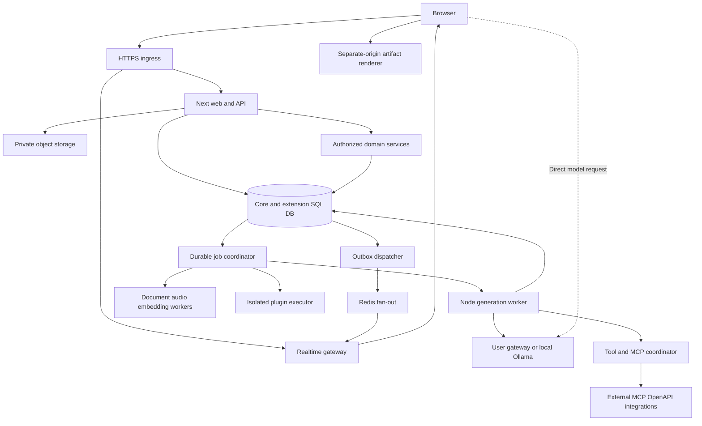

# SDD-01 — Architecture, boundaries dan scale

Owner phases P00/P01/P05/P23/P24. Normative scope [PRD](../prd.md); ADR rationale di [SDD-11](11-architecture-decisions.md).

## Sizing assumptions dan budgets

Angka berikut adalah **design assumptions untuk benchmark**, bukan jumlah pengguna yang dijanjikan atau batas feature parity.

| Asumsi | Perhitungan | Implikasi |
|---|---|---|
| 1.000 daily users × 20 turns/day | 20.000 turns/day ≈ 0,23 new runs/s average | CRUD ringan; generation concurrency mendominasi |
| Peak 40× average; average run 20 s | 9,3 starts/s × 20 s ≈ 186 active runs | Load profile awal 200 active runs; pool/fan-out/connection budgets diukur |
| 3 KB input+output/turn × 1,15 model fan-out | ≈69 MB/day; ≈25 GB/year sebelum indexes/projections | Initial persistence budget 2× ≈50 GB/year; attachment storage terpisah |
| 100 uploads/day × 2 MB | 200 MB/day ≈73 GB/year | Storage retention/cleanup jauh lebih berpengaruh daripada source DB saja |
| 200 active runs × 20 emitted chunks/s | 4.000 chunk events/s pada peak fixture | Coalesce display updates; durable event batching/compression benchmark wajib |

Default usulan internal SLO: API non-provider p95 ≤400 ms pada profile di atas; stream relay tambahan p95 ≤150 ms dari provider receipt; composer interaction p95 ≤100 ms; latest durable chunk checkpoint lag ≤1 s. Provider TTFT/transcription/indexing tidak dimasukkan sebagai latency Kawan tanpa label. Baseline comparison budgets ditetapkan P00 dengan hardware/network/data yang sama; bila usulan tidak realistis, dokumentasikan hasil dan revisi sebelum menjadi gate.

SQLite profile dev/personal single writer; production multi-instance memakai Postgres. Jangan mengklaim throughput Postgres otomatis berlaku pada SQLite. Load benchmark mengukur pool wait/lock contention/WAL growth, socket clients, bytes/sec, queue age dan outbox lag.

## Process diagram dan trust boundaries



DB is source of truth. Redis outage degrades live fan-out/cache; stored job/run/events tetap dapat dipoll/recover. Tidak ada job hanya di Redis atau process memory. Worker tidak menerima browser arbitrary executable code di request publik tanpa authorization + sandbox policy.

## Capability modules dan dependency direction

| Stable module | Phase | Tanggung jawab | Depends on |
|---|---|---|---|
| foundation | P00/P01 | Contract registry, SQL codecs, primitives, schema | — |
| identity | P02 | User/Auth/session/MFA/OAuth/application API identity | foundation |
| access | P03 | Role/group/resource grant evaluator | identity |
| connections | P04 | Provider resolution, secret references, outbound policies | access |
| chat | P05/P06 | Tree/history/share/generation scheduling | connections, access |
| rendering | P07/P08 | UX/Settings presentation and client transport | chat |
| files | P09 | Private file/storage/extraction lifecycle | access, connections |
| workspace | P10/P11 | Models/prompts/skills revisions/bindings | files, access |
| tools | P12 | MCP/OpenAPI/plugins/valves/tool orchestration | workspace, connections |
| knowledge | P13/P14 | Index/retrieve/search/memory | files, tools |
| media | P15/P16 | Voice/STT/TTS/realtime/images | tools, files, connections |
| collaboration | P17/P18 | Channels/notes/socket/Yjs | files, access |
| scheduling | P19/P20 | Calendar/automation/subagent coordinator | chat, collaboration, tools |
| execution | P21 | Terminal/Jupyter/Pyodide/file workspaces | tools, access |
| analytics | P22 | Feedback/evaluations/usage | chat, scheduling |
| administration | P23 | Operator config/views/event routing | Public interfaces semua modules |
| release | P24 | Compatibility/deploy/restore/closure | Semua mandatory modules |

Dependency diagram ini adalah code ownership, bukan pengganti sequential delivery phases. Hindari cycles melalui ports: chat menerima ToolExecutor/RetrievalResolver interfaces, tools tidak mengimport chat UI/controller. Automation menggunakan GenerationService, tidak meniru provider logic. Services menerima actor/context yang terautentikasi, bukan userId browser sebagai authority.

## Internal service interfaces

Interface di bawah adalah specification shape, bukan kode aplikasi. Gunakan discriminated result types, validated inputs dan explicit error taxonomy.

```typescript
type Actor = {
  userId: string; role: 'admin' | 'user' | 'pending';
  authMethod: 'session' | 'api-key' | 'trusted-proxy' | 'system-job';
  sessionStamp: string | null; requestId: string;
};
type ResourceRef = { kind: string; id: string };
type AuthorizationRequest = {
  actor: Actor; action: string; resource: ResourceRef;
};
type ProviderBinding = {
  connectionId: string; mode: 'server' | 'direct';
  providerKind: string; baseUrl: string; secretRef: string | null;
  requestedModel: string; providerModel: string; configRevision: string;
};
type JobEnvelope = {
  jobId: string; kind: string; ownerId: string; resource: ResourceRef;
  schemaVersion: number; payloadRef: string; requestId: string;
};
```

Server-secret-bearing internal objects tidak diserialisasi ke client props. JobEnvelope mempunyai refs, bukan key/raw document/prompt dump. Payload detail disimpan protected DB/object storage. Actor role/effective permission direload ketika job mulai dan sebelum side effects sensitif; system-job berasal signed internal dispatcher, tidak menjadi admin universal.

| Port | Input | Output/invariant |
|---|---|---|
| IdentityService.authenticate | Validated session/application token | Actor aktif; valid session stamp; auth scopes |
| AccessService.authorize | Actor/action/resource + config revision | Allow atau typed deny; ownership/group/public rules |
| ConnectionService.resolve | Actor/model/context | ProviderBinding valid dan capability snapshot |
| SecretService.withCredential | Authorized binding/purpose | Callback scoped transient credential; no client return |
| ChatService.mutate | Actor/chat/revision/typed mutation | Atomic tree+projection update + outbox record |
| GenerationService.start/cancel | Actor/idempotency/chat revision | Durable run IDs/state; idempotent result |
| ProviderAdapter.execute | Normalized request/binding/abort signal | Typed provider events, native fallback where required |
| ToolExecutor.execute | Actor/run/selected tool/validated args | Result/error/approval request + execution identity |
| FileService.authorizeRead | Actor/file/purpose | Short-lived file handle/stream; no raw path leaks |
| ConfigRegistry.resolve | Scope/key/user/group/override snapshot | Typed evaluated value + provenance, secret masked |
| EventDispatcher.publish | Persisted outbox ID | Idempotent fan-out; per-resource sequence |

Controller → validated DTO → domain service → transaction/repository; repository tidak membuat security decision tersendiri yang berbeda. Hanya compatibility edge memetakan names/status/payload baseline. UI DTO, compatibility payload dan provider wire request adalah tipe berbeda.

## Runtime dan package decisions

Node runtime dipakai untuk Prisma/crypto/auth/API dan generation worker. Long-lived WS/realtime berjalan service terpisah; request route bukan pemilik umur generation. Auth.js routes `/api/auth/*`; Kawan extension `/api/kawan/v1/*`; baseline namespaces tetap dilayani compatibility handlers. Static/runtime mounts bukan arbitrary filesystem exposes.

Gunakan release resmi Next 15/React yang compatible, Tailwind 4, AI SDK 5 dengan matching provider/react packages, Prisma dan Auth.js release yang lolos P00. Exact versions dicatat di dependency manifest/lockfile setelah official package compatibility/security check, bukan menulis angka patch fiktif di SDD. Prisma version harus mendukung mapping SQLite yang digunakan, tanpa mengubah JSONField TEXT ke native JSON otomatis.

Dependency boleh ditambahkan bila mendukung requirement terpetakan: Socket.IO protocol, Yjs, Markdown/math/diagram renderer, rich editor, parser/audio worker, SDK adapter. Tidak membuat abstraction framework/plugin marketplace baru yang berbeda dari baseline. Satu adapter interface per protocol family, bukan wrapper chain untuk setiap fungsi.

## Failure model dan inversion

| Skenario kegagalan desain | Early warning | Mitigasi / consequence |
|---|---|---|
| JSON history dan materialized rows tidak sinkron | Reconciler menemukan beda current leaf/content/files | Satu transactional mutation service; dirty projection blocks reads/import gate |
| Process crash membuat request inferensi ganda | Same run/provider call span muncul dua kali | Persist sent/checkpoint state; fenced lease; indeterminate outcome tidak auto-retry |
| Redis dipakai sebagai persistence utama | Restore DB kehilangan active job/output | SQL job/outbox/event log authoritative; Redis replay notification saja |
| Framework adapter kehilangan native protocol parts | Passthrough fixtures kehilangan fields/tool/reasoning | Native adapter edge dan lossless payload preservation |
| Semua engines terlihat selectable tetapi tidak dieksekusi | Configuration-effect tests gagal | Engine-specific contract/credential smoke sebelum verified |
| Worker/plugin memperoleh secret/file user lain | Cross-owner sandbox probe berhasil | Narrow signed grants, scoped secret handles, separate execution identity/FS/egress |

## Open questions dan resolver

Business traffic/retention belum dikonfirmasi: operator profile menetapkan setelah sizing benchmark. Exact baseline semantics ditetapkan P00/P01, per reference ID, sebelum task owner mulai. Deployment vendor belum dipilih: container/Postgres default usulan, managed variants harus membuktikan SSE/WS/job/private storage parity. Keputusan yang mengubah persisted/public contract memakai ADR; reversible naming/layout routine diputuskan developer dalam scope.
