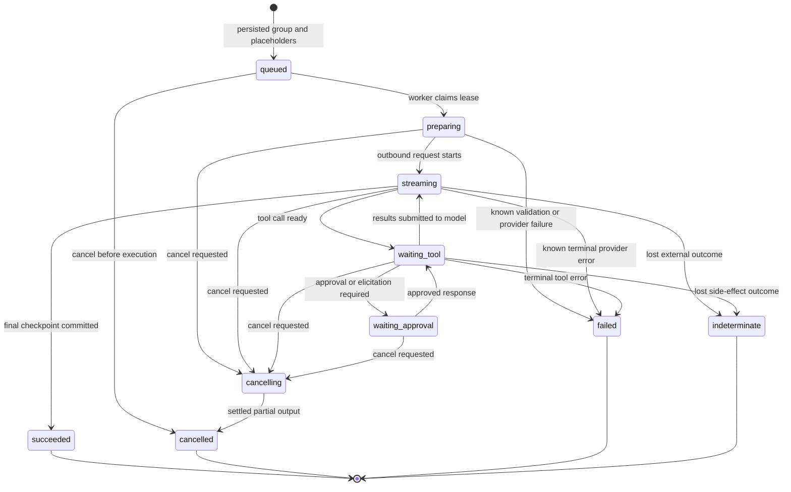
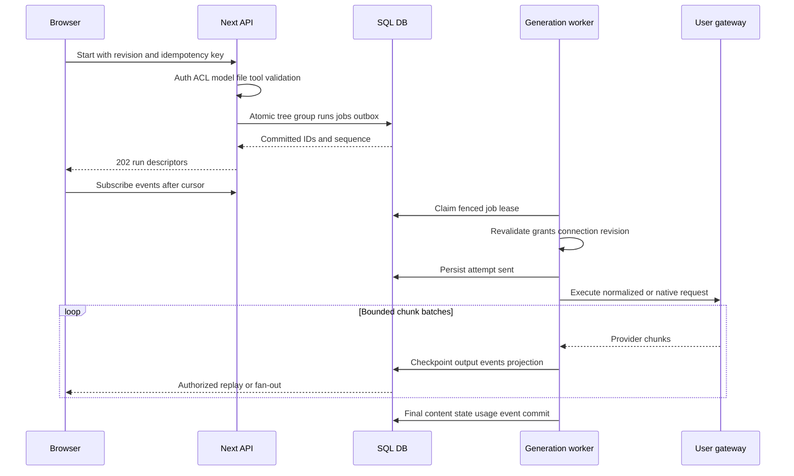

# SDD-04 — Message tree, run lifecycle dan streaming

Owner P05/P06/P07/P12/P20/P22. Tree/mutation/output formats baseline dipertahankan; internal durable orchestration adalah extension Kawan. Data invariants [SDD-02](02-data-design.md), endpoints [SDD-03](03-http-contracts.md).

## Tree semantics yang sudah direview dari baseline

Review source `src/lib/components/chat/Messages.svelte`, `Chat.svelte`, serta deletion transform di `backend/open_webui/models/chats.py` menemukan perbedaan yang penting dari tree sederhana:

| Action | Semantics reference-bound |
|---|---|
| Edit user + submit | Buat user sibling baru di bawah parent yang sama; old node/branch tetap ada; generate dari sibling baru |
| Edit user tanpa submit | Update content/files pada node yang sama dan persist; bukan otomatis branch |
| Assistant Save As Copy | Buat assistant sibling baru; children kosong; feedback/annotation/file carry-over mengikuti baseline copy rules |
| Edit assistant in place | Preserve original content metadata bila berlaku; structured output dan displayed content disinkronkan |
| Regenerate | Response sibling dari parent user; multi-model action menarget model slot response yang dipilih |
| Continue | Continue assistant node yang dipilih, bukan selalu membuat sibling baru; existing output tetap ada |
| Delete message baseline | Hapus selected message dan immediate children; grandchild nodes dipertahankan/reparent ke parent selected node; current leaf dihitung kembali |
| Delete subtree | Aksi berbeda; hanya gunakan pada explicit contract yang memang menghapus subtree; jangan menyamakan dengan delete-message baseline |

Semantics ini adalah hasil pembacaan source, belum runtime proof. Root deletion, duplicate grandchild references, assistant-edit metadata, continue output protocol dan deepest-child choice tetap membutuhkan fixture differential P00/P06. Jangan mengubah delete-message menjadi hapus seluruh descendants karena adjacency library lebih mudah.

## Message invariants dan ancestry algorithm

Node identity stabil, role/content/output/parent/children/model/files/sources/status/usage/metadata lossless. Parent nullable hanya untuk root; children unique dan edge reciprocal. Semua referenced IDs berada chat sama; DAG cycles/import dangling references ditolak atau ditangani menurut explicit import contract. currentId menunjuk node yang ada atau null pada empty history.

Build context dari current leaf ke root melalui parents, detect cycle/visited set, balik urutan, lalu map setiap typed output/file/tool part sesuai provider capability. System/folder/custom-model/personal settings/skills/knowledge context melalui config resolver dengan precedence yang captured baseline. Tidak mengirim seluruh siblings ke provider. Context compaction records terkait ancestry/revision; branch yang berubah tidak memakai summary branch lain tanpa validation.

Per mutation: authorize resource → idempotency/CAS → load canonical tree → validate role/edges/attachments → transform → derive current leaf/materialized projection → write atomically → outbox → return patch/revision. In-place edit running node default usulan 409 RUN_ACTIVE sampai explicit cancel/confirmed baseline handling; edit independent inactive branch tetap dapat bekerja. Stale final checkpoint tidak boleh mengubah current leaf bila user sudah pindah branch.

Typed mutation registry memperluas SDD-03 dengan `edit-user-in-place`, `copy-assistant`, dan `delete-message-reparent`; baseline UI binds ke jenis yang benar. User-facing action label/behavior tetap baseline, extension internal enum bukan nama UI baru.

## Run state machine



Transition table is normative: queued/preparing can fail authorization/model/config readiness; waiting approval can expire to typed failure/cancel; waiting tool can receive recoverable result error then continue when protocol supports; worker crash after outbound sent enters indeterminate unless provably resumable/idempotent. Group state derives all child runs; mixed success/failure shows per-model results. Completed/cancelled/failed/indeterminate terminal runs cannot be reopened by delayed chunks. Retry/regenerate creates explicit new run/attempt under corresponding user action.

`cancelling` means request recorded, not already stopped. `cancelled` means worker settled no further authorized execution with partial durable content. Stop cannot undo external tool/email/payment/filesystem action already committed; final tool status remains visible. No unconditional “stopped before provider charge” promise.

## Start sequence



ProviderBinding snapshot determines connection/model/config for group. Gateway key rotated/revoked/baseURL changed before sent: recheck revision policy, abort with CONNECTION_CHANGED or resolve safe key rotation under operator policy; do not silently choose active connection different from requested. Request already sent keeps immutable attempt attribution, cancel policy honored.

## Lease, checkpoints dan recovery

Default proposals: lease 30 s, renew every 10 s, claim batch bounded by worker capacity; expired lease can be reclaimed only after attempt-state inspection. Postgres claim uses `FOR UPDATE SKIP LOCKED`/atomic SQL; SQLite short transaction CAS. Every checkpoint/finalize includes expected lease token; old worker write fails after successor claim.

Chunk accumulator uses streaming decoder across byte boundaries; parse SSE partial frames/multi-line data/unknown optional fields/native protocol parts losslessly. Batch up to 250 ms or bounded bytes, whichever first; durable event/projection commit before delivery. Final/error/cancel flush immediately. Buffer/backpressure cap configurable; no infinite queue per client. UI can coalesce renders without dropping underlying event parts.

| Failure point | Recovery behavior |
|---|---|
| Before sent persisted | Safe reclaim/retry if no external call happened |
| Sent persisted, request definitely not transmitted | Adapter proof can classify retry-safe; absence of log is not proof |
| Outbound may have executed, response unknown | Mark indeterminate; no automatic inference repeat without provider idempotency/recoverability |
| Response chunks checkpointed, network gone | Recover partial output; classify interrupted or resume only supported protocol |
| Final DB transaction committed, delivery lost | Replay final event/content/usage; never regenerate |
| Fan-out unavailable | Poll/replay SQL-backed state; queue/jobs unaffected |
| Stop while waiting approval/tool | Invalidate pending approval/bridge; abort active supported call; report irreversible outcome accurately |

## Kawan event envelope

```json
{"eventId":"evt-opaque","generationId":"run-opaque","seq":"17","version":1,"type":"text.delta","partId":"part-1","payload":{"delta":"Halo"},"atMs":"1791760000000"}
```

Allowed public types: run.accepted/state, message.start, text.start/delta/end, reasoning.start/delta/end (only provider-supplied), source/file/status, tool.input.delta/ready, tool.approval/result/error, usage.updated, run.completed/cancelled/failed/indeterminate. Every type has schema, allowed-state transitions, part identity and size limits; unknown forward-compatible types stored and omitted from unsafe rendering until adapter understands them.

SSE uses `id: {generationId}:{seq}`, event field `kawan`, JSON data, blank delimiter; heartbeat comment default 15 s; content-type event-stream, cache no-store, proxy buffering disabled. Fetch streaming used where abort/headers/body support required. Browser validates schema/sequence, dedups eventId/seq, persists last cursor per run without key, and reconnects with bounded exponential delay + jitter.

Replay algorithm avoids subscribe race: establish live wakeup channel, capture durable high-watermark, replay `(cursor,watermark]`, then fetch newly committed events by sequence on each wakeup and periodically. Fan-out notification is a hint to read persisted events; no gap if notification lost. Expired cursor returns REPLAY_EXPIRED; client loads canonical message/run state then current cursor, never starts new inference.

For streams consumed by AI SDK v5, transform this envelope into UIMessage start/part/delta/end/tool/data protocol through a custom transport. Do not label Kawan envelope as native UI stream. UIMessage is rendered active-branch projection, not authoritative tree storage. [AI SDK v5 transport](https://ai-sdk.dev/v5/docs/ai-sdk-ui/transport) supports custom protocols; [v5 stream protocol](https://ai-sdk.dev/v5/docs/ai-sdk-ui/stream-protocol) specifies SSE parts and header `x-vercel-ai-ui-message-stream: v1` when serving that protocol.

Baseline provider/SSE/Socket.IO API contracts use their captured event names/payloads. Compatibility mapper is separate from Kawan event envelope. Socket.IO's default delivery is at-most-once; persistent IDs/cursors/replay are application responsibilities. [Official delivery guarantees](https://socket.io/docs/v4/delivery-guarantees/)

## Direct mode and server tool bridge

Direct browser constructs provider request from authorized active branch + local key; raw model key never goes to Kawan API, server jobs, telemetry or state sync. Provider output can be persisted as user chat data if baseline/user profile permits; “Direct” only describes credential/inference transport locality, not that chat history is necessarily browser-only.

Flow: create direct generation metadata → browser retrieves selected tool schemas → gateway request from browser → tool call ready → authenticated bounded DirectSession sends server tool ID/args/call ID → server authorizes/tool approval/execution → browser receives sanitized result → next gateway request browser → report parts/usage as client-reported. Sequence/nonce replay handling prevents duplicate same-call execution. User may select browser-executable tools only if baseline supports and policy classifies that execution mode.

Closing browser can stop Direct continuation; server cannot resume model call without key. Job/run reports direct_disconnected/indeterminate appropriately and expires bridge after configured TTL. Server cannot claim client-provided usage/output is gateway-verified. Local history/key behavior on logout/new device documented in UI. No hidden proxy fallback after CORS failure.

## Tool iteration, temporary and multi-model

Provider tool-call IDs mapped to execution IDs with unique run/step/call key; validate args against discovered schema and selected tool grants. Multiple parallel calls bounded per operator/model policy; execute only complete validated arguments, not partial streamed JSON. Persist result before next model step. Unknown/malformed/unselected calls produce typed tool error/termination per protocol. Re-authorize calendar/channel/file mutations at execution time.

Temporary mode storage/lifespan follows reference profile + explicit Kawan monitoring policy; no accidental sidebar/share persistence. Durable short-lived job/event state may be required during execution and cleaned after terminal TTL. Multi-model fan-out has one parent user node with per-model assistant siblings, per-run cancellation/usage and selected-view behavior matching reference. Cancelling group cancels remaining active children; completed outputs remain.

## Gate

Race fixtures: double-click/retry start, same-key-different-body, two tabs revision conflict, branch switch during stream, stop/finalize race, old fenced worker chunk, replay/live overlap, UTF-8 split, callback duplicate, deletion/revocation mid-run, Direct key lost, tool approval expired, provider unknown outcome. All source-reviewed transforms still require golden runtime fixtures before verified status.
